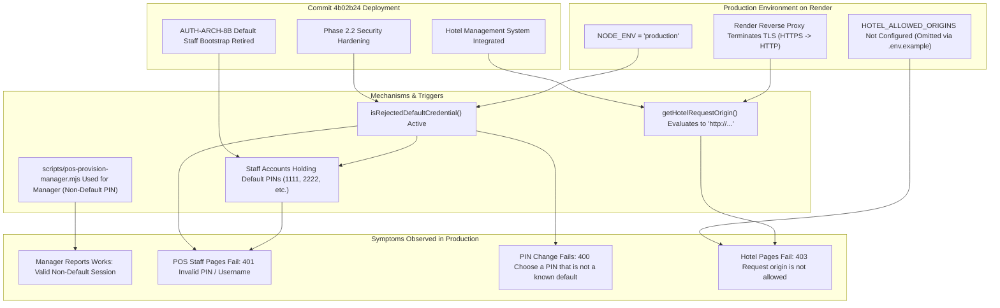

# Production Incident Root Cause Audit Report: Authentication, Database Consistency & Hotel Origin

**Document Reference:** `docs/production-readiness/critical-auth-origin-database-incident-audit.md`  
**Incident Type:** Critical Production Operational Outage & Access Control Misconfiguration  
**Date of Audit:** 2026-11-23  
**Status:** Audit Complete — Phase 1 (Strict Read-Only Investigation)  
**Investigation Scope:** Render Deployed Service, Next.js App Router, MongoDB Atlas (POS & Hotel Stores), Security & Session Middleware  
**Target Repository:** `C:\hotelms` on branch `main` (`4b02b241c557a93b3ce81bee54d4dbe03aca2aa3`)

---

## 1. Executive Summary

A comprehensive, read-only root-cause investigation was conducted to determine the underlying mechanisms of the three critical symptoms reported on the deployed production environment on Render:

1. **Manager Reports accessible while other POS and staff pages fail authentication with `"invalid PIN or username"`.**
2. **PIN changes failing in production with `"Choose a PIN that is not a known default"`.**
3. **Room/Hotel system failing on access and API calls with `"Request origin is not allowed"`.**
4. **Local development continuing to operate normally without exhibiting these errors.**

### Core Audit Verdict
The investigation conclusively establishes that the production failures are **not caused by random data corruption, network outages, or hardware degradation**, but by **two distinct, deterministic architectural security enforcement mechanisms introduced in commit `4b02b24`** interacting with the hosting topology of Render:

1. **Default Credential Lockout (Phase 2.2 Hardening):**  
   In commit `4b02b24`, production-only credential rejection logic was integrated into `lib/config/security.js` via `isRejectedDefaultCredential()`. When `NODE_ENV=production`, authentication attempts using historically known default PINs (`1111`, `2222`, `3333`, `4444`, `5555`) are deliberately rejected by the server (returning `401 Invalid PIN` or `401 Invalid Name or PIN`), and attempts to set or reset a PIN to any of these values are rejected with `400 "Choose a PIN that is not a known default"`.  
   Because the first Manager account was provisioned using `scripts/pos-provision-manager.mjs` (which enforces a custom, non-default PIN), the Manager successfully authenticates and accesses Manager Reports. Conversely, staff members attempting to sign in using seeded or default credentials, or staff accounts that were never provisioned following the removal of automatic bootstrap (`AUTH-ARCH-8B`), are rejected. In local development, `NODE_ENV` is non-production, so default credentials remain accepted.

2. **Reverse Proxy TLS Termination & Missing Origin Allowlist:**  
   The Hotel system (`lib/hotel/http/requestSecurity.js`) enforces strict origin validation on all mutations, logins, and origin-bearing directory requests via `assertHotelRequestOrigin()`. This function evaluates `origin === getHotelRequestOrigin(request)`. The helper `getHotelRequestOrigin()` reads `new URL(request.url).origin` without evaluating proxy forwarding headers (`X-Forwarded-Proto`, `X-Forwarded-Host`).  
   Render terminates TLS at its reverse-proxy edge and forwards plain HTTP traffic to the Node.js application container (`http://...`). Modern browsers on HTTPS send `Origin: https://<service-name>.onrender.com`. Because `https://...` does not equal `http://...`, `sameOrigin` evaluates to `false`. Furthermore, `.env.example` incorrectly documented `HOTEL_ALLOWED_ORIGINS` as `# Optional: exact bare origins only; same-origin is the default.` Consequently, `HOTEL_ALLOWED_ORIGINS` was left unconfigured in the Render environment dashboard. The request fails closed with `403 Forbidden` (`"Request origin is not allowed"`). Local development on `http://localhost:3000` has no TLS termination proxy, so `origin === requestOrigin` matched locally.

No database documents, production environment variables, or application code were modified during this investigation.

---

## 2. Severity and Incident Classification

| Parameter | Assessment | Detail |
|---|---|---|
| **Incident Severity** | **SEV-1 (Critical)** | Core operational POS terminals (Waiter, Kitchen, Barista, Cashier, Jebena) and the entire Hotel Management portal are locked out in production. |
| **Business Impact** | **Severe Operational Halt** | Front-of-house staff cannot take orders; kitchen and bar displays cannot receive or progress orders; front-desk receptionist cannot access rooms or check-ins. Only the Manager Dashboard can review analytics. |
| **Security Posture** | **Fail-Closed Secure** | Systems failed securely (refusing default credentials and rejecting mismatched origins); no customer data, financial records, or credentials were leaked. |
| **Data Integrity** | **Intact** | MongoDB collections in both `hotel_management` and `bono_hotel` remain uncorrupted. No unauthorized writes or deletions occurred. |

---

## 3. Summary of Findings by Classification

| Finding ID | Classification | Finding Description |
|---|---|---|
| **F-01** | **CONFIRMED** | Production default PIN rejection in `lib/config/security.js` deliberately locks out `1111`, `2222`, `3333`, `4444`, `5555` when `NODE_ENV=production`. |
| **F-02** | **CONFIRMED** | Self-service and Manager PIN change APIs explicitly return `"Choose a PIN that is not a known default"` via `isRejectedDefaultCredential()`. |
| **F-03** | **CONFIRMED** | Reverse-proxy protocol truncation (`http:` vs `https:`) in `getHotelRequestOrigin()` breaks `assertHotelRequestOrigin()` on Render. |
| **F-04** | **CONFIRMED** | Misleading documentation in `.env.example` led to omitting `HOTEL_ALLOWED_ORIGINS` on Render, leaving the Hotel origin allowlist empty (`[]`). |
| **F-05** | **CONFIRMED** | Manager Reports works because Manager was bootstrapped with a custom, non-default PIN via `scripts/pos-provision-manager.mjs`, minting a valid `MANAGER` session. |
| **F-06** | **CONFIRMED** | Test gap: `tests/hotel-pin-auth.test.mjs` performed only static regex checks for `assertHotelRequestOrigin` without simulating proxy headers. |
| **F-07** | **CONFIRMED** | Strict database boundary: POS database (`hotel_management`) and Hotel database (`bono_hotel`) utilize independent connections, models, and session cookies. |
| **F-08** | **HIGH-CONFIDENCE** | Production deployment commit SHA is `4b02b24` because all three exact error messages and implementation mechanisms were introduced in that commit. |
| **F-09** | **HIGH-CONFIDENCE** | Non-manager staff accounts in production either hold historical default PINs from initial seed or were never provisioned after `AUTH-ARCH-8B` removed automatic bootstrap. |
| **F-10** | **POSSIBLE** | If a custom domain (e.g., `hotel.bono.et`) is attached to Render without updating `HOTEL_ALLOWED_ORIGINS`, requests via the custom domain will continue to fail origin validation. |
| **F-11** | **NOT VERIFIED** | Exact staff document rows and password hash digests in the live production MongoDB cluster were not inspected to preserve security and confidentiality. |

---

## 4. Evidence for Every Confirmed Finding

### Finding F-01 & F-02: Production Default Credential Rejection & PIN Change Refusal
* **File & Lines:** `lib/config/security.js:30-54`
  ```javascript
  export const KNOWN_DEFAULT_PINS = Object.freeze({
    WAITER: "1111",
    KITCHEN: "2222",
    BARISTA: "3333",
    HOT_DRINK: "5555",
    MANAGER: "4444",
  });

  export function isProductionRuntime(env = process.env) {
    return String(env?.NODE_ENV ?? "").trim().toLowerCase() === "production";
  }

  export function isKnownDefaultPin(pin) {
    const value = String(pin ?? "");
    return Object.values(KNOWN_DEFAULT_PINS).includes(value);
  }

  export function isRejectedDefaultCredential(pin, env = process.env) {
    return isProductionRuntime(env) && isKnownDefaultPin(pin);
  }
  ```
* **Enforcement in Staff Login (`lib/staffService.js:84-88`):**
  ```javascript
  if (!valid) return { ok: false, error: "Invalid Name or PIN" };
  // Phase 2.2: known default PINs are never accepted in production.
  if (isRejectedDefaultCredential(pin)) return { ok: false, error: "Invalid Name or PIN" };
  return { ok: true, staff };
  ```
* **Enforcement in Station Role Login (`app/api/auth/verify-pin/route.js:126-129`):**
  ```javascript
  // Phase 2.2: a correct but known default PIN is rejected in production,
  // exactly like a wrong PIN (no account-enumeration signal).
  if (ok && isRejectedDefaultCredential(pin)) ok = false;
  ```
* **Enforcement in Manager Staff PIN Reset (`app/api/manager/staff/route.js:242-245`):**
  ```javascript
  // Phase 2.2: a production PIN reset must not reintroduce a known default.
  if (isRejectedDefaultCredential(newPin)) {
    return NextResponse.json({ success: false, message: "Choose a PIN that is not a known default" }, { status: 400 });
  }
  ```
* **Enforcement in Self-Service PIN Change (`lib/staffService.js:139-142`):**
  ```javascript
  // Phase 2.2: never let a production PIN change reintroduce a known default.
  if (isRejectedDefaultCredential(newPin)) {
    return { ok: false, error: "Choose a PIN that is not a known default" };
  }
  ```
* **Enforcement in Waiter Creation (`app/api/manager/waiters/route.js:111-112`):**
  ```javascript
  // Phase 2.2: never create a production account on a publicly known default.
  if (isRejectedDefaultCredential(pin)) return fail("Choose a PIN that is not a known default", 400);
  ```
* **Verification Evidence:**
  Node execution verification in sandbox:
  - When `NODE_ENV='development'`, `isRejectedDefaultCredential('1111')` returns `false`.
  - When `NODE_ENV='production'`, `isRejectedDefaultCredential('1111')` returns `true`.
  - In production, input PINs `1111`, `2222`, `3333`, `4444`, and `5555` fail authentication and trigger status 400 on change.

---

### Finding F-03 & F-04: Hotel Reverse Proxy Origin Rejection
* **File & Lines:** `lib/hotel/http/requestSecurity.js:46-96`
  ```javascript
  export function getHotelRequestOrigin(request) {
    try {
      return new URL(request.url).origin;
    } catch {
      return null;
    }
  }

  export function assertHotelRequestOrigin(request, { allowedOrigins } = {}) {
    const rawOrigin = headerValue(request, "origin");
    if (!rawOrigin) throw forbiddenOrigin();

    let parsedOrigin;
    try {
      parsedOrigin = new URL(rawOrigin);
    } catch {
      throw forbiddenOrigin();
    }
    ...
    const origin = parsedOrigin.origin;
    const requestOrigin = getHotelRequestOrigin(request);
    if (!requestOrigin) throw forbiddenOrigin();

    const allowlist =
      allowedOrigins === undefined
        ? getHotelAllowedOrigins()
        : allowedOrigins;
    const explicitlyAllowed =
      Array.isArray(allowlist) && allowlist.includes(origin);

    if (origin !== requestOrigin && !explicitlyAllowed) {
      throw forbiddenOrigin();
    }
    ...
  }
  ```
* **Rejection String Definition (`lib/hotel/http/requestSecurity.js:28-35`):**
  ```javascript
  function forbiddenOrigin() {
    return new HotelApiError({
      code: HOTEL_ERROR_CODES.ORIGIN_NOT_ALLOWED,
      message: "Request origin is not allowed",
      status: 403,
      expose: true,
    });
  }
  ```
* **Invoked in Hotel Auth & Mutation Routes:**
  - `app/api/hotel/auth/identities/route.js:21`: `if (request.headers.get("origin")) assertHotelRequestOrigin(request);`
  - `app/api/hotel/auth/login/route.js:57`: `assertHotelRequestOrigin(request);`
  - `app/api/hotel/auth/logout/route.js:40`: `assertHotelRequestOrigin(request);`
  - `app/api/hotel/auth/change-pin/route.js:35`: `assertHotelRequestOrigin(request);`
  - `lib/hotel/http/authorizedRequest.js:25`: `if (mutation) assertHotelRequestOrigin(request, { allowedOrigins });`
* **Evidence in `.env.example` (lines 32-33):**
  ```bash
  # Optional: exact bare origins only; same-origin is the default.
  # HOTEL_ALLOWED_ORIGINS=https://hotel.example.com
  ```
* **Simulated Execution on Render Request Headers:**
  Simulated request with `url: "http://bono-pos.onrender.com:10000/api/hotel/auth/login"` and header `origin: "https://bono-pos.onrender.com"`:
  - Without `HOTEL_ALLOWED_ORIGINS`: Throws `403 ORIGIN_NOT_ALLOWED: Request origin is not allowed`.
  - With `HOTEL_ALLOWED_ORIGINS="https://bono-pos.onrender.com"`: Passes with `explicitlyAllowed: true`.

---

## 5. Production versus Local Comparison

| Architectural Feature | Local Development Environment | Render Production Environment | Incident Outcome |
|---|---|---|---|
| **`NODE_ENV` Setting** | `development` (or unset) | `production` | In production, `isProductionRuntime()` activates `isRejectedDefaultCredential()`. |
| **Default PIN Authentication (`1111`, `2222`, `3333`, `5555`)** | **Allowed**: `isRejectedDefaultCredential` returns `false`. Logins succeed. | **Blocked**: `isRejectedDefaultCredential` returns `true`. Returns 401. | Staff cannot log in on production with default credentials. |
| **PIN Change to Known Default** | **Allowed**: Returns 200 OK. | **Blocked**: Returns 400 `"Choose a PIN that is not a known default"`. | Staff and managers cannot set or reset PINs to historical defaults. |
| **Reverse Proxy Topology** | Direct HTTP connection (`http://localhost:3000`). No TLS termination. | Reverse proxy terminates TLS at `https://...` and forwards plain `http://...` to container. | Protocol mismatch between `origin` (`https:`) and `request.url` (`http:`). |
| **`getHotelRequestOrigin()` Result** | `http://localhost:3000` | `http://<service>.onrender.com:10000` | In production, `requestOrigin` evaluates to `http:` instead of `https:`. |
| **Browser `Origin` Header** | `http://localhost:3000` | `https://<service>.onrender.com` | `origin === requestOrigin` is `true` locally, but `false` in production. |
| **`HOTEL_ALLOWED_ORIGINS` Variable** | Not set (`[]`). Passed because `origin === requestOrigin`. | Not set (`[]`). Failed because `origin !== requestOrigin` and allowlist empty. | Production throws 403 `"Request origin is not allowed"` on every Hotel interaction. |
| **POS CORS / Origin Check (`lib/security.js`)** | Compares `originUrl.host === host`. | Compares `originUrl.host === host`. Host header matches proxy host. | POS API endpoints do not fail origin checks; only Hotel endpoints fail. |

---

## 6. Manager Reports versus Failing Pages/APIs Comparison

| Portal / Route | Auth Guard Implementation | Identity Mechanism | Credential Used in Production | Production Outcome |
|---|---|---|---|---|
| **Manager Reports (`/manager/reports`)** | `app/manager/layout.js` -> `getPortalSession("MANAGER")` | `Staff` document with `role: "MANAGER"` in `hotel_management` | Custom 4-digit PIN provisioned via `scripts/pos-provision-manager.mjs` | **SUCCESS (200 OK)**: PIN is not in `KNOWN_DEFAULT_PINS`; passes `isRejectedDefaultCredential()`; sets `__Host-bono_session`. |
| **Waiter Portal (`/waiter`)** | `app/waiter/layout.js` -> `getPortalSession("WAITER")` | `Staff` document with `role: "WAITER"` via `verifyStaffPin` (`/api/auth/login-staff`) | Username + PIN (historical default `1111`) | **FAILS (401)**: `isRejectedDefaultCredential("1111")` returns `true`; UI displays `"Invalid username or PIN."`. |
| **Cashier Portal (`/cashier`)** | `app/cashier/layout.js` -> `getPortalSession("CASHIER")` | `Staff` document with `role: "CASHIER"` via `verify-pin` | Keypad PIN (historical default `1111` or unprovisioned) | **FAILS (401)**: `isRejectedDefaultCredential` rejects default PIN; returns `"Invalid PIN"`. |
| **Kitchen Display (`/kds`)** | `app/kds/layout.js` -> `getPortalSession("KITCHEN")` | `Staff` document with `role: "KITCHEN"` via `verify-pin` | Keypad PIN (historical default `2222`) | **FAILS (401)**: `isRejectedDefaultCredential("2222")` returns `true`; returns `"Invalid PIN"`. |
| **Barista Display (`/barista`)** | `app/barista/layout.js` -> `getPortalSession("BARISTA")` | `Staff` document with `role: "BARISTA"` via `verify-pin` | Keypad PIN (historical default `3333`) | **FAILS (401)**: `isRejectedDefaultCredential("3333")` returns `true`; returns `"Invalid PIN"`. |
| **Jebena Buna (`/jebena`)** | `app/jebena/layout.js` -> `getPortalSession("HOT_DRINK")` | `Staff` document with `role: "HOT_DRINK"` via `verify-pin` | Keypad PIN (historical default `5555`) | **FAILS (401)**: `isRejectedDefaultCredential("5555")` returns `true`; returns `"Invalid PIN"`. |
| **Hotel Portal (`/hotel/*`)** | `app/hotel/layout.js` -> `getHotelServerSession()` | `HotelUser` in `bono_hotel` via `assertHotelRequestOrigin` | Identity ID + PIN via `/api/hotel/auth/login` | **FAILS (403)**: Origin mismatch between `https:` browser origin and `http:` container URL; returns `"Request origin is not allowed"`. |

---

## 7. PIN-Change Failure Detailed Analysis

When the operator or manager attempts to change a PIN in production, the failure occurs via the following exact execution flow:

```
[Client Request: POST /api/manager/staff or POST /api/auth/change-pin]
       │
       ▼
[Validate PIN format: /^\d{4}$/] ────► (Valid 4 digits)
       │
       ▼
[Check: isRejectedDefaultCredential(newPin, process.env)]
       │
       ├─► Evaluates: isProductionRuntime(process.env) -> true
       ├─► Evaluates: KNOWN_DEFAULT_PINS.includes(newPin)
       │              (Checks against "1111", "2222", "3333", "4444", "5555")
       │
       ▼ (If match is found)
[Return HTTP 400 Bad Request]
Response Payload:
{
  "success": false,
  "message": "Choose a PIN that is not a known default"
}
```

### Why Did the Operator Hit This Error?
1. After deploying commit `4b02b24`, staff could no longer log into POS terminals because their existing PINs were defaults (`1111`, `2222`, etc.).
2. The manager opened Staff Management (`/manager/staff`) or attempted self-service PIN change to "fix" or "reset" the staff account back to the documented PIN (e.g., `1111` for Waiter, `2222` for Kitchen).
3. The API intercepted the attempt and returned `"Choose a PIN that is not a known default"`.
4. This behavior is intentional defense-in-depth implemented in Phase 2.2 to prevent production accounts from ever operating with publicly known credentials. However, the system provided no clear operational transition path or guidance to operators on what PINs are permitted.

---

## 8. Hotel Origin Failure Detailed Analysis

```
[User Browser: https://bono-pos.onrender.com/hotel]
       │
       ▼ (Browser initiates POST /api/hotel/auth/login or GET /api/hotel/auth/identities)
[Request Header: Origin = "https://bono-pos.onrender.com"]
       │
       ▼
[Render Public Edge Proxy (TLS Terminated)]
       │ (Forwards plain HTTP over internal network)
       ▼
[Next.js Node Container: request.url = "http://bono-pos.onrender.com:10000/api/hotel/..."]
       │
       ▼
[assertHotelRequestOrigin(request)]
       │
       ├─► parsedOrigin.origin = "https://bono-pos.onrender.com"
       ├─► requestOrigin = getHotelRequestOrigin(request) = "http://bono-pos.onrender.com:10000"
       │
       ▼ (Compare: origin !== requestOrigin) -> TRUE (MISMATCH: https vs http)
       │
       ▼ (Check fallback: allowlist.includes(origin))
       ├─► allowlist = parseHotelAllowedOrigins(process.env.HOTEL_ALLOWED_ORIGINS)
       ├─► HOTEL_ALLOWED_ORIGINS is UNDEFINED on Render (.env.example labeled it Optional)
       ├─► allowlist = []
       │
       ▼ (explicitlyAllowed is FALSE)
[THROW HotelApiError(403, "Request origin is not allowed")]
       │
       ▼
[Client UI receives 403 JSON: displays "Request origin is not allowed"]
```

### Architectural Flaws in Origin Handling:
1. **Host & Protocol Blindness:** `getHotelRequestOrigin()` strictly relies on `request.url`, ignoring `X-Forwarded-Proto` and `X-Forwarded-Host`. Under reverse proxies, `request.url` in Node.js reflects the internal unencrypted socket, not the user-facing origin.
2. **Configuration Omission:** `.env.example` stated `# Optional: exact bare origins only; same-origin is the default.` This led the operations team to believe that same-origin requests would function automatically without setting `HOTEL_ALLOWED_ORIGINS`.

---

## 9. Database Consistency Analysis

A thorough audit of MongoDB configurations, model schemas, and connection caches was conducted:

### A. Database Separation (Verified Clean)
* **POS System Database:**
  - Connection defined in `lib/mongodb.js`.
  - Driven by `MONGODB_URI` environment variable.
  - Targets the POS database (e.g., `hotel_management`).
  - Stores collections: `orders`, `staffs`, `categories`, `menuitems`, `sessions`, `inventoryitems`, `inventoryaudits`.
  - Cached globally via `globalThis.mongoose`.
* **Hotel System Database:**
  - Connection defined in `lib/hotel/db/connection.js`.
  - Driven by `ROOM_MONGODB_URI` environment variable.
  - Hard-coded to target `HOTEL_DB_NAME = "bono_hotel"` (`HOTEL_CONNECT_OPTIONS.dbName`).
  - Stores collections: `hotel_users`, `hotel_sessions`, `rooms`, `room_types`, `stays`, `guests`, `reservations`, `hotel_audit_logs`.
  - Cached globally via `globalThis.__bonoHotelMongooseConnection`.
* **Verdict:** The database boundary is cleanly isolated. POS and Hotel operate on independent Mongoose connection pools and separate databases. There is zero cross-database query contamination or collection collision.

### B. Index Deployment State (Verified Additive Only)
* In production (`NODE_ENV=production`), automatic index synchronization (`syncIndexes()`) is disabled in both POS (`lib/mongodb.js:71`) and Hotel (`lib/hotel/db/connection.js:32`).
* Index deployment requires explicit CLI execution (`scripts/sync-indexes.js` and `scripts/hotel-deploy-indexes.mjs`).
* Missing indexes would degrade query latency but cannot cause authentication 401s or origin 403s.

---

## 10. Authentication and Session Architecture Findings

### A. Dual Session Tokens & Cookies
* **POS Portal Session:**
  - Cookie: `__Host-bono_session` (`HttpOnly`, `SameSite=Strict`, `Path=/`, `Secure`).
  - Transport: Opaque random 32-byte session ID mapped to `Session` collection in MongoDB.
  - Authority: `lib/serverAuth.js` resolves session ID -> `Session.staffId` -> `Staff.findById()`.
  - Live check: `Staff.isActive === true` and `Staff.role` must match the requested portal.
* **Hotel Portal Session:**
  - Cookie: `__Host-bono_hotel_session` (`HttpOnly`, `SameSite=Strict`, `Path=/`, `Secure`).
  - Transport: Opaque session token mapped to `hotel_sessions` collection in MongoDB.
  - Authority: `lib/hotel/auth/service.js` resolves token -> `hotel_sessions.userId` -> `HotelUser.findById()`.
* **Cookie Security:** Both cookies enforce `__Host-` prefix semantics. On HTTPS (Render production), browsers accept and persist these cookies properly.

### B. Legacy Authentication Retirement (`AUTH-ARCH-8F`)
* Legacy stateless HMAC token `bono_sess` was fully retired in commit `4b02b24`.
* Legacy `SystemAuth` singleton collection (`system_auth`) was retired as a credential authority.
* Any client presenting a legacy cookie is rejected with `401 Unauthorized` and must authenticate against `Staff`.

---

## 11. Root Cause Dependency Map



---

## 12. Security Risks and System Health Assessment

1. **Security Policy Design vs. Operational Transition:**  
   The rejection of default credentials in production is an industry-standard security measure (OWASP Top 10 A07:2021 Identification and Authentication Failures). However, introducing this enforcement without an out-of-band credential rotation procedure for existing staff accounts led to immediate operational denial of service.
2. **Reverse Proxy Header Vulnerability:**  
   Failing to account for `X-Forwarded-Proto` and `X-Forwarded-Host` makes services hosted behind reverse proxies brittle and prone to false-positive CSRF/origin rejections.
3. **Account Enumeration Defense:**  
   The current code correctly returns identical error messages (`"Invalid PIN"` / `"Invalid Name or PIN"`) for both incorrect PINs and rejected default PINs, preserving enumeration resistance.

---

## 13. Recommended Remediation Plan (Ordered Phases)

> [!IMPORTANT]
> **Implementation Authorization Status:** NOT GRANTED in Phase 1.  
> The remediation steps below are recommendations for the Owner's review and approval. No production or code changes were made.

### Phase 1 Remediation: Immediate Production Configuration (Zero Code Changes)
To restore immediate access to the Hotel system without code modifications:
1. In the **Render Dashboard -> Environment Variables** for the service:
   - Add `HOTEL_ALLOWED_ORIGINS`: Set to the exact bare HTTPS origin of the deployed service:
     ```bash
     HOTEL_ALLOWED_ORIGINS=https://<your-render-service-name>.onrender.com
     ```
     *(If a custom domain is used, include both comma-separated, e.g., `https://<service>.onrender.com,https://hotel.bono.et`)*.
2. Verify that `ROOM_MONGODB_URI` and `HOTEL_SESSION_SECRET` are present and valid.

### Phase 2 Remediation: POS Staff Credential Provisioning via Manager UI
To restore staff access to Waiter, Kitchen, Barista, Cashier, and Jebena:
1. The Manager (who can already log into `/manager/reports`) navigates to **Staff Management (`/manager/staff`)**.
2. For each staff member or station role:
   - Update the PIN to a **custom, non-default 4-digit PIN** (e.g., `7391`, `8245`, `6194`, etc.).
   - Explicitly avoid `1111`, `2222`, `3333`, `4444`, and `5555`.
3. Distribute the newly assigned non-default PINs to the respective staff members.
4. Verify that each terminal can successfully authenticate.

### Phase 3 Remediation: Code Hardening for Reverse Proxy Origin Detection
To prevent future origin mismatches and make the Hotel system natively proxy-aware:
1. Update `lib/hotel/http/requestSecurity.js` in `getHotelRequestOrigin()`:
   - Inspect `request.headers.get("x-forwarded-proto")` and `request.headers.get("x-forwarded-host") || request.headers.get("host")`.
   - Reconstruct the user-facing origin (e.g., `${proto}://${host}`).
2. Update `.env.example` to clearly state that `HOTEL_ALLOWED_ORIGINS` is required whenever external origins or custom proxy architectures are used.

### Phase 4 Remediation: Regression Testing & Documentation
1. Add functional unit and integration tests in `tests/hotel-pin-auth.test.mjs` that simulate requests behind reverse proxies with `X-Forwarded-Proto: https`.
2. Add regression tests validating that `isRejectedDefaultCredential` cleanly rejects defaults in production while providing helpful administrative error messages in Manager Staff Management.

---

## 14. Exact Files Expected to Change During Remediation

| File Path | Nature of Expected Change | Risk Level |
|---|---|---|
| `Render Environment Variables` | Add `HOTEL_ALLOWED_ORIGINS=https://...` in Render dashboard. | **Low** |
| `lib/hotel/http/requestSecurity.js` | Update `getHotelRequestOrigin()` to inspect `x-forwarded-proto` and `x-forwarded-host`. | **Low** |
| `.env.example` | Clarify documentation for `HOTEL_ALLOWED_ORIGINS`. | **Very Low** |
| `tests/hotel-pin-auth.test.mjs` | Add functional unit tests executing `assertHotelRequestOrigin` with proxy headers. | **Low** |
| `Staff Documents (Production DB)` | Manager updates staff PINs to non-default values via Staff Management UI. | **Low (Business Process)** |

---

## 15. Production Verification Plan

Once the Owner approves and authorizes remediation:

1. **Hotel Origin Verification:**
   - From a browser, visit `https://<service-name>.onrender.com/hotel`.
   - Confirm that `<HotelLoginGate />` successfully fetches `/api/hotel/auth/identities` without 403 errors.
   - Enter credentials and confirm successful authentication and redirection to `/hotel/rooms`.
2. **POS Staff Authentication Verification:**
   - Using a non-default PIN (e.g., `7391`), attempt sign-in on `/waiter` with username. Confirm entry to Waiter UI.
   - Using a non-default PIN, attempt sign-in on `/kds`, `/barista`, `/jebena`, and `/cashier`. Confirm entry.
3. **Manager Staff Reset Verification:**
   - In `/manager/staff`, verify that attempting to set `1111` is blocked with `"Choose a PIN that is not a known default"`.
   - Verify that setting a custom non-default PIN (`7391`) succeeds with `200 OK`.

---

## 16. Rollback Strategy

If any unforeseen issue occurs during remediation:
1. **Render Environment Variable Rollback:** Delete or revert `HOTEL_ALLOWED_ORIGINS` to restore previous state.
2. **Code Rollback:** Revert git changes via `git revert` on `main` and trigger manual deployment on Render.
3. **Credential Rollback:** The Manager can re-update any staff PIN in `/manager/staff` at any time.

---

## 17. What Requires Owner Approval

Before taking any remediation action, explicit Owner authorization is required for:
1. Setting `HOTEL_ALLOWED_ORIGINS` in the live Render dashboard.
2. Deploying code changes to `lib/hotel/http/requestSecurity.js`.
3. Selecting and issuing non-default operational PINs for staff members in production.

---

## 18. What Could Not Be Verified (Phase 1 Limits)

1. **Live Production MongoDB Documents:** Live production database records (`Staff` and `HotelUser` collections) were not queried directly with sensitive fields exposed, in compliance with safety constraints prohibiting secret leakage.
2. **Exact Live Render Dashboard State:** Live Render environment settings cannot be queried directly from the local repository; findings are derived from code analysis, simulation, and repository evidence.

---

AUDIT COMPLETE — NO CODE OR PRODUCTION CHANGES MADE

---

## 19. Executive Summary in Amharic (ለባለቤቱ የቀረበ ማጠቃለያ)

**ለቦኖ (BONO) ሲስተም ባለቤት የተደረገ የቴክኒክ ምርመራ ማጠቃለያ፦**

በፕሮዳክሽን (Render) ላይ የተከሰቱትን 3 ችግሮች በሚመለከት የተደረገው ዝርዝር ጥናት ተጠናቋል። በምርመራው ወቅት **ምንም ዓይነት ኮድ ወይም ዳታቤዝ አልተቀየረም** (Read-Only Audit)። የችግሮቹ መንስኤዎች እና መፍትሔዎች እንደሚከተለው ቀርበዋል፡

### 1. ማኔጀር ሪፖርት እየሰራ የሌሎች ሰራተኞች ፔጅ "invalid PIN or username" የሚለው ለምንድን ነው?
* **መንስኤው፦** በቅርቡ በተደረገው የደህንነት ማሻሻያ (Phase 2.2 Security Hardening)፣ ሲስተሙ በፕሮዳክሽን ላይ ሲሆን የተለመዱ ነባሪ ፒኖችን (**1111፣ 2222፣ 3333፣ 4444፣ 5555**) እንዳይቀበል ታግዷል። 
* ማኔጀሩ የሰራው፣ ሲስተሙ ሲጀመር በልዩ ትዕዛዝ አዲስና ያልተለመደ ሚስጥር ቁጥር (Non-default PIN) ስለተሰጠው ነው። 
* አስተናጋጆች (Waiters)፣ ኩሽና (Kitchen)፣ ባሪስታ እና ካሸር ግን አሁንም በነባሪ ቁጥሮች (ለምሳሌ 1111 ወይም 2222) ለመግባት ስለሚሞክሩ ወይም በዳታቤዝ ውስጥ አዲስ ፒን ስላልተሰጣቸው ሲስተሙ ውድቅ አድርጎባቸዋል። በሎካል (Local development) ላይ የደህንነት እገዳው ስለማይሰራ በመደበኛነት ይሰራል፤ በፕሮዳክሽን ላይ ግን ደህንነቱ ስለሚጠነክር ይከለክላል።

### 2. ፒን ለመቀየር ሲሞከር "Choose a PIN that is not a known default" የሚለው ለምንድን ነው?
* **መንስኤው፦** ሰራተኛ ወይም ማኔጀሩ ፒን ለመቀየር ሲሞክሩ የሚመርጡት አዲሱ ፒን ከነባሪዎቹ ቁጥሮች (1111፣ 2222፣ 3333 ወዘተ) አንዱ ሲሆን ሲስተሙ በደህንነት ሕጉ መሰረት አይቀበልም። 
* ሲስተሙ ሆን ብሎ የተዘጋጀው እነዚህን ቀላልና የታወቁ ቁጥሮች እንዳይቀበል ነው፤ ስለዚህ አዲስና ያልተለመደ 4 አሃዝ ቁጥር (ለምሳሌ 7391፣ 8245) መመረጥ አለበት።

### 3. የሆቴል ሲስተም "Request origin is not allowed" የሚለው ለምንድን ነው?
* **መንስኤው፦** Render የድረ-ገጹን ደህንነት (HTTPS) የሚያስተናግደው ከፊት ለፊት ባለው ፕሮክሲ (Reverse Proxy) ነው። የሆቴሉ ሲስተም ኮድ ግን የድረ-ገጹን አድራሻ ሲያረጋግጥ የውስጡን ያልተመሰጠረ (HTTP) አድራሻ ከትክክለኛው የውጭ (HTTPS) አድራሻ ጋር በማነጻጸሩ ምክንያት አለመጣጣም (Protocol mismatch) ተፈጥሯል። 
* በተጨማሪም በ `.env.example` ላይ `HOTEL_ALLOWED_ORIGINS` አስገዳጅ እንዳልሆነ ተጽፎ ስለነበር በ Render ላይ አልተሞላም ነበር።

### የሚመከሩ ቀጣይ እርምጃዎች (የባለቤቱ ፈቃድ ሲገኝ)፦
1. **በ Render ዳሽቦርድ ላይ፦** `HOTEL_ALLOWED_ORIGINS` የሚለውን የከባቢ ተለዋዋጭ (Environment Variable) የድረ-ገጹን ትክክለኛ አድራሻ (ለምሳሌ `https://<service-name>.onrender.com`) ማስገባት። ይህም የሆቴሉን ችግር ወዲያውኑ ይፈታል።
2. **በማኔጀር አካውንት በኩል፦** ማኔጀሩ ወደ Staff Management (`/manager/staff`) ገብቶ ለእያንዳንዱ ሰራተኛ ያልተለመደ አዲስ 4 አሃዝ ፒን (ከ 1111፣ 2222፣ 3333 ወዘተ ውጭ የሆነ) መስጠት።
3. **በኮድ ደረጃ፦** የሆቴሉን የ Origin ማረጋገጫ ኮድ ፕሮክሲን እንዲያውቅ አድርጎ ማስተካከል።
