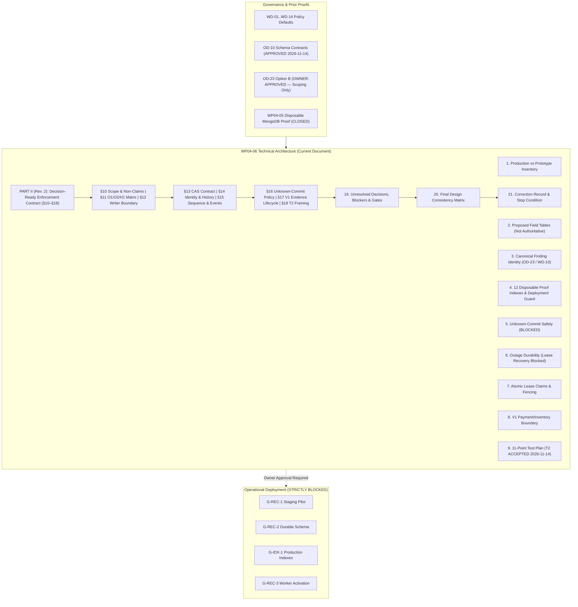
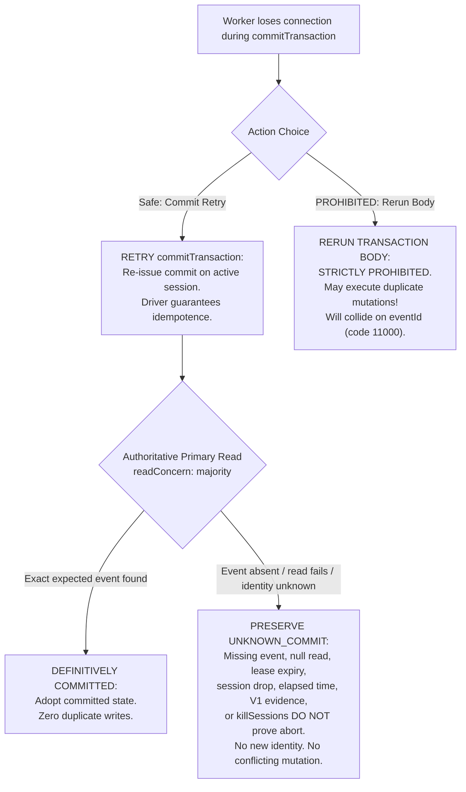

# WP-04-06 — Implementation Design Discovery Report

**Status:** **DESIGN DISCOVERY ONLY - RUNTIME IMPLEMENTATION NOT AUTHORIZED - O2/H-D UNRESOLVED - OD-10 APPROVED (2026-11-14): OD-10-A/B/C APPROVED; OD-10-D NOT APPROVED; BLK-SCH-01 CLOSED - OD-38 / OD-39 / OD-40 RECORDED (2026-11-14) - R-1 READ-ONLY SOURCE PRESENT IN WORKING TREE; CORRECTED, INDEPENDENTLY VERIFIED (2026-11-14), AND FORMALLY ACCEPTED BY OWNER (2026-11-14) - WP04-06 FINAL OWNER ACCEPTANCE (2026-11-14): BLK-AP-01 / BLK-AP-02 / BLK-EVT-01 CLOSED; W8 `ESC_UNKNOWN_COMMIT` AUTHORIZATION RECORDED (REGISTER §14)**
**Revision:** **REVISION 3 — TARGETED O2/H-D ATOMICITY CLARIFICATION (DOCUMENTATION ONLY)** — 2026-11-12  
**Supersedes revision:** **REVISION 2 — OWNER DECISION & ENFORCEMENT CONTRACT** — 2026-11-12 (Part I and Part II retained; §3.3/§6.2/§6.3/§7.2 consistency notes; §22 added)  
**Date:** 2026-11-12  
**Repository:** `C:\hotelms`  
**Branch / HEAD:** `main` / `69650435a6587d4577bc126f719fa1392bb934b3`  
**Authorization:** WP04-06 Design Discovery Only (OD-10 limited to the WP04-05 disposable proof at the time of writing; the owner subsequently approved the **OD-10 production schema contract on 2026-11-14** — see §3.4 — with OD-10-A/B/C approved and OD-10-D not approved; OD-23 Option B owner-approved for scoping only)  
**Implementation Authorization:** **SOURCE IMPLEMENTATION APPROVED BY THE OWNER; R-1 READ-ONLY SOURCE IMPLEMENTED IN THE WORKING TREE, AUDITED, CORRECTED, INDEPENDENTLY VERIFIED (2026-11-14), AND FORMALLY ACCEPTED BY OWNER (2026-11-14); RUNTIME INTEGRATION CONSTRAINED BY OD-38/OD-39 (READ-ONLY SCANNER ONLY; WRITER NOT WIRED); NO WORKER / SCHEDULER ACTIVATION**  
**Production DB / Index Deployment / Worker Activation:** **STRICTLY PROHIBITED**  
**Patch Scope:** This revision adds §22 (targeted O2/H-D atomicity clarification), aligns §3.3/§6.2/§6.3/§7.2 with the reservation and settlement semantics in §15.1 and §22, and registers OD-36/OD-37 as **NOT APPROVED**. It does not authorize WP04-06 implementation, schema/model creation, database access, index deployment, worker activation, or WP04-07. Completing this document does **not** grant WP04-06 design closure. O2/H-D remains unresolved until OD-36, OD-37, and the production schema decision are approved.

> **AMENDMENT 2026-11-12 — WP04-06 DESIGN CONSOLIDATION (see [`wp-04-06-design-consolidation-and-register.md`](file:///c:/hotelms/docs/production-readiness/wp-04-06-design-consolidation-and-register.md)):** The owner approved OD-24…OD-35 and OD-37 (with `ABANDONABLE_STATUSES = {LEASED}`) on 2026-11-12. The §19.4/§19.5 status columns for those decisions are superseded by the durable register in that document (OD-36 is WAIVED-BY-SELECTION; OD-27 scope clarified by OD-27-SC). In-document amendments: **§12.3 W6** is re-scoped to a standalone `T_reserve` transaction (I-C — no longer "inside W2/W5"; emits no event; reserves exactly one sequence); **§13.4** per-transition `$inc` applies only to event-consuming lifecycle rows, W7 effect rows never increment the counter, the folded W2+W6 variant remains unapproved, and expired-`LEASED` reclaim rows apply per §22.6/OD-37; **§15.1** adds the separate-single-slot-consumer rule; **§3.1/§3.2** enum/schema divergences are resolved per the OD-10 contract in that document (`RECOVERY_MANUAL_REQUIRED` removed; `AMBIGUOUS_COMMIT`, `ESC_EXHAUSTED`, `ROLE-RECOVERY-EXECUTOR`, `intentDigest`, `pendingOperation`, `TERMINAL_OP_STATES = {COMMITTED, ABANDONED}`, `ABANDONABLE_STATUSES = {LEASED}` adopted; audit wording `OPERATOR_DECISION_AFTER_HOLD`). The T9/Acquire `U_claim` consistency amendment is applied (claims require `$or: [{pendingOperation: null}, {"pendingOperation.state": {$in: ["COMMITTED","ABANDONED"]}}]` and increment `leaseGeneration` in the same write). This amendment is documentation only; **implementation remains NOT authorized**.
>
> **AMENDMENT 2026-11-14 — T2 ACCEPTED UNDER OD-35 (DOCUMENTATION ONLY):** The owner has formally accepted **WP04-06 T2** under **OD-35** on the basis of the reviewed real-writer wire proof, the independent P4 verification, and the P5 integration negative control (final evidence run `wp04-06-t2-94e4714b61c9`). **BLK-T2-01 is CLOSED.** §18.1, §18.2, §18.3, §19.3, §20 row 13, §21.4 and §21.7 are updated in place; the register records the acceptance in §12. The original proxy/parser-defect discovery in this revision is **preserved as historical provenance**. Pre-acceptance status statements elsewhere in this document — including §9's T2 row framing, the Revision 2/3 change records, and the §19.4/§19.5 "NOT APPROVED" columns — are retained as the record of what was true when written and are **superseded for current status** by §18.1. T2 acceptance does **not** close BLK-UC-01, BLK-UC-02, BLK-AP-01, BLK-AP-02, BLK-EVT-01, BLK-SCH-01 or BLK-EVID-01; does **not** sign any gate (G-REC-1, G-REC-2, G-REC-3, G-IDX-1, G-AUD-1, G-GOV-1 and G-PAY-1 remain unsigned/blocked); and does **not** authorize staging, production, database access, schema/index deployment, runtime integration, or worker activation. **(Superseded for blocker status only: BLK-AP-01, BLK-AP-02, and BLK-EVT-01 were CLOSED on 2026-11-14 — register §14; BLK-UC-01 and BLK-UC-02 were CLOSED on 2026-11-15 by owner action on the crash/restart execution evidence — register §15; BLK-EVID-01 remains OPEN.)**
>
> **AMENDMENT 2026-11-14 — OD-38 / OD-39 / OD-40 RECORDED (DOCUMENTATION ONLY):** Three owner-approved policies are formally recorded in this repository on **2026-11-14** as **OD-38** (runtime detection boundary), **OD-39** (payment and Inventory runtime preservation), and **OD-40** (recurrence after task closure). They are recorded in §1 item 6 and **§19.6**; the authoritative decision record is **register §1 and §13**. The repository contains no original approval date, signature, meeting record, or evidence reference for them, and **none is invented**. Recording them authorizes no schema change, index deployment, database access, migration, runtime Recovery integration, writer call site, worker, scheduler, cron, feature flag, observation persistence, or POS/payment/Inventory change, and signs no gate. **No Recovery feature flag exists in source**; OD-38 creates none. **BLK-EVID-01 is reassessed but remains OPEN** (§2.2, §19.3, §20 row 12, §21.4): three target modules are present but **untracked**, while the reserved `lib/recovery/reconciliation.js` path and `scripts/inventory-recovery-deploy-indexes.mjs` remain **absent**. **T2 remains ACCEPTED under OD-35 and BLK-T2-01 remains CLOSED.**
>
> **AMENDMENT — R-1 READ-ONLY SOURCE CORRECTION (WORKING TREE ONLY):** A **read-only R-1 source implementation** is present but **untracked**: `lib/recovery/repositories.js`, `lib/recovery/scanner.js`, `scripts/inventory-recovery-scan.mjs`, and four DB-free test files (`tests/wp04-06-recovery-repositories.test.mjs`, `tests/wp04-06-recovery-scanner.test.mjs`, `tests/wp04-06-scan-cli.test.mjs`, `tests/wp04-06-runtime-isolation.test.mjs`). The first implementation was audited and correction findings were identified; the correction package has been applied (missing-Pass-2 order suppression, explicit non-transactional pass-consistency limitation, explicit windowed D06 coverage limitation, CLI remote-target and production gates, and test separation). **R-1 was independently verified on 2026-11-14 (46/46 R-1 tests, 290/290 DB-free regression tests, ESLint clean) and is FORMALLY ACCEPTED BY THE OWNER on 2026-11-14; the verification results and historical audit record are preserved.** Runtime integration is **NOT AUTHORIZED**; no route, worker, scheduler, cron, or feature flag imports or activates R-1. **No database, staging, or production scan has been performed.** OD-10 and all unsigned gates remain unchanged at the time of that correction.
>
> **AMENDMENT — OD-10 APPROVED (2026-11-14, DOCUMENTATION ONLY):** The owner has **APPROVED the OD-10 signature** and the consolidated production schema contract, together with **OD-10-A** (approval model), **OD-10-B** (rejection lifecycle), and **OD-10-C** (event contract). **OD-10-D** (recurrence successor workflow) is **NOT APPROVED**; **OD-40** remains controlling. The ten reconciled clauses are recorded verbatim in **§3.4**; the authoritative register records them in **§2.4**. **BLK-SCH-01 is CLOSED (2026-11-14)** because the complete approved contract is recorded consistently in both governance documents. This approval does **not** deploy any index: deployment remains **PENDING/UNSIGNED** under **G-IDX-1**, the guarded deploy script (absent), and a DBA window. No model, schema, script, database, worker, runtime, or application behaviour is changed. All other blockers and gates are unchanged.
>
> **AMENDMENT — WP04-06 FINAL OWNER ACCEPTANCE AND BLOCKER CLOSURE (2026-11-14, DOCUMENTATION ONLY):** The owner has formally **accepted the final focused test-gap independent review and the complete WP04-06 offline evidence set** (`docs/production-readiness/wp-04-06-final-focused-test-gap-independent-review.md`; the full evidence-path list is register §14.2). On that basis **BLK-AP-01, BLK-AP-02, and BLK-EVT-01 are CLOSED (2026-11-14)** by owner action; §19.3 records each closure with the original blocker preserved. **W8 (`abandonOperation`) is recorded as a separately authorized OD-37 abandonment transition — not an `UNKNOWN_COMMIT` observation path; `ESC_UNKNOWN_COMMIT` is used only by W8** (register §14.4; §2.4 clause 5). The accepted residual limitations are preserved (register §14.5): approval-terminal protection is writer-CAS only, transaction evidence is the in-memory harness (T2/P4/P5 remains the separate accepted runtime record), and all package files remain untracked/uncommitted. No source, test, schema, index, database, or runtime behavior was changed. **BLK-UC-01, BLK-UC-02, and BLK-EVID-01 remain OPEN**; **BLK-T2-01 and BLK-SCH-01 remain CLOSED**; all gates remain **UNSIGNED/BLOCKED** and unchanged. **(Superseded for blocker status only: BLK-UC-01 and BLK-UC-02 were CLOSED on 2026-11-15 by owner action on the crash/restart execution evidence — register §15; BLK-EVID-01 remains OPEN.)**

---

## 1. Executive Summary & Governing Authorization

This document records the repository-grounded design analysis for **Work Package 04-06 (Durable Persistence & Recovery Service Implementation)**, following the formal closure of the bounded **WP04-05 Disposable Replica-Set Proof** ([`docs/production-readiness/wp-04-05-disposable-replica-set-proof-report.md`](file:///c:/hotelms/docs/production-readiness/wp-04-05-disposable-replica-set-proof-report.md)). It does **not** establish a validated production architecture. The unresolved design blockers in §19.3 and the consistency matrix in §20 are part of the deliverable, not footnotes. Part II (§10–§18) is the decision-ready enforcement contract added by Revision 2; it is decision-support material, not an approved design.

### Core Mandates & Preserved Decisions
1. **Governing Policy Preserved:** Adheres strictly to **WD-01 through WD-14**, **OD-10** (Schema Contracts; the production contract was **APPROVED on 2026-11-14** — see §3.4; the earlier WP04-05 disposable-proof scope is retained as historical), and **OD-23 Option B** (finding-level identity), which is **OWNER-APPROVED — OPTION B**. The OD-23 approval covers the scoping decision recorded in §4.4 and is **not** WP04-06 implementation authorization. The §3.1/§3.2 field tables remain the pre-approval proposal; §3.4 records the approved contract.
2. **Read-Only Detection Posture:** The recovery plane possesses zero business write authority. It reads V1 state via the guarded adapter ([`lib/recovery/adapter.js`](file:///c:/hotelms/lib/recovery/adapter.js)) and writes only to dedicated recovery collections (`inventory_recovery_tasks` and `inventory_recovery_events`).
3. **No Unapproved Approvals:** Unresolved owner decisions (**OD-04, OD-07, OD-09, OD-19, OD-21**) remain explicitly unapproved. **OD-10 (schema contracts)** was **approved as the production contract on 2026-11-14** (signature + OD-10-A/B/C; **OD-10-D not approved** — OD-40 controlling); see §3.4. **OD-23 (open-task scoping)** is owner-approved for the limited scope in §4.4, not for implementation. All numerical leasing, retry, and backoff values are provisional.
4. **Documentation Only:** No application code, schemas, tests, or database instances are modified or accessed.
5. **Consistency Patch Outcome:** This revision records four primary design-level conflicts that cannot be resolved by documentation alone (durable unknown-commit operation identity, unknown-commit resolution/durability, approval-schema divergence, and T2 wire-proof validity). They decompose into the eight blockers in §19.3 and are classified as **UNRESOLVED DESIGN BLOCKERS**. No solution is invented here. *(The T2 wire-proof validity conflict was subsequently resolved by the WP04-06 harness and accepted under OD-35 on 2026-11-14; BLK-T2-01 is closed — see §18.1. The other blockers remain open.)*
6. **Runtime-boundary, payment-preservation, and recurrence decisions (OD-38 / OD-39 / OD-40):** approved by the owner and **recorded in this repository on 2026-11-14** — see **§19.6** and register §1/§13. In summary: D01–D10 remain `DEFERRED`/`ALERT_ONLY`; the scanner is **read-only**; findings do **not** autonomously create Recovery Tasks; the writer has **no application-runtime call site**; there is **no runtime observation persistence** and **no worker/scheduler/cron**; `payOrder()` and the existing Inventory failure logging are **preserved unchanged**; `fingerprintEvidence()` is limited to **approved projected scanner bundles**; unknown-commit outcomes are **never automatically retried or replayed**; D06 may inspect existing `CONSUMING`; and recurrence after closure creates **no new task** and **does not reopen** the closed one. These are **policy recordings**, not implementation authorization, and no original approval date or signature is invented. **Current R-1 source status:** the read-only scanner/repository/CLI source is present in the working tree (untracked), was audited, corrected, and independently verified on 2026-11-14; **R-1 is FORMALLY ACCEPTED BY THE OWNER on 2026-11-14 (verification results and historical audit record preserved)**, runtime integration remains **NOT AUTHORIZED**, and no database/staging/production scan has been performed.



---

## 2. Authoritative Existing Modules vs. Test-Local Prototypes

An audit of the repository establishes the exact boundary between verified production code and in-test simulation prototypes:

### 2.1 Authoritative Production Modules (`lib/recovery/`)

The following modules in `lib/recovery/` are production-grade, pure, fully tested, and export frozen, read-only contracts:

| Module Path | Primary Exports (verified at HEAD) | Purpose & Invariants |
|---|---|---|
| [`lib/recovery/rules/registry.js`](file:///c:/hotelms/lib/recovery/rules/registry.js) | `RULES`, `RULES_BY_ID`, `RULE_IDS`, `getRuleDefinition`, `SEVERITY`, `EVIDENCE_LEVELS` | Frozen D01–D10 rule metadata, severity/confidence mappings, alert-only status for D06, read-only posture. (The report previously named a non-existent `RULE_REGISTRY` export.) |
| [`lib/recovery/evidence.js`](file:///c:/hotelms/lib/recovery/evidence.js) | `projectEvidence`, `tryProjectEvidence`, `EVIDENCE_SCHEMA_VERSION` | Pure projection allowlist for V1 orders, reservations, and stock movements. Recursively drops sensitive keys (`pin`, `accountNumber`), bounds quantities to $[0, 1000000]$. |
| [`lib/recovery/fingerprint.js`](file:///c:/hotelms/lib/recovery/fingerprint.js) | `fingerprintEvidence`, `canonicalize`, `canonicalizeFingerprintPayload`, `FINGERPRINT_VERSION` | Deterministic SHA-256 canonical JSON digest generator. Excludes sensitive data; canonicalizes numeric representations (`100` == `100.0`). (The report previously named a non-existent `generateEvidenceFingerprint` export.) |
| [`lib/recovery/classifier.js`](file:///c:/hotelms/lib/recovery/classifier.js) | `classifyEvidence`, `classifyBundles`, `assertFindingCode` | Pure detection classifier emitting frozen findings. Evaluates lifecycle rules and computes internal in-memory `dedupeKey` (`${ruleId}:${code}:${orderKey}:${itemKey}:${lineKey}`) at line 717. |
| [`lib/recovery/adapter.js`](file:///c:/hotelms/lib/recovery/adapter.js) | `createReadOnlyAdapter`, `collectEvidence`, `reconcile`, `AdapterError` | Read-only data access facade. Rejects repository objects exposing write/connection/collection surfaces (`WRITE_SURFACE_DETECTED`), bounds scan windows, and reports missing indexes without repairing. (The report previously named a non-existent `createRecoveryAdapter` export and a non-existent production `WriteTrap`; write-trap fakes live in `tests/helpers/recovery-fakes.mjs`.) |

### 2.2 Test-Local Prototypes (Design Targets; Partially Authored in the Working Tree)

The following components exist currently only as test helpers inside [`tests/integration/wp04-05-persistence.integration.test.mjs`](file:///c:/hotelms/tests/integration/wp04-05-persistence.integration.test.mjs):

| Test-Local Prototype | Test Location | Target Production Path in WP04-06 |
|---|---|---|
| `buildFindingIdentityKey(...)` | Lines 234–246 | Shared production module: `lib/recovery/identity.js` — **present in the working tree, untracked (not committed at HEAD)**. |
| `findingToIdentityKey(finding)` | Lines 248–252 | In-test bridge hashing classifier `dedupeKey`; not for production. |
| `TaskSchema` | Lines 263–404 | Authoritative production model: `lib/models/RecoveryTask.js` — **present in the working tree, untracked (not committed at HEAD)**. |
| `EventSchema` | Lines 409–500 | Authoritative production model: `lib/models/RecoveryEvent.js` — **present in the working tree, untracked (not committed at HEAD)**. |
| 12 Disposable Proof Indexes | Lines 617–645 | Standalone migration script: `scripts/inventory-recovery-deploy-indexes.mjs` — **absent from the working tree.** |
| `executeUnknownCommitReconciliation(...)` | Lines 1503–1582 | Production service: `lib/recovery/reconciliation.js` — **absent from the working tree** (the reserved WP04-03 scanner path). The WP04-06 auditor is a **different** module, `lib/recovery/operationReconciliation.js`, which is present but untracked. |
| Loopback TCP Proxy Server | Lines 1589–1634 | Retained exclusively in integration test harness (not deployed) |

> **Repository-evidence status (corrected 2026-11-14).** Three of the five target production paths are **present in the working tree but untracked**: `lib/recovery/identity.js`, `lib/models/RecoveryTask.js`, and `lib/models/RecoveryEvent.js`. They are **not committed at HEAD**, are **not deployed**, and their presence is **not** an implementation authorization. Two target paths remain genuinely **absent**: `lib/recovery/reconciliation.js` (the WP04-03 reserved path — **not** the WP04-06 auditor `lib/recovery/operationReconciliation.js`, which is present) and `scripts/inventory-recovery-deploy-indexes.mjs`. **BLK-EVID-01 remains OPEN** until its exit criteria in §19.3 are satisfied; the presence of three untracked files does **not** close it.

---

## 3. Proposed Schema Field Tables and Lifecycles (Not Authoritative)

> **OD-10 approval (2026-11-14).** The pre-approval proposal below is retained for historical provenance. The **approved production contract** is recorded verbatim in **§3.4**; where §3.1/§3.2 differ from §3.4, **§3.4 governs**. **BLK-SCH-01 is CLOSED.** Approval is not index deployment: no index is deployed and deployment remains pending under G-IDX-1, the absent guarded deploy script, and a DBA window.

### 3.1 RecoveryTask Schema Field Table (`lib/models/RecoveryTask.js`) — Proposed, Not Authoritative

Collection Name: `inventory_recovery_tasks`  
Auto-Indexing: `autoIndex: false` (Mandatory; cold-start index builds prohibited)  
Persisted Status Vocabulary: Exactly 7 statuses (`DETECTED`, `LEASED`, `RETRY_SCHEDULED`, `MANUAL_REQUIRED`, `RESOLVED`, `CLOSED`, `CANCELLED`). Neither `APPROVED` nor `ESCALATED` is a task status.

| Field Name | BSON / Mongoose Type | Required? | Validation & Bounds | Mutability | Default | Purpose |
|---|---|---|---|---|---|---|
| `taskId` | `String` | Required | Regex `/^REC:v1:[a-f0-9]{32}$/` | Immutable | None | Unique business identifier for the task instance. |
| `taskKey` | `String` | Required | Regex `/^GRP:[a-f0-9]{24}$/` | Immutable | None | Partition/grouping key per order (`GRP:<orderId>`). |
| `findingIdentityKey` | `String` | Required | Regex `/^REC:v1:[a-f0-9]{32}$/` | Immutable | None | OD-23 Option B stable finding digest. |
| `orderId` | `ObjectId` | Required | Valid 12-byte BSON ObjectId | Immutable | None | Target V1 order document reference. |
| `orderNumber` | `Mixed` | Optional | String/Number max 64 chars | Immutable | `null` | Human-readable order identifier for audit triage. |
| `reservationId` | `ObjectId` | Optional | Valid BSON ObjectId or `null` | Immutable | `null` | V1 reservation reference if applicable. |
| `itemId` | `ObjectId` | Optional | Valid BSON ObjectId or `null` | Immutable | `null` | WD-10 item-level attribution. |
| `lineId` | `Mixed` | Optional | String/Int max 64 chars or `null` | Immutable | `null` | WD-10 line attribution (deferred). |
| `rule` | `String` | Required | Enum `["D01".."D10"]` | Immutable | None | Detection rule classification code. |
| `code` | `String` | Required | Registered subcode string | Immutable | None | Specific defect identifier (e.g. `STOCK_NEGATIVE`). |
| `classification` | `String` | Required | Enum: `DEFECT`, `DISCREPANCY`, `DRIFT`, `CONTRADICTION`, `ALERT_ONLY` | Immutable | None | High-level finding classification. |
| `severity` | `String` | Required | Enum: `LOW`, `MEDIUM`, `HIGH`, `CRITICAL` | Mutable | Rule default | Operational severity level. |
| `confidence` | `String` | Required | Enum: `LOW`, `MEDIUM`, `HIGH` | Mutable | Rule default | Classifier detection confidence. |
| `evidenceLevel` | `String` | Required | Enum: `E1`, `E2`, `E3` | Mutable | Rule default | Evidence maturity stage. |
| `initialFingerprint`| `String` | Required | 64-char hex SHA-256 string | Immutable | None | Fingerprint of evidence at detection. |
| `currentFingerprint`| `String` | Required | 64-char hex SHA-256 string | Mutable | None | Fingerprint of latest observed evidence. |
| `status` | `String` | Required | Enum: `DETECTED`, `LEASED`, `RETRY_SCHEDULED`, `MANUAL_REQUIRED`, `RESOLVED`, `CLOSED`, `CANCELLED` | Mutable | `"DETECTED"` | Current task lifecycle status (7 approved states). |
| `isOpen` | `Boolean` | Required | Boolean (`true`/`false`) | Mutable | `true` | Discriminator for partial unique index `IDX-TSK-02`. |
| `leaseOwner` | `String` | Optional | String max 128 chars | Mutable | `null` | Worker holding active lease. |
| `leaseToken` | `String` | Optional | UUID v4 string | Mutable | `null` | Verification token for current leaseholder. |
| `leaseUntil` | `Date` | Optional | Valid UTC Date | Mutable | `null` | UTC expiration timestamp of current lease. |
| `leaseGeneration` | `BigInt` (BSON Long) | Required | Range $[0, 1000000]$ | Mutable | `0n` | Monotonic fencing counter. |
| `eventSequenceCounter` | `BigInt` (BSON Long) | Required | Range $[0, 1000000]$ | Mutable | `0n` | Monotonic counter for task event sequencing. |
| `attempts` | `Number` (Int32) | Required | Range $[0, 100]$ | Mutable | `0` | Execution attempt counter. |
| `maxAttempts` | `Number` (Int32) | Required | Positive integer | Immutable | `5` | Maximum retry limit (provisional under WD-08 / OD-09). |
| `nextAttemptAt` | `Date` | Optional | Valid UTC Date | Mutable | `null` | Backoff scheduled retry timestamp. |
| `manualReasonCode` | `String` | Optional | Enum: `POLICY_MANUAL_RULE`, `EVIDENCE_DRIFT`, `ATTEMPTS_EXHAUSTED`, `PERSISTENCE_TIMEOUT`, `AMBIGUOUS_COMMIT` | Mutable | `null` | Reason code triggering `MANUAL_REQUIRED`. |
| `escalation.code` | `String` | Optional | Enum: `ESC_UNKNOWN_COMMIT`, `ESC_DRIFT`, `ESC_TIMEOUT`, `ESC_UNSUPPORTED` | Mutable | `null` | Diagnostic escalation classification code. |
| `escalation.actualStatus` | `String` | Optional | String max 64 chars | Mutable | `null` | Observed status at time of escalation. |
| `approval.state` | `String` | Optional | Enum: `PENDING`, `APPROVED`, `REJECTED` | Mutable | `null` | Human operator approval state (within `MANUAL_REQUIRED`). |
| `approval.approvedBy` | `String` | Optional | String max 128 chars | Mutable | `null` | Operator user account ID. |
| `approval.approvedAt` | `Date` | Optional | Valid UTC Date | Mutable | `null` | Operator approval timestamp. |
| `approval.operatorRole` | `String` | Optional | Enum: `ROLE-TECHNICAL-LEAD`, `ROLE-DATA-OWNER`, `ROLE-INVENTORY-MANAGER` | Mutable | `null` | Role placeholder authorizing approval. |
| `approval.notes` | `String` | Optional | String max 256 chars (no secrets) | Mutable | `null` | Operational justification for approval. |
| `resolution` | `String` | Optional | Enum: `ALREADY_CORRECT`, `ESCALATED`, `CANCELLED` | Mutable | `null` | Terminal resolution type. |
| `lastErrorCode` | `String` | Optional | Enum: `EVIDENCE_DRIFT`, `TIMEOUT`, `CONFLICT`, `SEQUENCE_OVERFLOW` | Mutable | `null` | Diagnostic error classification. |
| `lastErrorField` | `String` | Optional | String max 128 chars | Mutable | `null` | Field path causing failure. |
| `priorTaskId` | `ObjectId` | Optional | Valid BSON ObjectId or `null` | Immutable | `null` | Reference to previous closed task instance's MongoDB `_id`. |
| `createdAt` | `Date` | Required | Valid UTC Date | Immutable | `Date.now` | Creation timestamp. |
| `updatedAt` | `Date` | Required | Valid UTC Date | Mutable | `Date.now` | Last update timestamp. |
| `closedAt` | `Date` | Optional | Valid UTC Date or `null` | Mutable | `null` | Closure timestamp. |
| `cancelledAt` | `Date` | Optional | Valid UTC Date or `null` | Mutable | `null` | Cancellation timestamp. |

#### 3.1.1 Persisted Status Boundary (Non-Negotiable)

The persisted task status vocabulary is **exactly seven values**:

`DETECTED`, `LEASED`, `RETRY_SCHEDULED`, `MANUAL_REQUIRED`, `RESOLVED`, `CLOSED`, `CANCELLED`.

- **`APPROVED` is not a persisted task status.** It exists only as a value of the nested `approval.state` metadata field. Writing `status: "APPROVED"` is prohibited; querying `{ status: "APPROVED" }` returns nothing by design.
- **`ESCALATED`, `AWAITING_APPROVAL`, and `UNKNOWN_COMMIT` are not persisted task statuses.** `ESCALATED` is an event/classification concept; `AWAITING_APPROVAL` was rejected by the approved state machine; `UNKNOWN_COMMIT` is an indeterminate transaction outcome condition, not a lifecycle status. There is currently no approved persisted representation of `UNKNOWN_COMMIT` (see **BLK-UC-02**).
- `status` and `approval.state` are separate namespaces. A task in `MANUAL_REQUIRED` may have `approval.state: "APPROVED"`, but its persisted status remains `MANUAL_REQUIRED`.
- The seven-value enum is the only status contract preserved by this document. Any additional status requires an explicit owner decision; this patch does not add one.

#### 3.1.2 Approval Subdocument Reconciliation

The `approval.*` rows in §3.1 are restated below with the validation, mutability, actor-permission, and lifecycle constraints that were missing from §3.3. **These constraints are proposed under OD-10 and are not approved schema.** They do not create new fields beyond those already declared in §3.1.

> **Declared table conflicts:** The §3.1 table marks every `approval.*` field as `Optional` and `Mutable`. The lifecycle below proposes conditional required-ness (`Required iff state = APPROVED`) and write-once mutability for audit integrity. Because the §3.1 table has not been amended, these are **declared inconsistencies**, not a resolved schema. The eventual OD-10 contract must choose explicit rules.

| Field | Declared Type | Required Condition | Validation | Mutability (table says `Mutable`; reconciled rule) | Actor Permission | Lifecycle Rule |
|---|---|---|---|---|---|---|
| `approval.state` | `String` / `null` | Optional; non-null only while `status === "MANUAL_REQUIRED"` | Enum: `PENDING`, `APPROVED`, `REJECTED` | Write-once per approval cycle; no update after a terminal decision | `OPERATOR` only; `SERVICE-WORKER` prohibited | `null` = no approval cycle; `PENDING` = awaiting decision (no entry transition defined); `APPROVED` = approval recorded; `REJECTED` = rejection recorded (no event/transition defined) |
| `approval.approvedBy` | `String` / `null` | Required iff `approval.state === "APPROVED"`; otherwise `null` | String max 128 chars; named operator identity | Immutable after the approval decision | Approver only; must be a different identity from the executor and verifier | Records the approving identity; does not itself change `status` |
| `approval.approvedAt` | `Date` / `null` | Required iff `approval.state === "APPROVED"`; otherwise `null` | Valid UTC Date | Immutable after the approval decision | Approver only | Records approval time; must be server/authoritative time, not worker-local inference |
| `approval.operatorRole` | `String` / `null` | Required iff `approval.state === "APPROVED"`; otherwise `null` | Enum: `ROLE-TECHNICAL-LEAD`, `ROLE-DATA-OWNER`, `ROLE-INVENTORY-MANAGER` | Immutable after the approval decision | Must match the approver's authorized role | Must not be the same role/identity used for independent verification where separation of duties applies |
| `approval.notes` | `String` / `null` | Optional | String max 256 chars; no secrets/credentials | Immutable after the approval decision | Approver only | Audit justification only; never used for control flow |

**Lifecycle reconciliation (approval):**

1. Approval is meaningful **only** while `status === "MANUAL_REQUIRED"`. Entering any other status requires `approval.*` to be cleared or retained strictly as immutable historical audit data; the field table does not yet define which, so this remains unresolved.
2. An approval decision is a `MANUAL_REQUIRED -> MANUAL_REQUIRED` transaction that updates only `approval.*` and emits `RECOVERY_APPROVED`. It does **not** change `status`.
3. Approved execution must follow the authoritative state machine transition **T12 (`MANUAL_REQUIRED -> LEASED`)**. The executor must be distinct from `approval.approvedBy`; the lease claim is a separate transaction and emits `RECOVERY_LEASED`. The direct `MANUAL_REQUIRED -> RESOLVED` transition previously shown in §3.3 is **withdrawn** because the state machine explicitly rejects skipping execution.
4. `approval.state: "REJECTED"` has no defined transition, event type, or actor contract. It cannot be treated as a complete lifecycle until OD-10 defines the rejection event and task effect (**BLK-AP-02**).
5. `approval.state: "PENDING"` has no defined entry transition or event. A worker must not invent one.
6. Separation of duties requires `executedBy`, `executedAt`, `verifierId`, and `verifiedAt`, which are absent from §3.1. Approval permissions therefore cannot be fully enforced against the current field table (**BLK-AP-01**).
7. The field table describes `approval.approvedBy` as an "operator user account ID", while the WP04-04 contract describes `approvedBy` as a role placeholder. Identity-vs-role semantics remain unresolved and must not be assumed by an implementation.
8. `ROLE-RECOVERY-EXECUTOR` is defined in the WP04-04 acceptance role model, but it is absent from §3.1 (`approval.operatorRole`) and §3.2 (`actorRole`). The T12 executor role therefore cannot be represented by the current field tables (**BLK-AP-01**).

#### 3.1.3 Schema Completeness: NOT CLAIMED

**This document does not claim that §3.1 is a complete or authoritative `RecoveryTask` schema.** The table is a merged proposal assembled from §3.1, the WP04-04 contract, and the WP04-05 test-local `TaskSchema`; those sources do not agree. The following fields exist in at least one source but are missing from §3.1:

- `findingCodeOnly`, `durableClass`, `fingerprintSchema`, `evidenceSchema`
- `executedBy`, `executedAt`, `verifierId`, `verifiedAt`
- `escalation.expectedStatus`, `escalation.expectedQuantity`, `escalation.actualQuantity`

Key enum and shape divergences:

| Field | §3.1 (this report) | WP04-04 Contract | WP04-05 `TaskSchema` | Status |
|---|---|---|---|---|
| `approval` | Nested `approval.*` object | Flat `approvedBy`/`approvedAt`/`executedBy`/`executedAt`/`verifierId`/`verifiedAt` | Flat `approvedBy`/`approvedAt`/`executedBy`/`executedAt`/`verifierId`/`verifiedAt` | **UNRESOLVED** |
| `classification` | `DEFECT`, `DISCREPANCY`, `DRIFT`, `CONTRADICTION`, `ALERT_ONLY` | `DEFECT`, `ALERT`, `INFO` | `DEFECT`, `ALERT`, `INFO` | **UNRESOLVED** |
| `severity` | `LOW`, `MEDIUM`, `HIGH`, `CRITICAL` | `CRITICAL`, `HIGH`, `MEDIUM`, `INFO` | `CRITICAL`, `HIGH`, `MEDIUM`, `INFO` | **UNRESOLVED** |
| `evidenceLevel` | `E1`, `E2`, `E3` | `E0`, `E1`, `E2`, `E3` | `E0`, `E1`, `E2`, `E3` | **UNRESOLVED** |
| `manualReasonCode` | Includes `AMBIGUOUS_COMMIT` | Excludes `AMBIGUOUS_COMMIT` | Excludes `AMBIGUOUS_COMMIT` | **UNRESOLVED** |
| `escalation.code` | `ESC_UNKNOWN_COMMIT`, `ESC_DRIFT`, `ESC_TIMEOUT`, `ESC_UNSUPPORTED` | `ESC_UNKNOWN_COMMIT`, `ESC_EVIDENCE_DRIFT`, `ESC_EXHAUSTED`, `ESC_MANUAL_RULE` | Same as WP04-04 | **UNRESOLVED** |
| `escalation` shape | `code`, `actualStatus` | `code`, `expectedStatus`, `actualStatus`, `expectedQuantity`, `actualQuantity` | Same as WP04-04 | **UNRESOLVED** |
| `lastErrorField` | Max 128 chars | Max 64 chars | No explicit bound | **UNRESOLVED** |
| Lifecycle audit fields | Absent | `executedBy`, `executedAt`, `verifierId`, `verifiedAt` | Present | **UNRESOLVED** |

**Consequence:** *(Superseded by §3.4.)* At the time of this proposal, OD-10's approval was limited to the WP04-05 disposable proof and did **not** satisfy the production schema contract. The **OD-10 production contract is now APPROVED (2026-11-14)**, **BLK-SCH-01 is CLOSED**, and §3.4 governs the field set and enum vocabulary. Approval does not deploy indexes.

---

### 3.2 RecoveryEvent Schema Field Table (`lib/models/RecoveryEvent.js`) — Proposed, Not Authoritative

Collection Name: `inventory_recovery_events`  
Auto-Indexing: `autoIndex: false` (Mandatory)  
Immutability: Entire collection is append-only (no updates, no deletes permitted).

| Field Name | BSON / Mongoose Type | Required? | Validation & Bounds | Mutability | Default | Purpose |
|---|---|---|---|---|---|---|
| `eventId` | `String` | Required | Regex `/^EVT:REC:v1:[a-f0-9]{32}:[0-9]+$/` | Immutable | None | Unique immutable event identifier (`EVT:<taskId>:<sequenceNumber>`). |
| `taskId` | `String` | Required | Regex `/^REC:v1:[a-f0-9]{32}$/` | Immutable | None | Parent recovery task reference. |
| `orderId` | `ObjectId` | Required | Valid 12-byte BSON ObjectId | Immutable | None | Target V1 order document reference. |
| `sequenceNumber` | `BigInt` (BSON Long) | Required | Range $[1, 1000000]$ | Immutable | None | Monotonic sequence number within parent task. |
| `leaseGeneration` | `BigInt` (BSON Long) | Required | Range $[0, 1000000]$ | Immutable | None | Monotonic lease generation active when event was written. |
| `timestamp` | `Date` | Required | Valid UTC Date | Immutable | `Date.now` | Event write timestamp. |
| `eventType` | `String` | Required | Enum: `RECOVERY_DETECTED`, `RECOVERY_LEASED`, `RECOVERY_RENEWED`, `RECOVERY_RETRY_SCHEDULED`, `RECOVERY_ESCALATED`, `RECOVERY_MANUAL_REQUIRED`, `RECOVERY_APPROVED`, `RECOVERY_RESOLVED`, `RECOVERY_VERIFIED`, `RECOVERY_CLOSED`, `RECOVERY_CANCELLED`, `RECOVERY_EVIDENCE_DRIFT` | Immutable | None | Audit ledger event classification. |
| `actorId` | `String` | Required | String max 128 chars | Immutable | None | Identifier of worker or operator. |
| `actorRole` | `String` | Required | Enum: `ROLE-TECHNICAL-LEAD`, `ROLE-DATA-OWNER`, `ROLE-INVENTORY-MANAGER`, `SERVICE-WORKER` | Immutable | None | Role placeholder authorization. |
| `actorType` | `String` | Required | Enum: `WORKER`, `OPERATOR`, `SCANNER`, `VERIFIER` | Immutable | None | Operational category of the actor. |
| `evidenceDigest` | `String` | Required | 64-char hex SHA-256 string | Immutable | None | Fingerprint of observed evidence. |
| `projectedEvidence`| `Mixed` | Optional | Bounded object; must pass recursive sensitive-key exclusion | Immutable | `null` | Allowlisted WP04-01 evidence snapshot. |
| `details.fromStatus` | `String` | Optional | Valid task status enum | Immutable | `null` | Preceding task status. |
| `details.toStatus` | `String` | Optional | Valid task status enum | Immutable | `null` | Succeeding task status. |
| `details.attempts` | `Number` (Int32) | Optional | Range $[0, 100]$ | Immutable | `null` | Attempt counter at time of event. |
| `details.diagnosticCode`| `String` | Optional | Enum: `TIMEOUT`, `PERSISTENCE_TIMEOUT`, `CONFLICT`, `DRIFT`, `RETRY` | Immutable | `null` | Machine-readable failure diagnostic. |
| `details.leaseDurationMs`| `Number` (Int32)| Optional | Positive integer | Immutable | `null` | Lease duration granted in milliseconds. |
| `details.delta.consumedDelta`| `Number` | Optional | Finite number in $[0, 1000000]$ | Immutable | `null` | Observed consumed quantity difference. |
| `details.delta.reservedDelta`| `Number` | Optional | Finite number in $[0, 1000000]$ | Immutable | `null` | Observed reserved quantity difference. |

#### 3.2.1 Event Enum and Field-Table Divergence

**This document does not claim that §3.2 is a complete or authoritative `RecoveryEvent` schema.** The event table diverges from both the WP04-04 contract and the WP04-05 test-local `EventSchema`:

| Item | §3.2 (this report) | WP04-04 Contract | WP04-05 `EventSchema` | Status |
|---|---|---|---|---|
| `RECOVERY_MANUAL_REQUIRED` | Declared in enum | **Absent** | **Absent** | **UNRESOLVED / NOT AUTHORIZED** |
| `details.diagnosticCode` | `TIMEOUT`, `PERSISTENCE_TIMEOUT`, `CONFLICT`, `DRIFT`, `RETRY` | `DOC_CORRUPT`, `INDEX_ABSENT`, `TIMEOUT`, `LEASE_EXPIRED`, `DRIFT_DETECTED` | Same as WP04-04 | **UNRESOLVED** |
| `details.delta.*` | `consumedDelta`, `reservedDelta` | Absent | Absent | **UNRESOLVED** |
| `details.observedFingerprint` | Absent | Present | Present | **UNRESOLVED** |
| `fencingToken` | Absent | Present | Present | **UNRESOLVED** |
| `fingerprintVersion`, `evidenceSchemaVersion` | Absent | Present | Present | **UNRESOLVED** |
| `details.attempts` | Optional | Required | Required | **UNRESOLVED** |
| `details.toStatus` | Optional | Required | Required | **UNRESOLVED** |
| `projectedEvidence` default | `null` | `Object` | `{}` | **UNRESOLVED** |
| `actorRole` | 3 governance roles + `SERVICE-WORKER` | 3 governance roles + `SERVICE-WORKER` | Same | **UNRESOLVED**: `ROLE-RECOVERY-EXECUTOR` (WP04-04 acceptance roles) cannot be represented |

**Event-enum consequences:**

- `RECOVERY_MANUAL_REQUIRED` is declared only in this report. It is **not authorized** for use until OD-10 resolves whether it replaces, supplements, or duplicates `RECOVERY_ESCALATED` (**BLK-EVT-01**). The lifecycle matrix in §3.3 therefore uses `RECOVERY_ESCALATED` for `MANUAL_REQUIRED` transitions.
- `RECOVERY_CLOSED` and `RECOVERY_EVIDENCE_DRIFT` are declared but have no transition row in §3.3. They are reserved, not proven.
- An append-only collection is claimed, but no repository module enforces append-only behavior at HEAD. The claim is a design requirement, not verified production behavior.

---

### 3.3 Atomic Lifecycle Transition Matrix

Every transition that mutates task state and emits an event specifies **one atomic multi-document transaction** covering both collections.

**Global precondition (applies to every row below):** no earlier operation for the task may remain in an indeterminate `UNKNOWN_COMMIT` condition. The prior operation must first be either **adopted as committed** from authoritative evidence, **definitively resolved as aborted** by server-side evidence, or **settled by an owner-approved OD-27 CAS protocol that fences the old operation** (settlement is not abort proof and is **NOT APPROVED**). While indeterminate, a worker must not create a new `sequenceNumber` or `eventId`, must not increment `eventSequenceCounter`, must not claim/advance a lease, and must not write task status. See §6.2, §6.3, §7.2, and §22.6.

| Source Status | Target Status | Allowed Actor | Preconditions | Atomic Writes (Single MongoDB Multi-Doc Transaction) | Emitted Event | Failure Behavior |
|---|---|---|---|---|---|---|
| *None* | `DETECTED` | `SCANNER` | Finding detected by classifier; no open task with same `findingIdentityKey`. | Task inserted (`status: "DETECTED"`, `isOpen: true`) AND event inserted (`eventType: "RECOVERY_DETECTED"`). | `RECOVERY_DETECTED` | Code 11000 on `IDX-TSK-02` $\to$ transaction aborts; re-read open task. |
| `DETECTED` | `LEASED` | `WORKER` | `isOpen: true`, status is `DETECTED`; no unresolved prior operation. | Single multi-doc txn: update task (`status: "LEASED"`, `leaseOwner`, `leaseToken`, `leaseUntil`, `$inc: { leaseGeneration: 1n, attempts: 1, eventSequenceCounter: 1n }`) AND insert event (`eventType: "RECOVERY_LEASED"`). | `RECOVERY_LEASED` | Competing claim won $\to$ update matches 0 documents; txn aborts cleanly; yields task. |
| `RETRY_SCHEDULED` | `LEASED` | `WORKER` | `isOpen: true`, `nextAttemptAt <= now`; no unresolved prior operation. | Single multi-doc txn: update task (`status: "LEASED"`, lease fields, `$inc: { leaseGeneration: 1n, attempts: 1, eventSequenceCounter: 1n }`) AND insert event (`eventType: "RECOVERY_LEASED"`). | `RECOVERY_LEASED` | Competing claim won $\to$ txn aborts; yields task. |
| `LEASED` | `LEASED` | `WORKER` | `isOpen: true`, `leaseOwner` matches, `leaseToken` matches, lease not expired; **no unresolved prior operation**. | Single multi-doc txn: update task (`leaseUntil`, `$inc: { eventSequenceCounter: 1n }`) AND insert event (`eventType: "RECOVERY_RENEWED"`). | `RECOVERY_RENEWED` | Fencing mismatch or unresolved prior operation $\to$ txn aborts; worker terminates turn. |
| `LEASED` | `RETRY_SCHEDULED` | `WORKER` | `isOpen: true`, `leaseGeneration` matches, `attempts < maxAttempts`; no unresolved prior operation. | Single multi-doc txn: update task (`status: "RETRY_SCHEDULED"`, `nextAttemptAt`, `$inc: { eventSequenceCounter: 1n }`) AND insert event (`eventType: "RECOVERY_RETRY_SCHEDULED"`). | `RECOVERY_RETRY_SCHEDULED` | Fencing mismatch or unresolved prior operation $\to$ txn aborts. |
| `LEASED` | `MANUAL_REQUIRED` | `WORKER` | `isOpen: true`, `leaseGeneration` matches, `attempts >= maxAttempts`; **no unresolved prior operation**. | Single multi-doc txn: update task (`status: "MANUAL_REQUIRED"`, `manualReasonCode: "ATTEMPTS_EXHAUSTED"`, `escalation.code: "ESC_EXHAUSTED"`, `$inc: { eventSequenceCounter: 1n }`) AND insert event (`eventType: "RECOVERY_ESCALATED"`). | `RECOVERY_ESCALATED` | Fencing mismatch or unresolved prior operation $\to$ txn aborts. |
| `LEASED` | **No transition** (`MANUAL_REQUIRED` prohibited) | None | An earlier `commitTransaction` outcome is unknown. Missing event, lease expiry, session closure, elapsed time, V1 evidence, `killSessions`, or null reads do **not** prove abort. | **No task or event mutation. No new `sequenceNumber` or `eventId`.** Preserve the indeterminate outcome. | None | Alert operationally; keep the task indeterminate. `MANUAL_REQUIRED` cannot be committed while the earlier conflicting transaction remains unresolved (**BLK-UC-02**). |
| `MANUAL_REQUIRED` | `MANUAL_REQUIRED` | `OPERATOR` (`actorRole` must equal `approval.operatorRole`) | `isOpen: true`; status exactly `MANUAL_REQUIRED`; no unresolved prior operation; actor is an authorized operator; `approval.state` is `null` or `PENDING`; approver identity is distinct from executor and verifier. | Single multi-doc txn: update `approval.state: "APPROVED"`, `approval.approvedBy`, `approval.approvedAt`, `approval.operatorRole`, `approval.notes`, `$inc: { eventSequenceCounter: 1n }` AND insert event (`eventType: "RECOVERY_APPROVED"`, `actorType: "OPERATOR"`, `details.fromStatus: "MANUAL_REQUIRED"`, `details.toStatus: "MANUAL_REQUIRED"`). | `RECOVERY_APPROVED` | Role/identity mismatch, missing required approval field, or separation-of-duties unverifiable $\to$ txn aborts. No status change. |
| `MANUAL_REQUIRED` | `LEASED` | `OPERATOR` (executor; role not representable — **BLK-AP-01**) | `isOpen: true`; `approval.state === "APPROVED"` with all required approval fields present; executor identity distinct from `approval.approvedBy`; action authorized for the finding class; no unresolved prior operation. | Single multi-doc txn: update task (`status: "LEASED"`, `leaseOwner`, `leaseToken`, `leaseUntil`, `$inc: { leaseGeneration: 1n, attempts: 1, eventSequenceCounter: 1n }`) AND insert event (`eventType: "RECOVERY_LEASED"`, `details.fromStatus: "MANUAL_REQUIRED"`, `details.toStatus: "LEASED"`). | `RECOVERY_LEASED` | Approval missing/expired, self-approval, or separation-of-duties unverifiable $\to$ txn aborts. This is state-machine transition **T12**; the approval event was committed in the prior transaction. |
| `LEASED` | `RESOLVED` | `WORKER` | `isOpen: true`, `leaseGeneration` matches, fresh V1 re-read confirms `ALREADY_CORRECT`; no unresolved prior operation. | Single multi-doc txn: update task (`status: "RESOLVED"`, `resolution: "ALREADY_CORRECT"`, `$inc: { eventSequenceCounter: 1n }`) AND insert event (`eventType: "RECOVERY_RESOLVED"`). | `RECOVERY_RESOLVED` | Finding still present or unresolved prior operation $\to$ transition forbidden. |
| `RESOLVED` | `CLOSED` | `VERIFIER` | `isOpen: true`, independent verification check passes (`actorType: "VERIFIER"`); verifier identity distinct from `approval.approvedBy` and executor; no unresolved prior operation. | Single multi-doc txn: update task (`status: "CLOSED"`, `isOpen: false`, `closedAt: now`, `$inc: { eventSequenceCounter: 1n }`) AND insert event (`eventType: "RECOVERY_VERIFIED"`). | `RECOVERY_VERIFIED` | Verification fails/drift detected $\to$ transitions back to `MANUAL_REQUIRED` subject to the global precondition. `RECOVERY_CLOSED` is not used by this transition. |
| `DETECTED` | `CANCELLED` | `SCANNER` | `isOpen: true`, parent order permanently voided/cancelled; no unresolved prior operation. | Single multi-doc txn: update task (`status: "CANCELLED"`, `isOpen: false`, `cancelledAt: now`, `resolution: "CANCELLED"`, `$inc: { eventSequenceCounter: 1n }`) AND insert event (`eventType: "RECOVERY_CANCELLED"`). | `RECOVERY_CANCELLED` | Task already claimed or unresolved prior operation $\to$ yields to worker. |
| `LEASED` | `CANCELLED` | `WORKER` | `isOpen: true`, `leaseGeneration` matches, order voided during processing; no unresolved prior operation. | Single multi-doc txn: update task (`status: "CANCELLED"`, `isOpen: false`, `cancelledAt: now`, `resolution: "CANCELLED"`, `$inc: { eventSequenceCounter: 1n }`) AND insert event (`eventType: "RECOVERY_CANCELLED"`). | `RECOVERY_CANCELLED` | Fencing mismatch or unresolved prior operation $\to$ txn aborts. |
| `MANUAL_REQUIRED` | `CANCELLED` | `OPERATOR` (`ROLE-INVENTORY-MANAGER`) | `isOpen: true`, authoritative V1 evidence re-read proves no divergence remains; no unresolved prior operation. | Single multi-doc txn: update task (`status: "CANCELLED"`, `isOpen: false`, `cancelledAt: now`, `resolution: "CANCELLED"`, `$inc: { eventSequenceCounter: 1n }`) AND insert event (`eventType: "RECOVERY_CANCELLED"`). | `RECOVERY_CANCELLED` | Divergence persists or unresolved prior operation $\to$ transition forbidden. This is state-machine transition **T13**. |

> **T12 attribution note:** WP04-04 defines `ROLE-RECOVERY-EXECUTOR`, but §3.1's `approval.operatorRole` and §3.2's `actorRole` do not include it. The executor attribution required by T12 cannot be represented as written (**BLK-AP-01**).

> **Escalation-code note:** The `LEASED -> MANUAL_REQUIRED` attempts-exhausted row uses `ESC_EXHAUSTED` because that is the WP04-04 value. §3.1 declared `ESC_UNSUPPORTED` instead. *(Superseded by §3.4: `escalation.code` is `{ESC_UNKNOWN_COMMIT, ESC_EVIDENCE_DRIFT, ESC_EXHAUSTED, ESC_MANUAL_RULE}`; `ESC_UNSUPPORTED`, `ESC_DRIFT`, and `ESC_TIMEOUT` are removed from the escalation enum, and `details.diagnosticCode` carries technical causes separately.)*

**Prohibited transitions:**

- `MANUAL_REQUIRED -> RESOLVED` **directly** is prohibited. The approved state machine requires `MANUAL_REQUIRED -> LEASED` (T12) before `LEASED -> RESOLVED`. The earlier direct row is withdrawn.
- Any transition from a task with an unresolved prior `UNKNOWN_COMMIT` is prohibited, including transitions that would write `MANUAL_REQUIRED`.
- `LEASED -> MANUAL_REQUIRED` for an unknown-commit outcome is prohibited until authoritative evidence resolves the earlier transaction.

> **OD-27 note (NOT APPROVED):** the prohibitions above are the default while no settlement protocol is approved. OD-27 option (b) records a candidate operator-authorized CAS settlement that would write `MANUAL_REQUIRED` without abort proof. It is **NOT APPROVED**, it does not create a transition in this matrix, and it would have to be added to this matrix and to the authoritative state-machine catalog before any implementation. A settlement fences the old operation; it does not prove that the original transaction aborted (§22.6).

**Completeness note:** This matrix is not exhaustive. The authoritative transition catalog remains [`docs/production-readiness/wp-04-recovery-state-machine.md`](file:///c:/hotelms/docs/production-readiness/wp-04-recovery-state-machine.md); T13 has been added here to avoid an incomplete seven-status cross-check. Any divergence between this matrix and that catalog is unresolved in favor of the catalog.

### 3.4 OD-10 approved contract — ten reconciled clauses (2026-11-14)

> **Approval record.** Owner approval granted **2026-11-14**: **OD-10 signature APPROVED**; **OD-10-A (approval model) APPROVED**; **OD-10-B (rejection lifecycle) APPROVED**; **OD-10-C (event contract) APPROVED**; **OD-10-D (recurrence successor workflow) NOT APPROVED** — **OD-40 remains controlling**. These clauses are the approved production contract and supersede the corresponding §3.1/§3.2 values where they differ. **BLK-SCH-01 is CLOSED.** `OD-04` retention, `OD-07` alerting, `OD-09` numerics, migration/backfill, transaction-limit verification, and index deployment remain separate and are **not** approved by OD-10.

> **1. Collections.** The production collections are `inventory_recovery_tasks`, `inventory_recovery_events`, and `inventory_recovery_operation_history`. The singular forms in register §2.1/§2.2 are corrected to these plural forms.
>
> **2. Approval record.** `approval.*` is the approval-cycle record. It may first be created during `MANUAL_REQUIRED`. Once created, it MUST persist across T12 execution and all subsequent task statuses for auditability and MUST NOT be cleared on T12 or any later transition. The approval decision itself is made only while `status = MANUAL_REQUIRED`. When `approval.state` is `APPROVED` or `REJECTED`, `approval.approvedBy`, `approval.approvedAt`, and `approval.operatorRole` are required; `approval.notes` is optional. Terminal approval decisions (`APPROVED` or `REJECTED`) are immutable. The flat `approvedBy`/`approvedAt` are the immutable audit mirror of the same decision and MUST equal the nested values; they are set in the same transaction and never updated. The flat `executedBy`/`executedAt` are required for T12 execution; `verifierId`/`verifiedAt` are required for T14 closure. `approvedBy`, `executedBy`, and `verifierId` MUST be distinct identities.
>
> **3. Rejection.** `RECOVERY_REJECTED` is in the production event enum. It is emitted only by the `MANUAL_REQUIRED → MANUAL_REQUIRED` rejection decision: the transaction sets `approval.state = REJECTED`, records the deciding operator in `approval.*` and the flat `approvedBy`/`approvedAt`, leaves `status = MANUAL_REQUIRED`, and inserts exactly one `RECOVERY_REJECTED` event with `details.fromStatus = MANUAL_REQUIRED` and `details.toStatus = MANUAL_REQUIRED`. The approval record persists under clause 2. The task remains `MANUAL_REQUIRED` until T13 cancellation; no re-approval transition is defined by this contract.
>
> **4. T14.** T14 (`RESOLVED → CLOSED`) emits exactly one event, `RECOVERY_VERIFIED`, in the same transaction as the task CAS and `isOpen: false`. `RECOVERY_CLOSED` remains a reserved enum value and is NOT emitted by T14 or any currently approved transition; it may be used only by a future separately approved transition. State-machine and blueprint references listing both events for T14 are corrected to this single-event rule.
>
> **5. Escalation and diagnostic separation.** `escalation.code` is the escalation category and is required on `RECOVERY_ESCALATED`; its allowed values are `{ESC_UNKNOWN_COMMIT, ESC_EVIDENCE_DRIFT, ESC_EXHAUSTED, ESC_MANUAL_RULE}`. `details.diagnosticCode` is the observed technical cause and is optional; its allowed values are `{DOC_CORRUPT, INDEX_ABSENT, TIMEOUT, LEASE_EXPIRED, DRIFT_DETECTED, PERSISTENCE_TIMEOUT, CONFLICT, DRIFT, RETRY}`. The two enums are disjoint: an escalation code MUST NOT be used as a diagnostic code, and a diagnostic code MUST NOT be used as an escalation code. No escalation code requires a diagnostic code. Recommended mapping: `ESC_UNKNOWN_COMMIT` → `{TIMEOUT, PERSISTENCE_TIMEOUT, CONFLICT}` or null; `ESC_EVIDENCE_DRIFT` → `{DRIFT_DETECTED, DRIFT}` or null; `ESC_EXHAUSTED` → `{TIMEOUT, PERSISTENCE_TIMEOUT, CONFLICT, RETRY}` or null; `ESC_MANUAL_RULE` → any permitted diagnostic value or null. This mapping applies only to a permitted `RECOVERY_ESCALATED` event. An `UNKNOWN_COMMIT` observation MUST NOT emit `RECOVERY_ESCALATED`, MUST NOT allocate a `sequenceNumber` or `eventId`, and MUST NOT mutate the task document or the pending operation; the observation remains scanner/reconciliation evidence only. `ESC_UNKNOWN_COMMIT` remains a defined escalation category but is not used by an observation; it may be used only by a separately approved transition that explicitly authorizes it. OD-27/OD-31 are preserved exactly: the operation remains `PREPARED`; no automatic replay, abandonment, or task-status transition is authorized.
>
> **6. Required fields.** The production task contract includes the following eleven fields missing from the R3 §3.1 table: `findingCodeOnly` (Boolean, default false), `durableClass` (Boolean|null, default null), `fingerprintSchema` (String, default `wp04-fingerprint-v1`), `evidenceSchema` (String, default `wp04-evidence-v1`), `executedBy`, `executedAt`, `verifierId`, `verifiedAt`, `escalation.expectedStatus`, `escalation.expectedQuantity`, and `escalation.actualQuantity`. `escalation.actualStatus` is already declared in R3 §3.1 L150 and is retained; it is not one of the eleven missing fields.
>
> **7. Enum alignment.** `classification ∈ {DEFECT, ALERT, INFO}`; `severity ∈ {CRITICAL, HIGH, MEDIUM, INFO}`; `confidence ∈ {HIGH, MEDIUM, LOW}`; `evidenceLevel ∈ {E0, E1, E2, E3}`; `manualReasonCode ∈ {POLICY_MANUAL_RULE, EVIDENCE_DRIFT, ATTEMPTS_EXHAUSTED, PERSISTENCE_TIMEOUT, AMBIGUOUS_COMMIT}`; `lastErrorCode ∈ {EVIDENCE_DRIFT, TIMEOUT, CONFLICT, SEQUENCE_OVERFLOW}`; `lastErrorField` is capped at 64 characters. The R3 §3.1 values (`DEFECT/DISCREPANCY/DRIFT/CONTRADICTION/ALERT_ONLY`; `LOW/MEDIUM/HIGH/CRITICAL`; `E1–E3`; 128-character `lastErrorField`) are superseded for the production contract.
>
> **8. Event details.** `details.toStatus` and `details.attempts` are required; `details.fromStatus` is optional/null. `details.diagnosticCode` is optional and bounded by the technical diagnostic enum in clause 5; it is not an escalation category. `details.observedFingerprint` is optional/null and 64-hex when present; `details.leaseDurationMs` is optional and positive; `details.delta.consumedDelta` and `details.delta.reservedDelta` are optional finite numbers in `[0, 1000000]`. Top-level `fencingToken` is optional/null UUID v4; `fingerprintVersion` defaults to `wp04-fingerprint-v1`; `evidenceSchemaVersion` defaults to `wp04-evidence-v1`; `projectedEvidence` defaults to `{}` and MUST pass recursive sensitive-key exclusion.
>
> **9. Operation history.** The H1 history collection is `inventory_recovery_operation_history`. The deterministic record field is `historyId = OPH:<taskId>:<operationId>`. The unique index is `{taskId: 1, operationId: 1}`, full unique, with no partial filter; the record is insert-only and MUST NEVER be upserted. `archiveId`, the `OPA:` prefix, and `IDX-OPA-01` from R3 §22.3.5 are not part of the production contract and MUST NOT be built. The task-document CAS remains the operation fence; the history record is never the uniqueness fence.
>
> **10. Recurrence.** Recurrence after closure creates no Recovery Task automatically and does not reopen the closed task (OD-40). The recurrence is retained as scanner evidence. If a future, separately approved recurrence workflow creates a successor task, it MUST be a new task with `priorTaskId` referencing the predecessor `_id`; the predecessor’s `status`, `isOpen`, and timestamps are never revived or rewritten (OD-23). No automatic successor creation and no manual successor workflow are authorized by this contract.

---

## 4. Canonical Finding Identity Specification (OD-23 Option B — Owner-Approved — & WD-10)

### 4.1 Canonical Serialization & Type Normalization
To prevent JSON serialization variations across engines, identity hashing uses recursive canonical normalization matching the documented BSON type wrappers:

1. **Lexicographical Key Ordering:** Object keys are sorted strictly alphabetically.
2. **Explicit BSON Type Normalization:**
   - Primitive strings $\to$ `String(val)`
   - ObjectIds $\to$ `{"$oid": "<24-hex-lowercase>"}`
   - Optional strings $\to$ `val === null ? {"$type": "null"} : {"$str": String(val)}`
   - Nulls $\to$ `{"$type": "null"}` (Prevents string `"null"` from colliding with literal `null`).
3. **Fixed Schema Version:** Every payload specifies `"schema": "wp04-task-identity-v1"`.
4. **Hashing Algorithm:** SHA-256 over the canonical string; take the first 32 hex characters; prefix with `REC:v1:`.

#### Exact Canonical Payload Example

```json
{
  "code": "STOCK_NEGATIVE",
  "itemId": { "$oid": "64b0f1a2c9e7a1b2c3d4e5f6" },
  "lineId": { "$str": "line_item_1" },
  "orderId": { "$oid": "64b0f1a2c9e7a1b2c3d4e500" },
  "rule": "D01",
  "schema": "wp04-task-identity-v1"
}
```

When `itemId` or `lineId` is null (e.g. order-level finding or deferred line tracking):

```json
{
  "code": "STOCK_NEGATIVE",
  "itemId": { "$type": "null" },
  "lineId": { "$type": "null" },
  "orderId": { "$oid": "64b0f1a2c9e7a1b2c3d4e500" },
  "rule": "D01",
  "schema": "wp04-task-identity-v1"
}
```

### 4.2 Relationship Between classifier.dedupeKey and findingIdentityKey
* **`classifier.dedupeKey`:** Generated in [`lib/recovery/classifier.js`](file:///c:/hotelms/lib/recovery/classifier.js) line 717 as a colon-delimited string:
  ```javascript
  `${ruleId}:${code}:${identifierKey(orderId)}:${identifierKey(itemId)}:${lineKey}`
  ```
  It serves as an **in-memory deduplication string** within a single classifier run.
* **`findingIdentityKey`:** The **persisted, cryptographic database key** (`REC:v1:<32-hex>`) stored on `RecoveryTask` and indexed by `IDX-TSK-02`. It is computed via `buildFindingIdentityKey(...)` by taking the SHA-256 hash of the canonical BSON-wrapped JSON payload.
* **Non-Identity Clarification:** `findingIdentityKey` is **not** identical to `classifier.dedupeKey`. They use different formats, different serializations, and serve different architectural planes (in-memory bundle deduplication vs. database partial unique index enforcement).

### 4.3 taskKey Serialization and priorTaskId Reference
* **taskKey Serialization:** `taskKey = \`GRP:${orderId.toString().toLowerCase()}\`` with validation regex `/^GRP:[a-f0-9]{24}$/`.
* **priorTaskId Reference Target:** Type `mongoose.Schema.Types.ObjectId` (default `null`) referencing `_id` of the predecessor closed task document. When a closed finding recurs (`isOpen: false`), the new open task document stores `priorTaskId: <predecessor._id>`, establishing an unbroken audit chain across lifecycles.

### 4.4 OD-23 Owner Approval — Exact Scope and Limits

**Owner decision:** OD-23 is **OWNER-APPROVED — OPTION B**. The approval covers exactly the following scoping rules and nothing else:

1. **Finding-level identity.** Identity is per finding (`findingIdentityKey`), not per order.
2. **Multiple independent findings per order.** One order may carry multiple concurrently open tasks, one per distinct finding identity; `IDX-TSK-02` enforces one open task per `findingIdentityKey`, not one per order.
3. **WD-10 item-level-first behavior.** Attribution prefers `itemId`, then `lineId`, then order level, exactly as WD-10 specifies. OD-19 (line-to-item allocation policy) remains unresolved.
4. **No reopening of closed or cancelled tasks.** `isOpen: false` is terminal for that task lifecycle; a recurrence creates a **new** task whose `priorTaskId` references the predecessor `_id`. The predecessor's `status`, `isOpen`, and timestamps are never revived or rewritten.

**Explicit limits of this approval:**

- OD-23 is a **design/scoping decision only**. It is **not** WP04-06 implementation authorization and does not authorize model creation, schema registration, worker activation, or any database write.
- It does not approve §3.1/§3.2 field sets, the 12 production indexes, or the deployment script. `IDX-TSK-02` remains empirically proven only on the disposable replica set; production deployment stays blocked by G-IDX-1 and by the missing script (**BLK-EVID-01**).
- It does not resolve OD-04, OD-07, OD-09, OD-19, OD-21, or the other blockers in §19.3. All remain open. OD-10 was subsequently approved on 2026-11-14 (§3.4) and **BLK-SCH-01 is CLOSED**; that approval does not deploy indexes and does not authorize implementation.
- Finding-level identity approval does not imply that a production `buildFindingIdentityKey` implementation exists; `lib/recovery/identity.js` is **present in the working tree but untracked** and is **not** committed at HEAD (**BLK-EVID-01**, §19.3).

---

## 5. 12 Disposable Proof Indexes & Deployment Guard

The 12 indexes verified in WP04-05 are specified below. **They represent empirical disposable proof indexes; none are currently deployed or claimed production-ready.**

### 5.1 Task Collection: `inventory_recovery_tasks`

#### `IDX-TSK-01`: Primary Task Identity
- **Keys:** `{ taskId: 1 }`
- **Unique:** `true`
- **Partial Filter:** None
- **Purpose:** Primary key uniqueness; fast lookups by task ID.
- **Duplicate Preflight:**
  ```javascript
  db.inventory_recovery_tasks.aggregate([
    { $group: { _id: "$taskId", count: { $sum: 1 } } },
    { $match: { count: { $gt: 1 } } }
  ])
  ```
- **Rollback:** Safe to drop (`dropIndex("IDX-TSK-01")`); collection retains default `_id` index.

#### `IDX-TSK-02`: OD-23 Option B Single Open Task Uniqueness
- **Keys:** `{ findingIdentityKey: 1 }`
- **Unique:** `true`
- **Partial Filter:** `{ isOpen: true }`
- **Purpose:** Enforces exactly one open task per distinct finding identity.
- **Duplicate Preflight:**
  ```javascript
  db.inventory_recovery_tasks.aggregate([
    { $match: { isOpen: true } },
    { $group: { _id: "$findingIdentityKey", count: { $sum: 1 } } },
    { $match: { count: { $gt: 1 } } }
  ])
  ```
- **Rollback:** Drop index; uniqueness enforcement temporarily pauses.

#### `IDX-TSK-03`: Order Task Audit Trail
- **Keys:** `{ orderId: 1, isOpen: 1 }`
- **Unique:** `false`
- **Partial Filter:** None
- **Purpose:** Fast retrieval of all tasks (active and closed) associated with a V1 order.
- **Duplicate Preflight:** Non-unique index; no preflight required.
- **Rollback:** Drop index; query falls back to collection scan.

#### `IDX-TSK-04`: Scheduler Work Queue
- **Keys:** `{ status: 1, isOpen: 1, nextAttemptAt: 1, leaseUntil: 1 }`
- **Unique:** `false`
- **Partial Filter:** None
- **Purpose:** Efficient polling by workers for claimable and retriable tasks.
- **Duplicate Preflight:** Non-unique index; no preflight required.
- **Rollback:** Drop index; scheduler polling performance degrades.

#### `IDX-TSK-05`: Active Lease Management
- **Keys:** `{ leaseOwner: 1, leaseUntil: 1, leaseGeneration: 1 }`
- **Unique:** `false`
- **Partial Filter:** `{ isOpen: true }`
- **Purpose:** Lease renewal, heartbeat verification, and reclamation of expired leases.
- **Duplicate Preflight:** Non-unique index; no preflight required.
- **Rollback:** Drop index.

#### `IDX-TSK-06`: Manual Escalation Triage Portal
- **Keys:** `{ status: 1, severity: 1, createdAt: 1 }`
- **Unique:** `false`
- **Partial Filter:** `{ status: "MANUAL_REQUIRED" }`
- **Purpose:** Human operator triage queue; provides sort ordering without in-memory `SORT` stage.
- **Duplicate Preflight:** Non-unique index; no preflight required.
- **Rollback:** Drop index.

---

### 5.2 Event Collection: `inventory_recovery_events`

#### `IDX-EVT-01`: Primary Event Identity
- **Keys:** `{ eventId: 1 }`
- **Unique:** `true`
- **Partial Filter:** None
- **Purpose:** Primary key uniqueness; rejects duplicate event insertions on unknown-commit retries.
- **Duplicate Preflight:**
  ```javascript
  db.inventory_recovery_events.aggregate([
    { $group: { _id: "$eventId", count: { $sum: 1 } } },
    { $match: { count: { $gt: 1 } } }
  ])
  ```
- **Rollback:** Safe to drop.

#### `IDX-EVT-02`: Monotonic Event Sequence
- **Keys:** `{ taskId: 1, sequenceNumber: 1 }`
- **Unique:** `true`
- **Partial Filter:** None
- **Purpose:** Prevents sequence collisions and race conditions within a task's audit ledger.
- **Duplicate Preflight:**
  ```javascript
  db.inventory_recovery_events.aggregate([
    { $group: { _id: { taskId: "$taskId", seq: "$sequenceNumber" }, count: { $sum: 1 } } },
    { $match: { count: { $gt: 1 } } }
  ])
  ```
- **Rollback:** Safe to drop.

#### `IDX-EVT-03`: Order Historical Timeline
- **Keys:** `{ orderId: 1, timestamp: -1 }`
- **Unique:** `false`
- **Partial Filter:** None
- **Purpose:** Chronological event timeline for customer order auditing.
- **Duplicate Preflight:** Non-unique index.
- **Rollback:** Safe to drop.

#### `IDX-EVT-04`: Telemetry and Event Stream
- **Keys:** `{ eventType: 1, timestamp: -1 }`
- **Unique:** `false`
- **Partial Filter:** None
- **Purpose:** Metrics collection, error spike monitoring, and operational alerting.
- **Duplicate Preflight:** Non-unique index.
- **Rollback:** Safe to drop.

#### `IDX-EVT-05`: Actor Forensic Ledger
- **Keys:** `{ actorId: 1, timestamp: -1 }`
- **Unique:** `false`
- **Partial Filter:** None
- **Purpose:** Accountability audits for human operators and automated workers.
- **Duplicate Preflight:** Non-unique index.
- **Rollback:** Safe to drop.

#### `IDX-EVT-06`: Fencing and Generation Audit
- **Keys:** `{ taskId: 1, leaseGeneration: 1 }`
- **Unique:** `false`
- **Partial Filter:** None
- **Purpose:** Forensic inspection of stale worker activity and fencing violations.
- **Duplicate Preflight:** Non-unique index.
- **Rollback:** Safe to drop.

---

### 5.3 Guarded Deployment Script Architecture

Deployment must occur exclusively via an explicit CLI script (`scripts/inventory-recovery-deploy-indexes.mjs`):

> **Repository-evidence status:** The script path above does **not exist at HEAD**. It is a design target only. The 12 indexes are empirically verified solely inside the disposable WP04-05 integration harness. No production deployment script, CLI guard, credential redaction, or idempotent add-only behavior exists in the repository. This is tracked as **BLK-EVID-01**.

- **Preflight Verification:** Confirms `hello.setName` is populated and `hello.isWritablePrimary === true`. Rejects standalone topologies.
- **Dual Confirmation:** Requires `--confirm` CLI flag and `--allow-production` with a valid `INVENTORY_RECOVERY_INDEX_DEPLOY_APPROVAL` ticket environment variable.
- **Duplicate Preflights:** Runs the duplicate aggregation queries before building unique indexes; fails closed if any duplicates exist.
- **Add-Only Idempotence:** Inspects `listIndexes()`; creates only missing indexes; never drops or alters existing indexes.
- **Credential Redaction:** Zero connection strings, credentials, or tokens are logged.

---

## 6. Unknown-Commit Safety & Indeterminate State Analysis

### 6.1 Strict Invariant: Null Reads, Missing Events, Lease Expiry, Time, Sessions, and killSessions Never Prove Server-Side Abort

When a client loses connectivity during `commitTransaction` (resulting in `UnknownTransactionCommitResult` or `MongoNetworkError`), the commit status on the replica set primary is **indeterminate**.



#### Core Invariants of Indeterminate State
1. **Null Reads Do Not Prove Server-Side Abort:**  
   In a distributed replica set, a commit command may have reached the primary and been queued into the WiredTiger journal or oplog replication pipeline while the client experienced a TCP socket timeout. A subsequent read returning `null`—even with `readConcern: { level: "majority" }`—does **not** prove that the write was discarded. It may become visible milliseconds later, or during election reconciliation.
2. **Session Closure Does Not Prove Server-Side Abort:**  
   A client-side socket disconnect or session object destruction on the worker does not cancel a transaction that the server has already accepted for commit.
3. **No Assumed Transaction Lifetime (`transactionLifetimeLimitSeconds`):**  
   The system must **never** assume `transactionLifetimeLimitSeconds` is exactly 60 seconds without authoritative configuration evidence queried directly from the target cluster. Production clusters, managed services (Atlas), and DBA policies frequently tune this value or alter session reaper frequencies. Elapsed time is never abort proof.
4. **V1 Defect Persistence Does Not Prove Recovery Abort:**  
   Re-reading V1 collections and observing that a defect persists does **not** prove the recovery transaction aborted. The recovery engine possesses zero V1 write authority; recovery transactions update only `inventory_recovery_tasks` and `inventory_recovery_events`. V1 state provides zero evidence regarding MongoDB recovery collection persistence.
5. **Missing Event Does Not Prove Abort:**  
   A read that fails to find the expected event is an absence-of-evidence result. It can be caused by replication visibility delay, an election, a read routed to a stale node, a failed read, or an identity error. It is not proof that the server discarded the commit.
6. **Lease Expiry Does Not Prove Abort:**  
   An expired `leaseUntil` only means the leaseholder stopped renewing. It says nothing about whether that worker's last `commitTransaction` reached the primary or committed. A new worker must not treat lease expiry as permission to rerun the transaction body or write a new sequence identity.
7. **`killSessions` Does Not Prove Abort:**  
   Issuing `killSessions` against the old worker's server session is prohibited as an abort-proof mechanism. It can terminate a session whose commit outcome is still indeterminate, and it cannot establish whether the transaction committed before termination. It also introduces an unauthorized server-side mutation.
8. **No Conflicting Writes While Earlier Commit is Indeterminate:**  
   A worker must **never** perform conflicting task or event mutations while an earlier commit outcome remains unknown. **`MANUAL_REQUIRED` cannot safely be persisted while an earlier conflicting transaction remains unresolved**, as writing a new status or sequence number will collide on `IDX-EVT-02` (code 11000) or overwrite committed state if the prior commit landed.
9. **Distinguishing Commit Retry from Transaction-Body Rerun:**
   - **Commit Retry (Safe & Idempotent):** Re-invoking `commitTransaction` on the existing session handle. Supported by driver retryable writes protocols; the primary recognizes an in-flight commit and returns the outcome idempotently. This is only possible while the original session handle still exists.
   - **Transaction-Body Rerun (Prohibited):** Starting a *new* session and re-executing writes (`updateOne`, `insertOne`) is **strictly prohibited**.
10. **Preserve Sequence and Event Identity:**  
    `sequenceNumber` and `eventId` must remain strictly locked to the in-flight attempt. A worker must never increment `eventSequenceCounter` or invent a new `eventId` for an unresolved operation.

#### Explicit Prohibitions

The following must **never** be used to infer that an operation aborted, and must never authorize a new task/event mutation, a new `sequenceNumber`, a new `eventId`, a lease claim that advances generation, or a `MANUAL_REQUIRED` write:

- a missing event, an empty query result, or a `null` read;
- lease expiry, heartbeat loss, or lease reclamation;
- client session closure, socket destruction, or driver session cleanup;
- elapsed wall-clock time or `transactionLifetimeLimitSeconds`;
- V1 business evidence (defect persists, order status, stock movement absence);
- `killSessions`, `killOp`, or any server-side session/operation termination;
- a stale/secondary read, cached state, or an in-memory buffer written by the crashed worker.

### 6.2 Authoritative Evidence Standard Before Any Conflicting Mutation

A **conflicting mutation** is any write to `status`, `leaseOwner`, `leaseToken`, `leaseUntil`, `leaseGeneration`, `attempts`, `nextAttemptAt`, `eventSequenceCounter`, `approval.*`, or any insert into `inventory_recovery_events`. Before any conflicting mutation, all of the following must hold:

1. **Authoritative read:** The read is served by the current writable primary with `readConcern: { level: "majority" }`. A secondary read, stale snapshot, cache, or in-memory buffer is not authoritative. A read error or timeout is **no evidence**, not an empty result.
2. **Exact subject:** The read is keyed by the immutable `taskId` and, where available, the exact `eventId`/`sequenceNumber` of the in-flight operation. "Latest event", "any event for this task", and aggregate counts are insufficient.
3. **Durable identity:** The exact in-flight identity comes from a durable record written before the commit attempt, or from a committed event. An identity reconstructed after the crash from `task.eventSequenceCounter + 1n` is **not** durable evidence (§6.3).
4. **Ledger coherence:** The committed `eventSequenceCounter` equals the **highest reserved** `sequenceNumber` for the task, not necessarily the highest committed event (§15.1). A reserved-but-unused sequence is an explained gap. A counter **below** the highest committed event’s `sequenceNumber`, or an event above the counter, is a contradictory state; stop without mutation. A gap alone is not a contradiction and is not abort proof.
5. **Immutable match:** A found event matches the intended operation on `taskId`, `eventId`, `sequenceNumber`, `leaseGeneration`, `eventType`, `details.fromStatus`, `details.toStatus`, and the evidence digest/fingerprint. An event at the same sequence with different attributes is not adoption evidence.
6. **No inference from absence:** If no matching event is found, the outcome is **indeterminate**, not aborted. No mutation is permitted.

| Evidence obtained | Conclusion | Permitted action |
|---|---|---|
| Exact committed event matches the intended operation | Operation committed | Adopt the committed task/event state. Zero writes. |
| Authoritative read succeeds; exact event absent; durable identity known | **Indeterminate** | Preserve `UNKNOWN_COMMIT`; no mutation; operational alert only. |
| Authoritative read fails or times out | **Indeterminate** | Preserve `UNKNOWN_COMMIT`; no mutation. |
| Counter below the highest committed event sequence, or an event above the counter | **Contradictory** | Stop; no mutation; escalate to owner. |
| Counter exceeds the highest committed event sequence, with no event at the reserved sequence | **Explained reservation gap** | Not abort proof. Do not reuse the sequence; do not mutate on the gap alone. |
| Durable record of the intended identity exists and server-side evidence definitively shows that exact transaction aborted | **Aborted** | A new operation may be attempted only under the approved transition rules, with a new lease/sequence allocation in one atomic transaction. |
| Lease expired, session closed, time elapsed, null read, V1 defect persists, or `killSessions` issued | **No conclusion** | No mutation. These are not abort proof. |

**Adoption is not abort proof.** Adopting an already-committed operation is proven by finding the exact committed event and matching its immutable attributes. Proving that an operation aborted requires a **server-side definitive abort outcome for that exact transaction**. The current architecture has no repository-grounded mechanism for obtaining such an outcome after a worker crash. Consequently, an unresolved operation cannot be converted into a retry or a `MANUAL_REQUIRED` write by documentation or by operational inference (**BLK-UC-02**).

### 6.3 Operation Identity: Why `eventSequenceCounter + 1n` Is Not Crash-Safe

The task counter and the event are updated in the **same** transaction in the non-reserved variant. Under **O2 reservation**, the counter is incremented in `T_reserve` and the effect inserts the event at the already-reserved sequence; the durable `pendingOperation.sequenceNumber`/`eventId` is then the identity source, not `counter + 1n` (§22.3). The ambiguity below still applies to the event, but a durable reservation record removes the identity ambiguity if it is written before the effect.

Let `C0` be the counter value before the in-flight operation and `C0 + 1` its intended sequence. Three worlds are possible after a crash under O2:

| Read state after crash | What the reader observes | What `counter + 1n` yields | Correct in-flight identity |
|---|---|---|---|
| Pre-commit read | `eventSequenceCounter = C0`; no committed event at `C0 + 1` | `C0 + 1` | `EVT:<taskId>:<C0+1>` — but only because this reader knows the read is pre-commit |
| Reserved, not effected | `eventSequenceCounter = C0 + 1`; `pendingOperation` `PREPARED` at `C0 + 1`; no event | `C0 + 2` | `EVT:<taskId>:<C0+1>` — recoverable from the pending record, **not** `C0 + 2` |
| Post-commit read | `eventSequenceCounter = C0 + 1`; committed event at `C0 + 1` exists | `C0 + 2` | `EVT:<taskId>:<C0+1>` — **not** `C0 + 2` |
| Read fails / stale | unknown | unknown | unknown |

A post-crash reader observes a counter value `C` but cannot tell from that read alone whether `C = C0` (pre-commit), `C = C0 + 1` (reserved but not effected), or `C = C0 + 1` (committed). Applying `C + 1n` therefore:

- returns the correct candidate only in the pre-commit world;
- returns a **new, never-attempted identity** (`C0 + 2`) in both the reserved-not-effected and post-commit worlds, risking a spurious event, a sequence gap, or a collision with a later operation.

**Per-world recoverability (the direct answer):**

- **If the read reflects post-commit state:** the exact in-flight event identity is `EVT:<taskId>:<C>` (where `C = C0 + 1`), and it can be recovered by reading the committed ledger and matching immutable attributes. This supports adoption, not retry.
- **If the read reflects reserved-but-not-effected state:** the exact identity is the `pendingOperation.sequenceNumber`/`eventId`, which is durable **only if** the reservation persisted them. This supports resuming the effect with the same identity; it is not abort proof and does not authorize a new identity.
- **If the read reflects pre-commit state:** the intended identity is `EVT:<taskId>:<C+1>`, but it exists only as a candidate. A reader cannot distinguish "not committed" from "not yet visible," and if the transaction aborted, no event will ever exist to confirm it. The identity is therefore not durably recoverable.
- **No single derivation is correct in all worlds.** A durable pre-commit record of `C0 + 1` (or an equivalent server-side idempotency key) is required to make the identity recoverable in every world; no such record exists in the documented schema or repository (**BLK-UC-01**).

The WP04-05 test-local helper does not solve this. Its signature receives `targetEventId`, `targetSeq`, and `leaseGeneration` from the caller (lines 1503–1513), and the tests construct `targetSeq = 1n` from a known pre-state (lines 1652–1653 and 1794–1795). Those values live in process memory and the caller's test code; they do not survive a worker crash. The helper is a reconciliation simulation, not a durable recovery protocol.

**Safe candidate probing (does not create authority):** After a crash, a reader may probe both `EVT:<taskId>:<C>` and `EVT:<taskId>:<C+1>` with a majority read and compare immutable attributes. If either matches the intended operation exactly, the operation is committed and may be adopted without writes. If neither matches, the result is still **indeterminate**; it does not prove abort, does not recover the aborted operation's identity, and does not authorize a retry.

**Guaranteed recovery would require** a durable, reader-visible record of the intended operation identity — binding `taskId`, `leaseGeneration`, `sequenceNumber`, `eventId`, and a fingerprint of the intended transition — committed before the unknown transaction, or an equivalent server-side idempotency mechanism. **No such field, collection, or mechanism exists in the documented schema or the repository.** O2’s proposed `pendingOperation` is the candidate record; it satisfies this obligation only if it persists `sequenceNumber` and `eventId` before the effect (§22.3). No production schema currently does so. This report does not invent one; the sentence states the proof obligation only and does not propose a schema, field name, collection, or implementation beyond the unapproved O2 analysis in §22.

> **BLK-UC-01 — UNRESOLVED DESIGN BLOCKER.** The current architecture cannot guarantee durable recovery of the exact in-flight `eventId`/`sequenceNumber` after a worker crash, regardless of whether the task counter read reflects pre-commit or post-commit state. Until this blocker is resolved by owner-approved design, no worker may derive identity as `eventSequenceCounter + 1n` after a crash, create a new sequence/event identity, or perform any conflicting mutation.

---

## 7. Outage Durability & Lease Recovery Protocol

### 7.1 Classification of Operational Logs vs. Durable Audit Events
* **Operational Logs (stderr / Disk):** Writing to stderr or local disk via [`lib/operationalLogger.js`](file:///c:/hotelms/lib/operationalLogger.js) is **operational diagnostic evidence only**. It is ephemeral, local to the worker host, and does **not** constitute a durable `RecoveryEvent`.
* **Durable Audit Events:** Only documents successfully committed to the `inventory_recovery_events` collection within a majority-acknowledged replica-set transaction constitute durable audit records.

### 7.2 Operation Identity After a Crash & New Leaseholder Protocol

**The `expectedSeq = task.eventSequenceCounter + 1n` derivation is withdrawn for post-crash recovery.** It is valid only when the reader already knows the counter read was taken before the unknown commit. A post-crash reader does not know that; if the commit landed, the counter already includes the in-flight operation and `+1n` points at a new, never-attempted identity. See §6.3.

1. **No durable identity guarantee at HEAD.**  
   The repository and the documented schema contain no durable pre-commit record binding the intended `eventId`/`sequenceNumber` to the task and lease generation. The test-local helper receives these values as function arguments; they are lost on process crash. Exact in-flight identity is therefore **not** guaranteed recoverable after a crash (**BLK-UC-01**).

2. **Lease expiry alone authorizes nothing.**  
   When Worker A crashes with an in-flight commit, the task may remain `status: "LEASED"` until `leaseUntil` expires. Expiry proves only that Worker A stopped renewing. It does not prove Worker A's commit aborted and does not prove the event is absent. A new worker must not treat expiry as a claim token.

3. **A new lease claim is itself a conflicting mutation.**  
   Claiming a lease normally writes `leaseOwner`, `leaseToken`, `leaseUntil`, `$inc: { leaseGeneration: 1n, attempts: 1, eventSequenceCounter: 1n }`, and inserts a `RECOVERY_LEASED` event. Those writes conflict with the unresolved operation and can create a new sequence/event identity. **No new leaseholder may claim, renew, or advance generation while the prior outcome is unknown.** The previously described "Worker B claims the expired lease, then reconciles" sequence is therefore prohibited.

4. **Read-only reconciliation preflight.**  
   Before any task/event mutation, an operator or worker may only perform authoritative majority reads. It may:
   - read the task by `taskId`;
   - probe the bounded candidate identities `EVT:<taskId>:<C>` and `EVT:<taskId>:<C+1>` where `C` is the observed committed counter;
   - compare immutable attributes (`eventType`, `fromStatus`, `toStatus`, `leaseGeneration`, evidence digest/fingerprint) against the intended operation.

   - **If an exact matching committed event is found:** adopt the committed state. No writes, no new identity. This is adoption, not abort proof.
   - **If no exact matching event is found, the read fails, or identity is unknown:** preserve `UNKNOWN_COMMIT`. Do not rerun the transaction body, do not write `MANUAL_REQUIRED`, do not claim a lease, and do not emit an event. Report an unresolvable persistence conflict.

5. **`MANUAL_REQUIRED` cannot be committed while unresolved under the default policy.**  
   The earlier protocol's "escalate to `MANUAL_REQUIRED` after DB recovery" is withdrawn. Writing `MANUAL_REQUIRED` requires a new event identity and a counter increment in a conflicting transaction. Until a server-side definitive abort outcome for the exact prior transaction is available **or an owner-approved OD-27 CAS settlement protocol exists**, `MANUAL_REQUIRED` must not be persisted. There is currently no approved durable representation for the indeterminate condition; the task remains in its last observable status (typically `LEASED`) and the outcome remains indeterminate until owner intervention (**BLK-UC-02**). OD-27 option (b) is a candidate settlement protocol, but it is **NOT APPROVED**; it would still not prove abort (§22.6).

6. **Only definitive server-side abort evidence permits a new operation under the default policy.**  
   If, and only if, authoritative server-side evidence establishes that the exact prior transaction aborted, a new operation may be attempted under the approved transition matrix with a newly allocated lease and sequence in one atomic transaction. An owner-approved OD-27 CAS settlement is a **different** basis: it would permit a post-settlement operation because the settlement CAS fences the old operation, not because abort was proven. That is a protocol decision, is **NOT APPROVED**, and must not be described as abort evidence. The current architecture does not define how to obtain definitive abort evidence after a worker crash; this is part of **BLK-UC-02**, not an implemented capability.

7. **Local log / disk failure behavior.**  
   If writing to local disk or stderr fails, the worker must **fail closed immediately** and terminate its process turn. A local log is operational diagnostic evidence only; it is never a durable `RecoveryEvent` and never proves commit or abort.

8. **Durability invariant.**  
   **`MANUAL_REQUIRED` is NOT durable until its MongoDB task/event transaction commits successfully.** Because such a transaction is prohibited while a prior outcome is indeterminate, `MANUAL_REQUIRED` cannot be used to "close out" an unresolved unknown commit.

9. **No inference list.**  
   Missing event, null read, lease expiry, session closure, elapsed time, V1 evidence, `killSessions`, stale reads, and cached state are not abort proof and do not authorize any mutation or new identity.

---

## 8. Safe Integration Boundary with V1 Payment & Inventory

The recovery engine operates under strict read-only boundary constraints:

```text
[ V1 Application Layer ]                    [ V2 Recovery Plane ]
(Orders, Reservations, Movements)           (Recovery Tasks & Events)
        |                                           |
        |--- Read-Only Inspection (Adapter) ------->| (Evidence Projection)
        |                                           |
     [ NO WRITE ] <--- Pure Assertions -------------| (Zero Write Authority)
```

1. **Zero Business Mutation Authority:**
   - Recovery workers are strictly prohibited from writing to `orders`, `inventory_items`, `stock_movements`, or `inventory_reservations`.
   - Recovery workers **never** compensate, refund, deduct, void, or mutate customer orders or stock balances.
2. **Guarded Read-Only Adapter:**
   All reads against V1 collections must pass through [`lib/recovery/adapter.js`](file:///c:/hotelms/lib/recovery/adapter.js). The production adapter exports `createReadOnlyAdapter` and rejects repository objects exposing write/connection/collection surfaces (`WRITE_SURFACE_DETECTED`); the `createWriteTrap` / `createConnectionTrap` fakes used by tests live in `tests/helpers/recovery-fakes.mjs`, not in production. Any attempted write surface fails closed. No production adapter is wired to live V1 collections at HEAD.
3. **Resolution Strictly Restricted to `ALREADY_CORRECT`:**
   - A recovery task may only transition to `RESOLVED` if fresh, authoritative reads establish that the defect is no longer present in the V1 database, and only after the global precondition in §3.3/§6.2 is satisfied.
   - Any defect requiring business correction must be transitioned to `MANUAL_REQUIRED` for human intervention under G-GOV-1, subject to the same global precondition. No `MANUAL_REQUIRED` write is permitted while an earlier transaction outcome is indeterminate.

---

## 9. 11-Point Staged Test Plan (T2 ACCEPTED 2026-11-14)

The future implementation suite for WP04-06 must implement and verify the following 11 staged test conditions:

| # | Test Scenario | Harness & Scope | Acceptance Assertion & Technical Status |
|---|---|---|---|
| **T1** | Unknown commit with positive read | Ephemeral Replica Set + TCP Proxy | Lost commit ACK intercepted; majority read on primary finds the **exact expected** event identity (caller-supplied in the harness); worker adopts committed state (`ADOPT_COMMITTED_STATE`); zero duplicate writes. **Status: harness-only pass.** The test supplies `targetEventId`/`targetSeq` from known pre-state; it does **not** prove post-crash identity recovery (**BLK-UC-01**). |
| **T2** | Pre-commit wire severance verification | Ephemeral Replica Set + Wire Proxy | **STATUS: ACCEPTED under OD-35 (2026-11-14) — see §18.1.** *Historical status at Revision 2/3 (preserved as provenance): UNRESOLVED / NOT ACCEPTANCE-PASSING, because the WP04-05 proxy detected `commitTransaction` by naive TCP byte-substring matching (`data.includes(Buffer.from("commitTransaction"))`), without BSON/OP_MSG message framing or the 16-byte header (`messageLength`, `requestID`, `responseTo`, `opCode`). TCP is a byte stream: a command split across chunks could be missed, and a document/comment/filter containing the ASCII string could cause a false match.* The WP04-06 harness resolved this with parsed OP_MSG command classification, independent P4 verification, and the P5 negative control (final evidence run `wp04-06-t2-94e4714b61c9`). `killSessions`, null reads, session closure, and elapsed time remain invalid abort-proof substitutes. |
| **T3** | Retry commit vs. rerun transaction body | Ephemeral Replica Set + Fault Injection | Verifies driver `commitTransaction` retry succeeds idempotently on the **same active session**, whereas rerunning transaction statements in a new session results in duplicate key error (code 11000). **Scope limit:** this does not apply after a process crash destroys the session; post-crash retry is governed by §6.2 and is blocked by **BLK-UC-01/02**. |
| **T4** | Prolonged database outage handling | Ephemeral Replica Set (Server Stop) | MongoDB process stopped during transaction; worker fails closed without crashing; writes a local operational log to stderr/disk. **No in-memory buffer may be treated as durable recovery state or as evidence of commit/abort.** Status: operational behavior only; not acceptance evidence for unknown-commit resolution. |
| **T5** | Post-restart reconciliation attempt | Ephemeral Replica Set (Server Restart) | MongoDB restarted; worker reconnects and performs **read-only** authoritative reconciliation. If an exact committed event is found, adopt it. If identity/outcome cannot be established, the worker must make **no task/event writes** and must not persist `MANUAL_REQUIRED`. **STATUS: UNRESOLVED / NOT ACCEPTANCE-PASSING** for the former "escalate to `MANUAL_REQUIRED` with `ESC_UNKNOWN_COMMIT`" variant, which is withdrawn because an earlier conflicting transaction remains unresolved (**BLK-UC-02**). Only the negative/no-write assertion is currently testable. |
| **T6** | Duplicate finding race conditions | Concurrency Harness (Port 27019) | Two independent clients attempt to insert open task for identical `findingIdentityKey`; exactly one succeeds; loser receives code 11000 and re-reads. |
| **T7** | Stale generation fencing rejection | Concurrency Harness (Port 27019) | Worker A holds generation 1n; Worker B claims lease (generation 2n); Worker A attempts update; matches 0 documents and aborts. **Not an unknown-commit abort proof:** this tests fencing only. |
| **T8** | Process crash during claim and append | Process Supervision Harness | Worker child process killed mid-transaction via `SIGKILL`; temporary database verified clean; no partial documents. Lease expiry/reclaim may occur, but **reclaim is not abort proof** and must not write a new event/sequence identity while the prior outcome is indeterminate. **Status: partially unresolved (BLK-UC-01/02).** |
| **T9** | Partial index duplicate preflight | Migration Script Verification | Preflight aggregation script executes against seeded collection with duplicates; detects violation and halts index build before deployment. **Status: NOT RUNNABLE at HEAD** — `scripts/inventory-recovery-deploy-indexes.mjs` does not exist (**BLK-EVID-01**). |
| **T10**| V1 read-only boundary enforcement | Unit Harness (`lib/recovery/adapter.js`) | `createReadOnlyAdapter` rejects repository objects exposing write/connection/collection surfaces (`WRITE_SURFACE_DETECTED`); test-local `createWriteTrap`/`createConnectionTrap` fakes throw on write/connection methods. Verifies zero write capability in the adapter contract. |
| **T11**| Full DB-free regression suite | Unit Harness (`node:test`) | All 92 existing tests in `wp04-01-recovery-core.test.mjs`, `wp04-03-recovery-adapter.test.mjs`, and `wp04-03-recovery-classifier.test.mjs` pass cleanly. **Re-run during this documentation patch: 92 tests, 13 suites, 92 pass, 0 fail, 0 skipped.** |

---

---

# PART II — DECISION-READY ENFORCEMENT CONTRACT (REVISION 2, DOCUMENTATION ONLY)

> **Scope note.** Part II was added by Revision 2. It does not change any decision recorded in Part I, does not select O1, O2, or a hybrid, and does not authorize implementation. It converts the unresolved findings from the repository-wide writer inventory and the O1/O2 crash-safety challenge into explicit owner questions, enforceable contracts, and acceptance gates. Every new decision below is **NOT APPROVED**.

## 10. Decision-Ready Scope and Non-Claims

### 10.1 What Revision 2 establishes

| # | Established | Basis |
|---|---|---|
| 1 | **No production recovery writer currently exists.** `inventory_recovery_tasks`, `inventory_recovery_events`, `RecoveryTask`, and `RecoveryEvent` occur only in documentation and the untracked WP04-05 integration test. `lib/recovery/` contains zero write calls. | Repository-wide writer inventory; §2.2; §5.3 |
| 2 | **Neither O1 nor O2 is implementation-ready.** Each requires a durable operation representation, a unique/CAS serialization point, a same-transaction conditional-write rule, and a writer-enforcement mechanism that do not exist. | §11–§14 |
| 3 | **The writer enforcement contract is now specified** as a single future module plus a source-level boundary test. | §12 |
| 4 | **The transaction/CAS contract is now specified** for every proposed transition, including explicit abort on zero matched documents. | §13 |
| 5 | **Open identity, sequence, event, unknown-commit, and evidence-lifecycle questions are registered as owner decisions.** | §14–§17, §19.4–§19.5 |
| 6 | **T2 remains unresolved and non-acceptance-passing.** *(Revision 2-era statement; superseded 2026-11-14 — T2 accepted under OD-35, see §18.1.)* | §18 |

### 10.2 What Revision 2 does not establish

1. It does **not** select O1, O2, or a hybrid.
2. It does **not** approve any schema, model, index, migration, worker, scheduler, or test.
3. It does **not** grant WP04-06 design closure or implementation authorization.
4. It does **not** satisfy T2, BLK-UC-01, BLK-UC-02, BLK-EVT-01, BLK-SCH-01, or BLK-EVID-01.
5. It does **not** authorize WP04-07. WP04-07 remains blocked until the decisions and gates in §19 are satisfied.
6. It does **not** add, rename, merge, or remove a persisted task status. The seven statuses remain exactly `DETECTED`, `LEASED`, `RETRY_SCHEDULED`, `MANUAL_REQUIRED`, `RESOLVED`, `CLOSED`, `CANCELLED`; neither `UNKNOWN_COMMIT` nor `APPROVED` becomes a task status.

### 10.3 Evidence boundary

This revision is a static, read-only document review. No database was contacted. No runtime writer behaviour was observed. The WP04-05 prototype is a disposable test harness, not production code, and is **not** accepted as an implementation.

---

## 11. O1 vs O2 vs Hybrid Owner Decision Matrix

### 11.1 Definitions under evaluation

| Label | Definition |
|---|---|
| **O1** | A separate durable operation record in its own collection. `T_intent` inserts the record in `PREPARED` state and reserves the sequence; `T_effect` performs the task/event mutation plus a `PREPARED -> COMMITTED` CAS on the operation record in one transaction. |
| **O2** | A `pendingOperation` subdocument on the task. A single-document task update reserves the operation and sequence; `T_effect` performs the task/event mutation plus a `pendingOperation.state` CAS in one transaction. |
| **H1** | O2-style single-document reservation plus a separate append-only operation-history record written in the effect transaction. |

H1 is evaluated only for a **distinct enforceable safety property**. It is not assumed to be better because it combines mechanisms.

### 11.2 MongoDB guarantees vs application obligations

This distinction is binding on the comparison.

| Property | MongoDB guarantee? | Evidence / limit |
|---|---|---|
| A single-document update is atomic | **Yes** | MongoDB single-document atomicity. |
| A multi-document transaction commits or rolls back as a unit | **Yes**, on a replica set or mongos | Requires transactions; standalone is unsupported. |
| A conditional update that matches zero documents aborts the transaction | **No** | It returns `matchedCount: 0` / `null`; the application must explicitly abort. |
| A duplicate key error ends the transaction with an error | **Yes** | The application must not swallow it and continue. |
| Concurrent transactions writing the same document produce a write conflict | **Yes** | Surfaces as `TransientTransactionError`; the application must retry after re-reading. |
| Unique index enforces uniqueness | **Yes** | Only for the exact index key and partial filter deployed. |
| Majority write concern makes a commit durable against rollback | **Yes**, when used | A commit without majority acknowledgement is not durable adoption evidence. |
| Majority read concern provides a consistent committed view | **Yes**, subject to the transaction's write concern | A failed or stale read is still not abort proof. |
| A durable post-crash record proving a specific transaction aborted | **No such documented per-transaction abort record** | Absence, time, lease expiry, session closure, and `killSessions` are not proof. |
| The exact pre-crash operation identity survives a process crash | **No** | Only if the application durably wrote it before the unknown commit. |

**Application obligations common to O1, O2, and H1:**

1. Write the intent/operation record before the effect attempt.
2. Put the task mutation, event insert, and operation/pending CAS in **one** transaction and one session.
3. Abort explicitly when any required conditional write matches zero documents or returns `null`.
4. Never insert the event or return success after a failed task/operation CAS.
5. Never write a new sequence/event identity while a prior outcome is unresolved.
6. Fence every task write by `taskId`, expected `status`, `leaseGeneration`, `leaseToken`/`leaseOwner`, and live `leaseUntil` where a lease applies.
7. Reject unknown fields and raw-collection writes at the writer boundary.

Under **H-D**, the archive-before-replace write is part of the same commit unit as the `pendingOperation` replacement (§22). A separate archive commit is not an acceptable H-D implementation: a crash between the two commits creates either an orphan archive or a replacement with no archived copy.

### 11.3 Comparison matrix

| Dimension | O1 | O2 | H1 | Status |
|---|---|---|---|---|
| **Intent atomicity** | Multi-document transaction: operation insert + sequence reservation | Single-document task update: `pendingOperation` + sequence reservation | Same as O2, plus a second durable record | O2/H1 intent is atomic by single-document guarantee; O1 intent needs a transaction |
| **Effect atomicity** | Task + event + operation CAS in one transaction | Task + event + pending CAS in one transaction | Task + event + pending CAS + history insert in one transaction | All depend on an application-enforced same-session rule |
| **Duplicate prevention** | Operation record state + unique reserved sequence/eventId | `pendingOperation` state + unique reserved sequence/eventId | Same as O2 + history uniqueness | Equivalent only if CAS is a same-transaction write |
| **Concurrency / fencing** | Unique active operation per task + lease-generation predicate | Task-document CAS on `{taskId, generation, counter, pending}` | Same as O2 | O1 needs a new partial unique index; O2 needs every writer to honor `pending` |
| **Required indexes** | New operation collection; partial unique “one active per task”; event indexes | Existing `{taskId}` unique + event indexes; optional pending-state scan index | O2 indexes + history indexes | None deployed today |
| **Crash window: intent ACK lost** | Read operation record by task/active state; absence is not abort | Read task; absence of `pendingOperation` is not abort | Read task/history; absence is not abort | **UNRESOLVED** in all three |
| **Crash window: effect ACK lost** | Exact committed event + operation `COMMITTED` proves adoption; otherwise indeterminate | Exact committed event + `COMMITTED` pending proves adoption; otherwise indeterminate | Same as O2 plus history row | **UNRESOLVED** proof of abort |
| **Late original commit** | Blocked only if original effect CASes the operation record in its transaction | Blocked only if original effect CASes `pendingOperation` in its transaction | Same as O2 | **UNRESOLVED** until enforced |
| **Lease-generation fencing** | Operation carries generation; task write must still check generation | Pending carries generation; task write must still check generation | Same as O2 | Application invariant |
| **Operation identity durability** | Durable if intent commits; otherwise process-local ID is lost | Durable if the task update commits; otherwise lost | Same as O2 | **UNRESOLVED** (BLK-UC-01) |
| **History retention** | Natural: operation record persists independently of task mutation | Weak: terminal `pendingOperation` may be overwritten by the next operation | Best: separate append-only history | Requires owner decision (OD-33) |
| **Repository-wide enforcement** | Every effect/abandonment writer must CAS the operation record | Every task writer must respect `pendingOperation` | Every writer must respect both | **UNRESOLVED**; no production writer exists |
| **Operational recovery** | New query/index for unresolved operations; separate collection to inspect | Inspect the task document; simpler operator view | Two places to inspect | O1 needs more operational tooling |
| **Schema impact** | New collection; task schema unchanged | Changes `TaskSchema`; new subdocument contract | Changes task schema and adds a collection | O2/H1 require OD-10 re-approval |
| **Primary failure mode** | Missing/duplicate active operation if the partial index is wrong | A task writer clears/overwrites `pendingOperation` | Dual-write divergence between pending and history | All are application invariants |

### 11.4 Hybrid assessment (H1)

H1 provides a **distinct audit property** — operation history survives replacement of the terminal `pendingOperation` — but it does **not** provide a distinct **crash-safety** property:

- If the history record is only written in the effect transaction, it is an audit copy; it does not serialize the original attempt any better than the `pendingOperation` CAS.
- If the history record is also the uniqueness fence (`unique {taskId, active}`), H1 converges to O1 and inherits O1's index and collection requirements.
- If the history record is written in a separate transaction, a crash between the two writes creates a new indeterminate boundary.

**Conclusion:** no genuinely distinct, enforceable crash-safety property is identified for H1 on current evidence. A hybrid may still be chosen for audit reasons, but it must be specified as its own variant with its own CAS predicates; it cannot be treated as automatically safer.

### 11.5 Advantages and costs

| Option | Advantages | Costs / risks | Implementation-ready? |
|---|---|---|---|
| **O1** | Independent operation history; active-operation uniqueness can be enforced by a partial unique index independent of task writers; clean separation of protocol state from lifecycle state | New collection, new index, new deploy script, new operator tooling; every effect writer must CAS the record; cross-document intent transaction | **No** |
| **O2** | Intent is a single atomic document update; simpler reservation; no new intent index; operator sees pending state on the task | Requires a task-schema change; every future task writer must honor `pendingOperation`; history is lost when the terminal pending is replaced unless separately archived | **No** |
| **H1** | O2 intent simplicity plus durable operation history | More schema surface; dual-write consistency; no extra crash-safety without converging to O1 | **No** |

### 11.6 Why no option is selected

The evidence supports only these conclusions: O2 has the simpler intent boundary; O1 has the stronger separation and history model; neither has an enforceable writer population today; and neither can prove a post-crash abort. Selecting an option would require the owner to accept specific unresolved risks (OD-24), so this document does not select one.

---

## 12. Centralized Writer Enforcement Contract

### 12.1 Current writer reality

| Category | Exists? | Status |
|---|---|---|
| Production writer to `inventory_recovery_*` | **No** | No production caller, worker, route, or deploy script exists; the authored models are present but **untracked** and unwired |
| Test-only prototype writer | **Yes** | `tests/integration/wp04-05-persistence.integration.test.mjs` (untracked); harness only |
| Documentation-only proposed writer | **Yes** | WP04-04/WP04-06 state-machine and transition tables |
| Unrelated V1 business/inventory writer | **Yes** | Mutates orders/reservations/stock only; no recovery fields |

The prototype is **not** a production writer and must not be imported, promoted, or cited as implementation evidence.

### 12.2 Authorized writer module (proposed, not authorized)

A single future module — proposed path `lib/recovery/taskWriter.js` — must be the only code allowed to mutate recovery-task state or insert recovery events. *(Evidence correction 2026-11-14: the module is **present in the working tree but untracked** — not committed at HEAD, not imported anywhere, and with no production caller. Its presence is not implementation authorization, and it must not be wired into application runtime under this authorization.)*

The module owns:

- predicate construction for every transition;
- the session/transaction boundary;
- explicit abort on zero-match;
- sequence reservation;
- operation/pending reservation, effect commit, and abandonment;
- event construction and enum validation;
- uniform error mapping (`CAS_MISMATCH`, `SEQUENCE_OVERFLOW`, `DUPLICATE_EVENT`, `UNRESOLVED_OUTCOME`).

### 12.3 Mandatory write entry points

Every future write must go through the module. No caller may write the model or collection directly.

| # | Entry point | Caller | Mutations | Transaction requirement |
|---|---|---|---|---|
| W1 | `createTaskFromFinding` | Scanner | Insert task + `RECOVERY_DETECTED` event | One transaction; duplicate key aborts |
| W2 | `claimLease` | Worker | `status`, lease fields, `$inc leaseGeneration/attempts/eventSequenceCounter` + event | One transaction |
| W3 | `renewLease` | Worker | `leaseUntil`, `$inc eventSequenceCounter` + event | One transaction |
| W4 | `releaseLease` | Worker | `$unset` lease fields + event | One transaction |
| W5 | `applyTransition` | Worker/operator/verifier | Status/resolution/approval fields, `$inc counter` + event | One transaction; allowlisted transition only |
| W6 | `reserveOperation` | Worker (inside W2/W5) | Insert/reserve operation or `pendingOperation`, reserve sequence | Same transaction as the intent write |
| W7 | `commitOperation` | Worker | Task effect + event + operation `PREPARED -> COMMITTED` | One transaction |
| W8 | `abandonOperation` | Authorized operator/protocol | Task `MANUAL_REQUIRED` + event + operation `PREPARED -> ABANDONED` | One transaction; requires OD-27/OD-29 |
| W9 | `resolveTask` / `closeTask` | Worker/verifier | Status/resolution/`isOpen`/timestamps + event | One transaction |
| W10 | `cancelTask` | Scanner/worker/operator | Status/`isOpen`/`cancelledAt`/resolution + event | One transaction |
| W11 | `recordApproval` | Operator | `approval.*`, `$inc counter` + event | One transaction; no status change |
| W12 | `escalateTask` | Worker/operator | `MANUAL_REQUIRED`, reason/escalation + event | One transaction; prohibited while unresolved |
| W13 | `archiveClosedTasks` / retention job | Operator job | Archive/delete only `isOpen: false` and no unresolved operation | Separate guarded admin path; no open-task write |
| W14 | `repairTask` | Authorized operator | Any corrective write + mandatory audit event | One transaction; read-only unless explicitly authorized |

> **AMENDMENT 2026-11-12 (I-C — see `wp-04-06-design-consolidation-and-register.md` §4 R3-AM2):** W6 `reserveOperation` is **not** folded into W2/W5. Under the approved I-C model it is a standalone `T_reserve` transaction executed by the worker immediately after the claim/transition and before the effect, under the same lease identity; it emits **no event** and reserves exactly one sequence (one `$inc eventSequenceCounter`). Under the approved OD-24 (H1) representation, W6 persists the full reservation identity (`operationId`, `state: "PREPARED"`, `leaseGeneration`, `sequenceNumber`, `eventId`, `reservedAt`, `reservedBy`, `intentDigest`) in `pendingOperation` in that same transaction.

**Lease expiry and takeover are W2 variants and must not bypass this section.** Expiry reclamation must be a fenced write with `T(LEASED)` + `L(G,Tk,W,now)` + an expired-lease predicate; takeover is a claim only after the previous lease is expired or released, the lease generation is incremented in the same write, and no unresolved operation exists. Neither expiry nor takeover may proceed while `U` fails, and neither may emit a new sequence/event identity while a prior outcome is indeterminate.

**W13/W14 are not ordinary transitions.** They must not be used to bypass the unresolved-outcome prohibition, and they must not delete or rewrite an operation record while its outcome is unknown. Retention/cleanup may not delete an event or operation record that is the only evidence of an unresolved outcome.

### 12.4 Prohibited patterns

The following are prohibited in production source, scripts, and tests that are not the disposable harness:

1. `RecoveryTask.updateOne`, `findOneAndUpdate`, `replaceOne`, `bulkWrite`, `deleteOne`, `deleteMany` outside `lib/recovery/taskWriter.js`.
2. `RecoveryEvent.insertOne`/`insertMany`/`create` outside the module (events are append-only through the module).
3. Raw `db.collection("inventory_recovery_tasks" | "inventory_recovery_events")` writes outside the module and the disposable harness.
4. Any task write that omits `taskId`, expected `status`, `leaseGeneration`, and (where applicable) the operation predicate.
5. Any write to `status`/`isOpen`/lease/counter while a prior operation is unresolved.
6. Any non-transactional `MANUAL_REQUIRED` write.
7. Any reuse of a reserved `eventId` or `sequenceNumber`.

### 12.5 Repository source test contract (proposed, not authorized)

Proposed future test path: `tests/wp04-06-writer-boundary.test.mjs`. It must fail when a recovery write appears outside the authorized module.

| Assertion | Contract |
|---|---|
| A1 | Only `lib/recovery/taskWriter.js` may import the recovery task/event models. |
| A2 | No file under `lib/`, `app/`, or `scripts/` may contain a write call against `RecoveryTask`, `RecoveryEvent`, `inventory_recovery_tasks`, or `inventory_recovery_events` outside the module. |
| A3 | No `db.collection("inventory_recovery_*")` write exists outside the module and the disposable harness. |
| A4 | Every transition fixture with a stale `leaseGeneration`, wrong `status`, or zero-match CAS produces an abort and **no** event. |
| A5 | A failed operation/pending CAS produces no committed event and no success result. |
| A6 | No non-transactional `MANUAL_REQUIRED` write path exists (static and behavioural assertions). |
| A7 | No sequence/event identity is created while an unresolved operation fixture exists. |
| A8 | The disposable harness is not imported by production code and is excluded from the production allowlist. |

**Limitations:** a static source test cannot prove runtime behaviour, transaction isolation, or absence of dynamic writes. It is a guardrail, not a guarantee; it must be paired with code review, integration tests on a disposable replica set, and runtime tracing.

### 12.6 Prototype status (non-negotiable)

The WP04-05 prototype:

- is **test-only** and untracked;
- writes tasks and events directly, including raw driver writes;
- contains unguarded counter/status writes and a non-transactional `MANUAL_REQUIRED` helper;
- is **not** a production writer, **not** an approved implementation, and **not** evidence that O1 or O2 is enforceable.

---

## 13. Transaction and CAS Contract

### 13.1 Zero-match does not abort a MongoDB transaction

A conditional `updateOne`/`findOneAndUpdate` that matches zero documents returns `matchedCount: 0` (or `null`). **MongoDB does not abort the transaction automatically.** If the application continues, it can insert the event, commit the transaction, and report success without having applied the required state change.

**Binding rule:** every required conditional write must be checked, and the application must call `abortTransaction()` before any event insert, commit, success response, or further statement when the result is zero/null.

### 13.2 Mandatory transaction rules

| Rule | Requirement |
|---|---|
| R1 | Task mutation, event insert, and operation/pending CAS share one session and one transaction. |
| R2 | Every required CAS is checked for `null` / `matchedCount === 0`; any failure aborts. |
| R3 | No event is inserted before all required task/operation CAS checks succeed. |
| R4 | A duplicate-key error (11000) aborts; it is never swallowed to “continue”. |
| R5 | No success response or committed event is returned on a CAS failure. |
| R6 | A write conflict (`TransientTransactionError`, code 112/251) aborts, re-reads, and retries the **same** operation identity; it never mints a new identity. |
| R7 | No non-transactional fallback exists for `MANUAL_REQUIRED` or any safety-critical transition. |
| R8 | Majority write concern is required for commit/adoption evidence; majority read concern for the reconciliation read. |

### 13.3 Predicate components

| Symbol | Predicate |
|---|---|
| `T(from)` | `{ taskId, status: <from>, isOpen: true }` |
| `L(G,Tk,W,now)` | `{ leaseGeneration: G, leaseToken: Tk, leaseOwner: W, leaseUntil: { $gt: now } }` |
| `S(C)` | `{ eventSequenceCounter: C }` (expected committed counter; required when reserving) |
| `N(max)` | `{ eventSequenceCounter: { $lt: max } }` (`max = 1000000`) |
| `O1(OP,G)` | `{ operationId: OP, state: "PREPARED", leaseGeneration: G }` |
| `O2(OP,G)` | `{ "pendingOperation.operationId": OP, "pendingOperation.state": "PREPARED", "pendingOperation.leaseGeneration": G }` |
| `U` | “no unresolved prior operation” (implementation depends on OD-24/OD-26; must be a positive predicate, never inferred from absence alone) |

`U` must be expressed as an explicit query condition on the selected representation. It must not be implemented as “read and hope”.

For O2, `U` in a **replacement** reservation is not the same predicate as `U` in an unrelated lifecycle transition. A replacement must additionally require that the existing `pendingOperation` is terminal and matches the archived operation exactly (§22.3). Under OD-31 a `PREPARED` operation — including one whose effect outcome is observed as `UNKNOWN_COMMIT` — is non-terminal and blocks replacement.

### 13.4 Per-transition CAS contract (proposed)

Every row is one transaction. “Abort when” is mandatory in addition to any database error.

| Transition | Task predicate | Lease predicate | Sequence predicate | Operation predicate | Same-transaction writes | Abort when |
|---|---|---|---|---|---|---|
| *None* → `DETECTED` (W1) | insert; uniqueness `{ findingIdentityKey, isOpen: true }` | n/a | n/a | n/a | Task insert + `RECOVERY_DETECTED` | Duplicate key 11000 or validation error; no partial write |
| `DETECTED` → `LEASED` | `T(DETECTED)` | n/a | `S(C)` + `N(1000000)` | `U` | Status/lease fields, `$inc generation/attempts/counter`, event | Task matched 0, counter ceiling, or duplicate event |
| `RETRY_SCHEDULED` → `LEASED` | `T(RETRY_SCHEDULED)` + `nextAttemptAt <= now` | n/a | `S(C)` + `N` | `U` | Same as above | Task matched 0 (claim lost), ceiling, duplicate |
| `LEASED` → `LEASED` (renew) | `T(LEASED)` | `L(G,Tk,W,now)` | `S(C)` + `N` | `U` | `leaseUntil`, `$inc counter`, event | Lease mismatch, counter mismatch, duplicate |
| `LEASED` → `RETRY_SCHEDULED` | `T(LEASED)` | `L(...)` | `S(C)` + `N` | `U` | Status, `nextAttemptAt`, `$inc counter`, event | Lease/attempt/sequence mismatch, duplicate |
| `LEASED` → `MANUAL_REQUIRED` (exhausted) | `T(LEASED)` + `attempts >= maxAttempts` | `L(...)` | `S(C)` + `N` | `U` | Status, reason/escalation, `$inc counter`, event | Lease/attempt mismatch, duplicate; prohibited if `U` fails |
| `MANUAL_REQUIRED` → `MANUAL_REQUIRED` (approval) | `T(MANUAL_REQUIRED)` + `approval.state` in `[null, PENDING]` | n/a | `S(C)` + `N` | `U` | `approval.*`, `$inc counter`, event | Status/approval mismatch, duplicate |
| `MANUAL_REQUIRED` → `LEASED` (T12) | `T(MANUAL_REQUIRED)` + `approval.state = APPROVED` | n/a | `S(C)` + `N` | `U` | Lease fields, `$inc generation/attempts/counter`, event | Approval/role/separation check fails; duplicate |
| `LEASED` → `RESOLVED` | `T(LEASED)` + fresh evidence `ALREADY_CORRECT` | `L(...)` | `S(C)` + `N` | `U` | Status/resolution, `$inc counter`, event | Evidence still divergent, lease/sequence mismatch, duplicate |
| `RESOLVED` → `CLOSED` | `T(RESOLVED)` + independent verification | n/a | `S(C)` + `N` | `U` | Status, `isOpen: false`, `closedAt`, `$inc counter`, event | Verification fails, sequence mismatch, duplicate |
| `DETECTED` → `CANCELLED` | `T(DETECTED)` + order void proof | n/a | `S(C)` + `N` | `U` | Status, `isOpen: false`, `cancelledAt`, resolution, `$inc counter`, event | Order not void, sequence mismatch, duplicate |
| `LEASED` → `CANCELLED` | `T(LEASED)` + order void proof | `L(...)` | `S(C)` + `N` | `U` | Same as above | Lease/void/sequence mismatch, duplicate |
| `MANUAL_REQUIRED` → `CANCELLED` | `T(MANUAL_REQUIRED)` + no divergence | n/a | `S(C)` + `N` | `U` | Same as above | Divergence persists, sequence mismatch, duplicate |
| **Operation effect** (W7) | `T(from)` + `L(...)` | `L(...)` | `S(C)` + `N` | `O1`/`O2` | Task effect + event + operation `COMMITTED` | Any CAS zero/null, duplicate event, conflict |
| **Operation abandonment** (W8) | `T(from)` + `L(...)` | `L(...)` | `S(C)` + `N` | `O1`/`O2` | `MANUAL_REQUIRED` + event + operation `ABANDONED` | Any CAS zero/null, event contract unavailable, conflict |

**Notes:**

- `S(C)` prevents two readers of the same counter from reserving the same sequence.
- `U` is not optional. A transition without a positive unresolved-outcome predicate is invalid even if its CAS succeeds.
- For O1, `O1(OP,G)` must be a **write** in the same transaction, not a read.
- For O2, `O2(OP,G)` must be a **write** in the same transaction, not a read.
- Abandonment requires an owner-approved event contract; until OD-29 is resolved, W8 is not executable.
- **W8 live-lease conflict:** the `L(...)` predicate requires a live lease, but a post-crash abandonment normally has an **expired** lease. W8 as written therefore cannot cover the case it was introduced for. See §22.6 and **OD-37** (NOT APPROVED).
- **AMENDMENT 2026-11-12 (OD-24 H1 / OD-30 / I-C / T9 — see `wp-04-06-design-consolidation-and-register.md` §4 R3-AM3):**
  - (a) The per-transition `$inc eventSequenceCounter` applies **only** to event-consuming lifecycle rows. **W7 operation-effect rows never increment the counter** — §22.4.2 (L1882) is elevated from warning to rule; repeating §13.4's `$inc` at effect time would double-consume the sequence.
  - (b) The folded W2+W6 variant remains unapproved (R3 L1825); W6 is a standalone `T_reserve` transaction (I-C).
  - (c) Every lifecycle claim row (W2, T12 re-claim, expired-`LEASED` reclaim) gains the positive unresolved-operation predicate `U_claim` — `$or: [{ pendingOperation: null }, { "pendingOperation.state": { $in: ["COMMITTED", "ABANDONED"] } }]` — and increments `leaseGeneration` **in the same write** (T9/Acquire amendment). `TERMINAL_OP_STATES = {COMMITTED, ABANDONED}`.
  - (d) Expired-`LEASED` reclaim is a W2 variant per §22.6 with `ABANDONABLE_STATUSES = {LEASED}`. **OD-29(a) and OD-37 are now APPROVED** (note above is superseded); W8 remains executable only with the approved event contract (`RECOVERY_ESCALATED` + `diagnosticCode`) and settlement fields per the OD-10 contract, with audit wording `basis: "OPERATOR_DECISION_AFTER_HOLD"` — never `ABORT_CONFIRMED`.
  - (e) Under OD-27-SC, worker-bounded **same-identity** replay is permitted only after a writer-observed **definitive abort** (§13.5 rule 3 covers write conflicts only; a CAS zero-match is not a conflict). `UNKNOWN_COMMIT` remains observed-only per §16/OD-31(b): operation stays `PREPARED`, no replay, no new identity.

### 13.5 Response and audit rules

1. On CAS failure: abort, emit no event, return a typed failure, and do not report success.
2. On duplicate event: abort; re-read the exact event; adopt only if immutable attributes match.
3. On write conflict: abort, re-read, retry the **same** identity up to the approved bound.
4. On unknown commit: apply §16; do not rerun the body, do not mint a new identity.
5. Every committed transition must produce exactly one event in the same transaction.

### 13.6 No non-transactional fallback

There is no approved standalone or non-transactional mode for recovery writes. A topology that cannot provide transactions must fail closed with `TRANSACTIONS_UNAVAILABLE`. Writing `MANUAL_REQUIRED` as a “fallback” is prohibited because it creates a conflicting mutation and an unaudited state change.

---

## 14. Operation Identity and History

### 14.1 Questions that must remain owner decisions

| ID | Question | Why it cannot be silently decided |
|---|---|---|
| Q1 | Is the active-operation uniqueness scoped per task across **all** lease generations, or per `{taskId, leaseGeneration}`? | Per-generation scope allows two active intents and a late old-generation effect. |
| Q2 | If O1, what is the exact partial unique index filter and the exact set of “active” states? | The index definition determines whether uniqueness is enforceable at all. |
| Q3 | Is `UNKNOWN_COMMIT` a persisted operation state, or an observed outcome while the operation remains `PREPARED`? | This changes the state machine, index filter, and operator tooling. |
| Q4 | If O2, when may a terminal `pendingOperation` be replaced, and what must be retained first? | Replacement can erase the only durable identity/history. |
| Q5 | Do immutable recovery events provide sufficient operation history, or is a separate immutable operation record required? | Events record transitions, not necessarily the pre-commit intent of a failed attempt. |
| Q6 | How does the operation identity survive a process crash and an uncertain intent commit? | No process-local UUID survives; only a committed durable record does. |
| Q7 | Who may authorize CAS replay or CAS abandonment, and under what evidence? | Both are protocol decisions, not abort proof. |

### 14.2 Crash-boundary behaviour (no abort inference)

| Boundary | Durable state | Provable | Permitted action |
|---|---|---|---|
| ID generated, before first write | Nothing | Nothing | No effect can exist; a new intent may be attempted only under the serialization rule |
| Intent sent, no ACK | Maybe committed | Not from the missing ACK | Read the record; if visible, recover; if not, retry the authoritative read. Absence is **not** abort |
| Intent committed, process dies | Intent record / pending operation | Exact identity is durable | New worker reads by `taskId` and resolves |
| Intent aborted, process dies | No record | No committed intent, but absence is not proof | A competing intent must be serialized by the task-scoped rule; it is a new identity |
| First majority read misses the record | Unknown | Nothing | Retry; do not start the effect; do not claim identity recovery |
| Effect sent, no ACK, committed | `COMMITTED` + exact event | Adoption if exact immutable match | Adopt; zero writes |
| Effect sent, no ACK, not committed | `PREPARED`, no event | Indeterminate | CAS replay or abandonment only under an approved protocol |
| Late original commit after a decision | Terminal operation state | Serialization only if the original CASes the record | Otherwise **UNRESOLVED** |

### 14.3 Deterministic identity is not supported

A deterministic `operationId` derived from `taskId + leaseGeneration + eventType + fromStatus + toStatus + digest` is **NOT SUPPORTED** as a crash-safety mechanism:

- repeated legitimate transitions can produce identical inputs and collide;
- retries can produce different inputs (evidence digest, timestamps, attempt count);
- there is no durable per-task/per-lease ordinal in the repository;
- a process-local UUID does not survive a restart.

Only a committed durable intent record (or an owner-approved equivalent idempotency mechanism) makes the identity recoverable.

### 14.4 History retention options (not selected)

| Option | Description | Consequence |
|---|---|---|
| H-A | Events are the only history | Smallest schema; pre-commit intents of aborted attempts may be invisible |
| H-B | Separate immutable operation ledger | Best audit; new collection/index/deploy path |
| H-C | Embedded terminal `pendingOperation`, replaced on next intent | Simple; loses prior operation history unless archived first |
| H-D | Embedded pending plus archive-before-replace | Retains history without a separate live collection; replacement rule must be enforced. The archive medium and unique identity are unspecified (**OD-36**); if the archive is a separate document, replacement becomes a multi-document transaction (§22). |

**No option is selected.** OD-33 records the decision.

### 14.5 Explicit non-decisions

This document does **not** decide Q1–Q7. It does not add `UNKNOWN_COMMIT` or `APPROVED` to the seven task statuses, and it does not define an operation state enum as approved.

---

## 15. Sequence and Event Contract

### 15.1 Sequence reservation and gaps

1. A sequence may be reserved in the intent transaction (O1) or the `pendingOperation` update (O2).
2. If the effect aborts or is abandoned, the reserved sequence remains consumed. **Reservation creates permanent gaps.**
3. The task counter means “highest reserved sequence”, not “highest committed event”.
4. A gap is not proof that any transaction aborted; it is only a consumed reservation.
5. Reading a gap must not authorize reuse or a new identity.
6. An O2 `pendingOperation` reservation is one commit unit with any H-D archive insert. The reserved `operationId`, `sequenceNumber`, `eventId`, and `leaseGeneration` must be persisted in `pendingOperation` **before** the effect attempt; otherwise the reservation does not make the identity crash-recoverable and **BLK-UC-01** remains open (§22.3).
7. **AMENDMENT 2026-11-12 (I-C — see `wp-04-06-design-consolidation-and-register.md` §4 R3-AM4):** a claim's lifecycle event and a subsequent operation reservation are **separate single-slot consumers in separate transactions**. Each transaction consumes exactly one sequence (one `$inc`); the effect inserts at the already-reserved sequence with **zero** counter increment. The single-slot ceiling guard `N(1000000)` therefore remains sufficient as written. A committed event sequence and a reserved-but-uneffected sequence may coexist; the reserved slot gaps permanently if the operation is abandoned (OD-28(a)).

### 15.2 Reuse is prohibited (proposed)

Reusing a reserved sequence for a different operation makes `eventId`, `IDX-EVT-02`, and audit playback ambiguous. The proposed rule is **no reuse**. This requires owner approval (OD-28); it is not approved by this document.

### 15.3 Overflow

At `eventSequenceCounter = 1,000,000`, the reservation predicate `N(1000000)` matches zero documents. The writer must fail closed with `SEQUENCE_OVERFLOW` and perform **no** task/event write. Because a `MANUAL_REQUIRED` write itself needs a new event/sequence, overflow escalation cannot be performed under the current contract; the task remains in its last observable state and requires operator intervention. This is an unresolved consequence recorded under OD-28.

### 15.4 Approval requirement

Sequence reservation semantics, gap acceptance, no-reuse, and overflow behaviour require explicit owner approval. They are not implied by the existing “benign gap” prose in WP04-04.

### 15.5 Event naming and enum consistency (BLK-EVT-01)

Current divergence:

| Event name | §3.2 (this report) | WP04-04 | WP04-05 `EventSchema` | Status |
|---|---|---|---|---|
| `RECOVERY_MANUAL_REQUIRED` | Declared | Absent | Absent | **UNAUTHORIZED** |
| `RECOVERY_ESCALATED` | Declared | Present | Present | Consistent |
| `RECOVERY_CLOSED` | Declared | Present (unmapped) | Present (unmapped) | **UNRESOLVED** |
| `RECOVERY_EVIDENCE_DRIFT` | Declared | Present (unmapped) | Present (unmapped) | **UNRESOLVED** |

The WP04-05 helper writes `eventType: "RECOVERY_MANUAL_REQUIRED"` through the raw driver, bypassing Mongoose validation (`wp-04-05` Observation 4). That is **not** evidence the enum is valid.

**Contract requiring owner confirmation (OD-29):** either

- **Option A (recommended by evidence):** use `RECOVERY_ESCALATED` for attempts-exhausted and unknown-commit escalation, with `details.diagnosticCode` distinguishing the cause. This requires no new enum value and aligns with WP04-04 and the test-local schema.
- **Option B:** add `RECOVERY_MANUAL_REQUIRED` as a distinct event type, and update §3.2, WP04-04, and the event schema enum together.

Neither option is approved. Until one is confirmed, no `MANUAL_REQUIRED` transition or abandonment may be written.

### 15.6 Event identity format

The declared format is `EVT:<taskId>:<sequenceNumber>`. The test helper's `EVT:<taskId>:ESC_<Date.now()>` violates the declared regex and reuses `sequenceNumber: targetSeq`. It is not a valid event identity and must not be used as a model.

---

## 16. Unknown-Commit Policy (Binding Documentation Position)

### 16.1 Non-proof list

The following are **never** proof that a transaction aborted:

- a missing event, empty result, or `null` read;
- a failed, timed-out, stale, or secondary read;
- lease expiry, heartbeat loss, or lease reclamation;
- client session closure, socket destruction, or driver cleanup;
- elapsed wall-clock time or any assumed `transactionLifetimeLimitSeconds`;
- V1 business evidence (defect persists, order status, missing movement);
- `killSessions`, `killOp`, or server-side session/operation termination;
- cached state or an in-memory buffer from the crashed worker.

### 16.2 No definitive post-crash abort proof is established

The repository contains no durable per-transaction abort record and no mechanism that can obtain one after the process is gone. Therefore:

1. An unknown outcome remains **indeterminate**.
2. It is not converted into a retry, a new identity, a lease claim, or a `MANUAL_REQUIRED` write by documentation.
3. Adoption is permitted only from an exact committed event with matching immutable attributes and a majority read.

### 16.3 CAS replay and abandonment are protocol decisions

A CAS replay or CAS abandonment can **serialize** a later decision against the original attempt. It does **not** prove the original transaction aborted:

- If the original committed, its same-transaction CAS has already made the state terminal; the replay/abandonment CAS fails.
- If the original aborted, the replay/abandonment CAS may succeed and become the terminal decision.
- The forced terminal state is a protocol outcome, not server-side abort evidence.

Either protocol requires owner approval (OD-27), a valid event contract (OD-29), and the same-transaction CAS rule (§13).

### 16.4 Prohibitions while unresolved

No new conflicting operation, sequence, event, lease generation, status, or effect may proceed while the prior outcome remains unresolved, unless the selected protocol explicitly and safely permits it. In particular:

- do not increment `eventSequenceCounter`;
- do not mint an `eventId`;
- do not claim, renew, or advance a lease;
- do not write `MANUAL_REQUIRED` non-transactionally;
- do not rerun the transaction body in a new session.

### 16.5 Permitted read-only actions

An operator or worker may:

1. read the task by `taskId`;
2. probe the bounded candidate identities around the observed counter;
3. compare immutable attributes (event type, from/to status, lease generation, evidence digest);
4. adopt an exact committed match with zero writes;
5. alert and preserve the indeterminate state.

---

## 17. V1 Evidence Lifecycle and Recovery-Task Linkage

### 17.1 Invariant separation

Recovery-task writer invariants apply to recovery collections only. Unrelated V1 writers (orders, reservations, stock, payments) must **not** be required to mutate `pendingOperation`, an operation record, or any recovery field merely because they can affect the evidence a task depends on.

Instead, this document defines a separate **evidence-retention/linkage policy** requirement. Implementing that policy is a future, separately authorized change to V1 paths.

### 17.2 Source-order lifecycle

| V1 event | What recovery may observe | Required handling | Owner decision |
|---|---|---|---|
| **Order cancelled** | `status: CANCELLED`; reservation may be released | Re-read evidence. Cancel the task only if the transition predicate and evidence prove no divergence; otherwise move to operator review per the state machine. Never infer from status alone. | OD-32 |
| **Order cleared** | `clear-orders` deletes non-preserved orders and reservations, zeroes holds | The task may become orphaned. Preserve the last committed evidence snapshot; do not auto-resolve; do not write while an operation is unresolved. | OD-32 |
| **Order archived** | `status: ARCHIVED`, document retained | Evidence remains readable; task may continue under normal transitions. Snapshot/digest must identify the archived state. | OD-32 |
| **Order deleted** | Document absent (e.g. `clean-order-history.js`) | The task cannot be verified against the source. Preserve last evidence and escalate to an operator if a write is permitted; otherwise hold indeterminately. Never treat absence as “already correct”. | OD-32 |
| **Order modified** (items, payments, stock) | `currentFingerprint` changes | Record `RECOVERY_EVIDENCE_DRIFT` (subject to OD-29) and apply the state-machine drift path; do not silently continue with stale evidence. | OD-32 |

### 17.3 Policy components requiring approval

1. **Snapshot timing:** what evidence is captured at detection and at each transition.
2. **Snapshot retention:** whether `projectedEvidence` is stored on every event or only on drift/terminal events (OD-04 retention).
3. **Linkage:** whether the task stores only `orderId` or also an immutable order/document fingerprint.
4. **Orphan policy:** the required task state when the source order is deleted or cleared.
5. **Cleanup precedence:** whether retention/cleanup may delete a task whose source order is gone.
6. **Cross-plane guard:** whether V1 destructive paths must refuse when an open recovery task references the order (this would be a V1 change, not a `pendingOperation` requirement).

### 17.4 Non-requirement

This section does **not** require `clear-orders`, `clean-order-history.js`, order cancellation, payment, or inventory writers to write recovery fields. It requires a separate owner-approved linkage/retention policy before those interactions can be considered safe.

---

## 18. T2 Protocol Framing Status

### 18.1 Status

**T2: `ACCEPTED` under OD-35 (2026-11-14). BLK-T2-01: CLOSED.**

**Historical defect (preserved as provenance).** The WP04-05 proxy detected `commitTransaction` by naive TCP byte-substring matching (`data.includes(Buffer.from("commitTransaction"))`). It did not parse BSON/OP_MSG framing or the 16-byte message header (`messageLength`, `requestID`, `responseTo`, `opCode`). TCP is a byte stream: a command split across chunks could be missed, and a document/comment/filter containing the ASCII string could cause a false match. That limitation was real and is why T2 was previously unresolved.

**Resolution.** The WP04-06 harness classifies commits from the **parsed OP_MSG command name** (never a raw byte substring), validates `messageLength` before inspecting any header, section, or BSON, reassembles fragmented and coalesced frames, correlates request/response by `requestID`, and verifies the server-side outcome with a **separate** primary/majority client that does not import the proxy under test.

| Property | Accepted evidence |
|---|---|
| P1 — parse OP_MSG framing and validate `messageLength` first | `tests/integration/support/opmsg.mjs`; DB-free parser tests |
| P2 — reassemble fragmented / coalesced messages | stream demultiplexer + parser tests |
| P3 — correlate by `requestID`, never payload substrings | 0 correlation warnings; per-connection `requestID`/`responseTo` matching |
| P4 — independent server-side verification | separate `MongoClient`, `directConnection: true`, primary read preference, majority read concern, actual WP04 collections |
| P5 — negative control | T2-C: zero commit detections while `find`/`insert` carried literal `commitTransaction` payload text |
| P6 — documented topology / parameters | disposable replica set; cluster parameters recorded in the evidence |

**Final evidence run:** `wp04-06-t2-94e4714b61c9` (`EXECUTED_EVIDENCE_RECORDED`).

**Independent acceptance review (2026-11-14):** T2-A PASS; T2-B PASS; T2-C PASS; P4 PASS; P5 PASS; OP_MSG and sequence invariants PASS; H1 atomicity PASS; disposable cleanup PASS; historical evidence PRESERVED.

**Timeout semantics:** the 2,000 ms value recorded in that run is the **overall disposable-harness W7 `withTransaction()` timeout** — callback execution plus driver commit/retry handling — not a commit-retry-only deadline and not a production writer timeout.

**Scope:** acceptance resolves the T2 wire-verification blocker only. It does not resolve BLK-UC-01, BLK-UC-02, BLK-AP-01, BLK-AP-02, BLK-EVT-01, BLK-SCH-01, or BLK-EVID-01, and it does not authorize staging, production, database access, schema/index deployment, runtime integration, or worker activation. *(Superseded: BLK-SCH-01 was closed by the separate 2026-11-14 OD-10 approval — §3.4; BLK-AP-01, BLK-AP-02, and BLK-EVT-01 were closed on 2026-11-14 by the owner's final WP04-06 acceptance — §19.3, register §14. BLK-UC-01, BLK-UC-02, and BLK-EVID-01 remain open.)*

### 18.2 Minimum proof properties (implemented and verified in the accepted harness)

| ID | Required property |
|---|---|
| P1 | Parse OP_MSG framing and validate `messageLength` before inspecting the command. |
| P2 | Reassemble fragmented messages and handle coalesced messages. |
| P3 | Correlate request/response by `requestID`; do not rely on payload substrings. |
| P4 | Independently verify the server-side outcome (not with the same proxy code under test). |
| P5 | Include a negative control proving a non-commit message containing the substring is not misclassified. |
| P6 | Document cluster parameters and topology used for the proof. |

### 18.3 Non-accepted substitutes

`killSessions`, null reads, session closure, elapsed time, lease expiry, and V1 evidence remain invalid abort-proof substitutes. The WP04-05 harness was not accepted on that basis; the accepted proof is the WP04-06 harness recorded in §18.1. These substitutes remain invalid regardless of harness.

---

## 19. Owner Decisions, Operational Gates & Design Blockers

The following owner decisions and operational gates remain **unresolved, unexecuted, or explicitly limited, and strictly blocking** except where an approval scope is stated:

Three further owner decisions — **OD-38**, **OD-39**, and **OD-40** — were approved by the owner and **recorded in this repository on 2026-11-14**. They are policy recordings, not implementation authorization, and they unblock no gate; see **§19.6** and register §1/§13.

### 19.1 Existing Unresolved Owner Decisions (Carried Forward Unchanged)

| Decision ID | Description | Proposal / Policy Ref | Current Status | Operational Impact & Unsupported Assumptions |
|---|---|---|---|---|
| **OD-04** | Retention Horizon for Tasks and Events | §16.3 (D-06) | **UNRESOLVED** | Blocks staging/production data retention policy and TTL index configuration. |
| **OD-07** | Operational Alert Sinks and SLAs | §16.3 (D-09) | **UNRESOLVED** | Blocks automated alerting for `MANUAL_REQUIRED` tasks (Slack/PagerDuty/Email). Cannot assume alert routing exists. |
| **OD-09** | Production Lease Duration & Retries | §16.3 (D-07) | **UNRESOLVED** | Blocks production deployment (test inputs 5m lease / 5 attempts remain provisional). |
| **OD-19** | Line-to-Item Allocation Policy | §16.3 (D-18) | **UNRESOLVED** | Blocks mandatory line-level tracking (WD-10 item-level-first remains active). |
| **OD-21** | Worker Execution Model | §16.3 (D-19) | **UNRESOLVED** | Blocks standing daemon activation (manual operator CLI vs background scheduler). |
| **OD-10** | Exact Recovery Task and Event Schema Contracts | WP04-04 §5.1–5.2; §3.4 | **APPROVED (2026-11-14) — PRODUCTION CONTRACT** | Signature plus OD-10-A (approval model), OD-10-B (rejection lifecycle), and OD-10-C (event contract) approved; **OD-10-D not approved** (OD-40 controlling). The ten clauses are in §3.4. **BLK-SCH-01 CLOSED.** Approval does **not** deploy indexes; deployment remains pending under G-IDX-1, the absent guarded deploy script, and a DBA window. |
| **OD-23** | Open-Task Scoping (Option B) | WP04-04 §5.1 / OD-23 | **OWNER-APPROVED — OPTION B** | Approved scope (§4.4): finding-level identity; multiple independent findings per order; WD-10 item-level-first; no reopening of closed/cancelled tasks, with recurrence via a new task and `priorTaskId`. **Scoping only**; production index deployment and implementation remain unauthorized. |
| **Cluster Param** | `transactionLifetimeLimitSeconds` | §16.3 (D-08) | **UNRESOLVED** | Server transaction lifetime limit cannot be assumed to be 60s; requires DBA verification. |

### 19.2 Blocked Operational Gates

| Gate ID | Title | Status | Blocking Reason |
|---|---|---|---|
| **G-REC-1** | Staging Read-Only Pilot | **BLOCKED** | Requires approved isolated staging environment. |
| **G-REC-2** | Durable Recovery Schema & Repository | **BLOCKED** | Requires owner authorization of WP04-06 implementation package. |
| **G-REC-3** | Recovery Engine & Worker Activation | **BLOCKED** | Requires G-REC-1, G-REC-2, G-IDX-1, and G-GOV-1 signatures. |
| **G-IDX-1** | Production Index Deployment | **BLOCKED** | Requires authorized maintenance change window and CAB review. |
| **G-AUD-1** | Audit Ledger Compliance Sign-Off | **BLOCKED** | Requires compliance review of append-only event schema. |
| **G-GOV-1** | Governance & Human Role Assignment | **BLOCKED** | Named individuals for `ROLE-TECHNICAL-LEAD`, `ROLE-DATA-OWNER`, and `ROLE-INVENTORY-MANAGER` unassigned. |
| **G-PAY-1** | Payment Mutation Verification | **BLOCKED** | Phase 2.5 prerequisite. |

**No production readiness claim is made.** All operational gates above remain blocked; none is partially satisfied by this documentation patch.

### 19.3 Unresolved Design Blockers

These blockers are **not** resolved by this report, with six recorded exceptions: **BLK-T2-01 was CLOSED on 2026-11-14** by the owner's acceptance of T2 under OD-35 (§18.1); **BLK-SCH-01 was CLOSED on 2026-11-14** by the owner's OD-10 signature and the recording of the approved contract in §3.4 / register §2.4; **BLK-AP-01, BLK-AP-02, and BLK-EVT-01 were CLOSED on 2026-11-14** by the owner's final acceptance of the WP04-06 offline evidence set (each row below records its closure basis; register §14); **and BLK-UC-01 and BLK-UC-02 were CLOSED on 2026-11-15** by owner action on the crash/restart execution evidence run `wp04-06-t2-debdf49b933a` (each row below records its closure basis; register §15). Every other blocker below (**BLK-EVID-01**) remains open and requires owner-approved design decisions and, where applicable, separately authorized implementation evidence.

| Blocker ID | Blocker | Repository / Document Evidence | Impact |
|---|---|---|---|
| **BLK-UC-01** | **CLOSED 2026-11-15.** Original blocker: durable operation identity after a worker crash is not guaranteed — `eventSequenceCounter + 1n` is valid only for a known pre-commit counter read and produces a new identity if the commit landed; no durable pre-commit intent record existed. Closed by owner action on the crash/restart execution evidence run `wp04-06-t2-debdf49b933a`: the approved O2 `pendingOperation` design (OD-24/OD-25/OD-26/OD-28/OD-30/OD-37; I-C standalone `T_reserve`; T9/Acq claim amendment — register §1) is implemented as W6 `reserveOperation`, which persists `operationId`, `sequenceNumber`, `eventId`, and `leaseGeneration` **before** the effect attempt, and the **T5-CRASH** scenario proved durable reservation recovery: a SIGKILLed victim that had run only W1/W2/W6 left the exact reserved identity durable (`PREPARED`), a fresh child reconciled read-only HOLD with zero writes, and the fresh W7 completed at that exact identity with the reserved fencing token; independent P4 (direct primary/majority) verified the committed world (events 3 / history 1). **Accepted residuals (register §15):** harness-only disposable replica-set evidence; Windows SIGKILL = TerminateProcess recorded as observed, never claimed as POSIX delivery; single-run evidence requiring independent review; **BLK-EVID-01 remains OPEN**. | §6.3, §22.3, §22.4 item 6; register §1, §15. Evidence: `docs/production-readiness/evidence/wp04-06-t2-debdf49b933a.json`. | No longer blocks post-crash reconciliation, safe retry, or the claim that exact `eventId`/`sequenceNumber` is crash-recoverable under the approved O2 design. Does **not** authorize runtime integration, worker activation, or index deployment, and does not close any other blocker; **BLK-EVID-01 remains OPEN**. |
| **BLK-UC-02** | **CLOSED 2026-11-15.** Original blocker: no persisted representation or safe resolution path for `UNKNOWN_COMMIT` — `MANUAL_REQUIRED` could not be committed while a prior transaction was unresolved; a new lease claim was itself a conflicting mutation; no read-only arbitration mechanism existed. Closed by owner action on the crash/restart execution evidence run `wp04-06-t2-debdf49b933a`: the approved hold-default + operator-authorized OD-37 abandonment protocol (OD-27, OD-27-SC, OD-31, OD-37 — register §1; W8 authorization register §14.4) records `UNKNOWN_COMMIT` as an **observed-only condition** (operation stays `PREPARED`, no persisted status), the read-only arbitration mechanism `assessOperationOutcome` produces the zero-write HOLD, and W8 `abandonOperation` implements §22.6.2's same-transaction CAS requirements with the OD-37 expired-original-lease server-time predicate (`$$NOW ≥ leaseUntil`; `ABANDONABLE_STATUSES = {LEASED}`); the **T8-CRASH** scenario proved the full path: the armed W7 commit was withheld and never reached mongod, the SIGKILLed victim left the durable `PREPARED` crash world with no partial rows (events 2 / history 0), the fresh child reconciled read-only HOLD with zero writes, and the authorized W8 settled the task to `MANUAL_REQUIRED` / `AMBIGUOUS_COMMIT` / `ESC_UNKNOWN_COMMIT` with exactly one `RECOVERY_ESCALATED` settlement event and one `ABANDONED` history row referencing the reserved event identity, leaving the reserved sequence as a permanent gap (OD-28). **Accepted residuals (register §15):** authorization is a settlement fence, **not abort proof** (`OPERATOR_DECISION_AFTER_HOLD`, never `ABORT_CONFIRMED`); OD-07 alerting input is still required before the residual audit control is actionable; harness-only disposable evidence; single run requiring independent review. | §6.1, §6.2, §7.2, §22.6; register §1, §14.4, §15. Evidence: `docs/production-readiness/evidence/wp04-06-t2-debdf49b933a.json`. | No longer blocks the operator resolution path for a durable `PREPARED` crash world. Does **not** authorize worker activation, automatic escalation, runtime integration, or index deployment, and does not close any other blocker. An `UNKNOWN_COMMIT` observation still authorizes no write and never proves abort; **BLK-EVID-01 remains OPEN**. |
| **BLK-AP-01** | **CLOSED 2026-11-14.** Original blocker: approval model divergence — nested `approval.*` in §3.1 vs flat `approvedBy`/`executedBy`/`verifierId` in WP04-04 and the test-local schema; separation-of-duties fields missing from §3.1; `approvedBy` identity-vs-role semantics conflict. Closed by the owner's final acceptance of the WP04-06 offline evidence set: the approved contract (register §2.4 clauses 2 and 6; OD-10-A) records the nested/flat approval model and SoD attribution, and the canonical writer enforces separation (W11 typed distinctness + CAS `$ne`; T12 executor attribution; T14 verifier distinctness), with clause-6 field assertions verified in the accepted final review. **Accepted residual (register §14.5): approval-terminal protection is writer-CAS only — not database-level immutability.** | §3.1.2, §3.1.3; WP04-04 §5.1; register §2.4, §14. | No longer blocks approval implementation, approval audit, or enforcement of approver/executor/verifier separation. Does **not** authorize runtime integration and does not close any other blocker. |
| **BLK-AP-02** | **CLOSED 2026-11-14.** Original blocker: `PENDING` and `REJECTED` approval states had no defined entry transition, task effect, or event type; no `RECOVERY_REJECTED` event existed. Closed by the owner's final acceptance of the WP04-06 offline evidence set: OD-10-B and register §2.4 clause 3 define the complete rejection lifecycle (`MANUAL_REQUIRED → MANUAL_REQUIRED`, `approval.state = REJECTED`, immutable flat mirror, exactly one `RECOVERY_REJECTED`, approval persists per clause 2, no re-approval transition); implemented as W11 `recordRejection` (task CAS + one event in one transaction, no history row); W5 `T-REJECT` is unreachable through `applyTransition`; negative controls verified in the accepted final review. | §3.1.2, §3.2, §3.3; register §2.4 clause 3, §14. | No longer blocks a complete approval lifecycle, including rejection. Does **not** authorize runtime integration and does not close any other blocker. |
| **BLK-EVT-01** | **CLOSED 2026-11-14.** Original blocker: event-contract divergence — `RECOVERY_MANUAL_REQUIRED` existed only in §3.2; `details.diagnosticCode` enums differed; `RECOVERY_CLOSED` and `RECOVERY_EVIDENCE_DRIFT` had no transition mapping; `fencingToken`/version fields were missing from §3.2. Closed by the owner's final acceptance of the WP04-06 offline evidence set: OD-10-C and register §2.4 clauses 4–5 and 8–9 record the approved enum contract (disjoint escalation/diagnostic enums; `RECOVERY_MANUAL_REQUIRED` removed; T14 emits exactly one `RECOVERY_VERIFIED`; reserved-event mappings recorded; 64-hex `observedFingerprint`; UUID-v4 `fencingToken`), all verified in the accepted final review; `ESC_UNKNOWN_COMMIT` is authorized only for the W8 abandonment transition (register §14.4). | §3.2.1; WP04-04 §5.2; register §2.4, §14. | No longer blocks event-schema approval or the offline append-only audit contract. Deployed append-only/index behavior remains gated by G-IDX-1; does **not** authorize runtime integration or close any other blocker. |
| **BLK-SCH-01** | **CLOSED 2026-11-14.** Original blocker: schema completeness was not established; §3.1/§3.2 were merged proposals, not an authoritative contract, and OD-10's approval was limited to the WP04-05 disposable proof, leaving the production schema contract unapproved. Closed by the owner's **OD-10 signature** and the consistent recording of the ten approved clauses in register §2.4 and §3.4. | §3.1.3, §3.2.1, §3.4, §19.1; register §2.4. | No longer blocks production model authoring against the approved contract. It does **not** authorize index deployment (G-IDX-1), runtime integration, or any other blocker's closure. |
| **BLK-T2-01** | **CLOSED 2026-11-14.** Original blocker: T2 wire proof was not acceptance-passing because the WP04-05 proxy used TCP byte-substring matching without OP_MSG framing or independent verification. Resolved by parsed-command classification, independent P4 verification, and the P5 negative control in the WP04-06 harness; owner accepted T2 under OD-35. | Historical discovery: WP04-05 report "Observation 3"; test proxy lines 1594–1618; §9 T2; §18.1. Accepted evidence: `docs/production-readiness/evidence/wp04-06-t2-94e4714b61c9.json`. | No longer blocks T2 acceptance or the claim that pre-commit severance was proven on the disposable replica set. Does **not** close BLK-UC-01/02 or any schema/index/approval/event blocker. |
| **BLK-EVID-01** | **REASSESSED 2026-11-14 — remains OPEN.** Working-tree presence is not committed provenance and does not satisfy its exit criteria. **Present but untracked (not committed at HEAD):** `lib/recovery/identity.js`, `lib/models/RecoveryTask.js`, `lib/models/RecoveryEvent.js`. **Genuinely absent:** `lib/recovery/reconciliation.js` (the reserved WP04-03 scanner path — **not** the present WP04-06 auditor `lib/recovery/operationReconciliation.js`) and `scripts/inventory-recovery-deploy-indexes.mjs`. | §2.2, §5.3; working-tree and `git status` check on 2026-11-14. | Still blocks implementation provenance and index deployment (T9 remains not runnable). **Exit criteria:** the guarded deploy script exists; the reserved reconciliation path is either implemented under WP04-03 or formally reassigned; and all target modules are committed under a separately authorized change. The existence of three untracked files is **not** closure. |

### 19.4 Revision 2 Owner Decisions — Summary (All NOT APPROVED)

Revision 2 adds OD-24 through OD-35; Revision 3 adds OD-36 and OD-37. **None is approved.** Each is recorded so the owner can choose O1, O2, or a justified hybrid from explicit guarantees and costs. Recommendations in §19.5 are evidence-based recommendations only; they are **not** approvals and must not be read as a selection.

| ID | Decision | Blocks | Status |
|---|---|---|---|
| **OD-24** | Select the durable operation representation: O1, O2, H1, or defer | BLK-UC-01, BLK-UC-02; WP04-06 design closure | **NOT APPROVED** |
| **OD-25** | Active-operation uniqueness scope: per task across all lease generations, or per `{taskId, leaseGeneration}` | BLK-UC-01; index design; late-effect safety | **NOT APPROVED** |
| **OD-26** | Exact positive predicate `U` for “no unresolved prior operation”, and where it is persisted | BLK-UC-02; every transition in §13.4 | **NOT APPROVED** |
| **OD-27** | Unknown-commit resolution protocol: serialized CAS replay, CAS abandonment, or indefinite hold; and required authorization role | BLK-UC-02; W8; operator tooling | **NOT APPROVED** |
| **OD-28** | Sequence reservation semantics: permanent gaps, no-reuse, overflow failure behaviour | §15; audit playback; operator escalation | **NOT APPROVED** |
| **OD-29** | Event naming contract for escalation and unmapped reserved events (BLK-EVT-01) | BLK-EVT-01; W5/W8/W12; audit schema | **NOT APPROVED** |
| **OD-30** | If O1/H1: exact partial unique index filter and exact set of “active” operation states | BLK-UC-01; index deployability | **NOT APPROVED** |
| **OD-31** | Whether `UNKNOWN_COMMIT` is a persisted operation state or an observed outcome while the operation remains `PREPARED` | BLK-UC-02; state machine; index filter | **NOT APPROVED** |
| **OD-32** | V1 evidence retention/linkage policy, snapshot timing, and orphan handling when a source order is cancelled, cleared, archived, deleted, or modified | BLK-EVID-01; §17; recovery correctness | **NOT APPROVED** |
| **OD-33** | Operation history retention model (H-A–H-D) and the O2 terminal `pendingOperation` replacement rule | §14.4; audit completeness | **NOT APPROVED** |
| **OD-34** | Authorize the writer-boundary module path, production allowlist, and source-boundary test | §12; repository-wide enforcement | **NOT APPROVED** |
| **OD-35** | T2 protocol-aware wire proof acceptance criteria and required independent evidence | BLK-T2-01; T2 acceptance | **APPROVED (criteria); T2 ACCEPTED 2026-11-14 — see §18.1 and register §12** |
| **OD-36** | H-D archive medium, immutable archive identity, uniqueness key, and retention/lifetime | OD-33; T_reserve atomicity; index/deploy scope; BLK-UC-01 | **NOT APPROVED** |
| **OD-37** | Post-crash/expired-lease abandonment: exact source-status set and expired-lease CAS predicate, replacing or supplementing W8’s live-lease `L(...)` | OD-27; W8; BLK-UC-02 | **NOT APPROVED** |

### 19.5 Decision Detail (Each Status: NOT APPROVED)

#### OD-24 — Operation representation

- **Exact question:** Which durable representation of an in-flight operation is approved: O1 (separate operation collection), O2 (task-embedded `pendingOperation`), H1 (O2 plus append-only history), or “defer and keep WP04-06 closed”?
- **Available options:** O1; O2; H1; defer.
- **Recommended option (recommendation only, not an approval):** **No selection recommended by evidence.** O2 has the smallest intent boundary (single-document atomicity); O1 has the stronger independent-uniqueness and history separation. The choice depends on OD-25, OD-30, and OD-33.
- **Consequences and risks:** O1 adds a collection, index, deploy script, and operator tooling; O2 requires a task-schema change and writer-wide `pendingOperation` discipline; H1 adds schema surface without a distinct crash-safety property (§11.4). All three remain unable to prove a post-crash abort (§16).
- **Status:** **NOT APPROVED.**

#### OD-25 — Active-operation uniqueness scope

- **Exact question:** Is at most one active operation permitted per `taskId` across **all** lease generations, or one per `{taskId, leaseGeneration}`?
- **Available options:** (a) per task across all generations; (b) per `{taskId, leaseGeneration}`; (c) per task with an explicit “generation superseded” terminal marker.
- **Recommended option (recommendation only):** (a) per task across all generations, because per-generation scope permits two active intents and a late old-generation effect.
- **Consequences and risks:** (a) requires a task-scoped partial unique index and may reject legitimate concurrent work until the prior outcome is resolved; (b) reduces contention but reopens the late-effect hazard the fencing rule exists to prevent.
- **Status:** **NOT APPROVED.**

#### OD-26 — Definition of the unresolved-outcome predicate `U`

- **Exact question:** What exact positive query condition proves “no unresolved prior operation” for the selected representation, and where is it persisted?
- **Available options:** (a) O1 query on the operation collection by `{taskId, state ∈ active}`; (b) O2 condition on `pendingOperation.state`/existence on the task document; (c) a separate task-level `unresolvedOperation: true` flag; (d) H1 combination.
- **Recommended option (recommendation only):** (a) for O1 or (b) for O2 — a representation-local predicate read inside the same transaction. Avoid (c) because a denormalized flag creates a second serialization point.
- **Consequences and risks:** Any `U` based on absence alone is invalid (§13.3). A predicate that is checked outside the transaction does not serialize the effect. A wrong predicate either blocks all work (false positive) or admits a conflicting mutation (false negative).
- **Status:** **NOT APPROVED.**

#### OD-27 — Unknown-commit resolution protocol

- **Exact question:** When an operation remains indeterminate, which protocol is authorized: serialized CAS replay of the effect, serialized CAS abandonment to `MANUAL_REQUIRED`, or indefinite hold pending operator review? Which role may authorize it?
- **Available options:** (a) CAS replay with the same identity; (b) CAS abandonment using the original operation record; (c) indefinite hold + alert; (d) a bounded combination (hold, then abandonment after a defined operator action).
- **Recommended option (recommendation only):** **Hold by default, with abandonment as an explicitly authorized operator action** once OD-29 and a valid event contract exist. No automatic replay is recommended on current evidence, because replay after a committed effect would duplicate the effect unless the same-transaction CAS is proven enforced.
- **Consequences and risks:** All three are protocol decisions, **not proof that the earlier transaction aborted** (§16.3). Replay can duplicate an effect if the original committed and the CAS was not in the same transaction. Abandonment can permanently mask a committed effect **only if the effect writer did not CAS the `pendingOperation` in the same transaction**; under a conforming writer population the effect and abandonment CASes are mutually exclusive (§22.6). Indefinite hold blocks the task and requires alerting (OD-07).
- **Status:** **NOT APPROVED.**

#### OD-28 — Sequence reservation semantics

- **Exact question:** Are reserved-but-unused sequence numbers permanently consumed (gaps allowed), is reuse prohibited, and what is the approved behaviour at the counter ceiling?
- **Available options:** (a) permanent gaps + no reuse + fail closed at ceiling; (b) gaps + reuse of abandoned reservations; (c) gaps + no reuse + a dedicated non-event overflow escalation path.
- **Recommended option (recommendation only):** (a) for uniqueness and audit determinism; the overflow dead-end must be acknowledged and paired with operator intervention.
- **Consequences and risks:** Reuse makes `eventId`, `IDX-EVT-02`, and audit playback ambiguous. Option (c) requires an approved event/sequence mechanism that does not currently exist. Option (a) means a task at the ceiling cannot escalate through the normal event path (§15.3).
- **Status:** **NOT APPROVED.**

#### OD-29 — Event naming and enum contract (BLK-EVT-01)

- **Exact question:** For attempts-exhausted and unknown-commit escalation, is the committed event `RECOVERY_ESCALATED` with `details.diagnosticCode`, or a new `RECOVERY_MANUAL_REQUIRED` value? How are `RECOVERY_CLOSED` and `RECOVERY_EVIDENCE_DRIFT` mapped?
- **Available options:** (a) `RECOVERY_ESCALATED` + diagnostic code, no new enum value; (b) add `RECOVERY_MANUAL_REQUIRED` and update §3.2, WP04-04, and the event schema together; (c) hold all escalation writes until the contract is approved.
- **Recommended option (recommendation only):** (a), because it requires no new enum value and aligns with WP04-04 and the test-local schema.
- **Consequences and risks:** (b) is a breaking schema/enum change across three documents plus the model. (c) blocks all `MANUAL_REQUIRED` transitions and abandonment (W8/W12). The WP04-05 raw-driver write is not validation evidence for either option.
- **Status:** **NOT APPROVED.**

#### OD-30 — O1 partial unique index filter and active-state set

- **Exact question:** If O1 or H1 is selected, what is the exact partial unique index key and `partialFilterExpression`, and which operation states count as active?
- **Available options:** (a) `{ taskId: 1 }` unique with `state ∈ {PREPARED}`; (b) `{ taskId: 1 }` unique with `state ∈ {PREPARED, UNKNOWN_COMMIT}`; (c) `{ taskId: 1, leaseGeneration: 1 }` unique; (d) a boolean `active: true` field with a partial filter.
- **Recommended option (recommendation only):** (b) if `UNKNOWN_COMMIT` is persisted as an operation state (OD-31); otherwise (a) plus a separate active marker. Never (c) unless OD-25 selects per-generation scope.
- **Consequences and risks:** A partial filter that omits an indeterminate state silently permits a second active operation. A filter that includes terminal states permanently blocks the task. The index is undeployable today (no script, no collection, G-IDX-1 blocked).
- **Status:** **NOT APPROVED.**

#### OD-31 — Representation of `UNKNOWN_COMMIT`

- **Exact question:** Is `UNKNOWN_COMMIT` a persisted operation state, or an observed outcome while the operation remains `PREPARED`?
- **Available options:** (a) persisted operation state; (b) observed outcome only, operation stays `PREPARED`; (c) persisted task-level marker (rejected: would add an eighth status or a second serialization point).
- **Recommended option (recommendation only):** (b) observed outcome, because the process that would write a state cannot prove the outcome and a persisted `UNKNOWN_COMMIT` write is itself a conflicting mutation with its own unknown-commit window.
- **Consequences and risks:** (a) creates a second indeterminate write and requires its own resolution protocol; (b) requires the index/`U` predicate to treat `PREPARED` as blocking until resolved. Neither adds `UNKNOWN_COMMIT` to the seven task statuses.
- **Status:** **NOT APPROVED.**

#### OD-32 — V1 evidence retention and orphan policy

- **Exact question:** What evidence snapshot is captured at detection and each transition, how long is it retained, what links a task to a source order, and what state must a task take when the order is cancelled, cleared, archived, deleted, or modified?
- **Available options:** (a) snapshot-on-detect only; (b) snapshot on every transition; (c) snapshot plus immutable order fingerprint linkage; (d) no snapshot, re-read on demand (rejected: source can disappear).
- **Recommended option (recommendation only):** (c) with an explicit orphan state; the exact orphan state must be one of the seven (likely `MANUAL_REQUIRED`), decided with OD-27/OD-29.
- **Consequences and risks:** Without a snapshot, `clear-orders`/`clean-order-history.js` can destroy the only evidence. Requiring V1 writers to mutate recovery fields is explicitly rejected (§17.1). Snapshot-on-every-transition increases event size and retention cost (OD-04).
- **Status:** **NOT APPROVED.**

#### OD-33 — Operation history retention

- **Exact question:** Which history model is approved (H-A events only, H-B separate immutable ledger, H-C embedded terminal pending replaced on next intent, H-D embedded plus archive-before-replace), and under O2 when may a terminal `pendingOperation` be replaced?
- **Available options:** H-A; H-B; H-C; H-D.
- **Recommended option (recommendation only):** H-B for O1 or H-D for O2, because replacement without archiving can discard the only durable identity/history of a prior attempt.
- **Consequences and risks:** H-C is simplest but can erase the prior operation; H-B/H-D add storage and a retention obligation (OD-04). None substitutes for abort proof.
- **Status:** **NOT APPROVED.**

#### OD-34 — Writer-boundary enforcement authorization

- **Exact question:** Is the proposed single writer module (`lib/recovery/taskWriter.js`), the production allowlist, and the source-boundary test authorized as the only permitted recovery-task/event write path?
- **Available options:** (a) authorize the single-module boundary and source test; (b) authorize a different module layout with an equivalent boundary; (c) no enforcement, rely on review (rejected: not enforceable).
- **Recommended option (recommendation only):** (a), paired with runtime tracing and integration proof, because a static test alone cannot prove runtime behaviour (§12.5).
- **Consequences and risks:** A single module concentrates risk and requires its own review; the allowlist can be bypassed by raw driver writes if review fails. No production writer exists today, so this is a forward-looking constraint.
- **Status:** **NOT APPROVED.**

#### OD-35 — T2 proof acceptance criteria

- **Exact question:** What protocol-aware wire proof is required before T2 can be marked acceptance-passing?
- **Available options:** (a) the P1–P6 properties in §18.2; (b) an alternative with independent server-side verification; (c) retain T2 as unresolved indefinitely.
- **Recommended option (recommendation only):** (a), with P4 (independent verification) and P5 (negative control) mandatory.
- **Consequences and risks:** Naive TCP substring detection must not be accepted. (c) blocked T2 acceptance but did not block documentation. T2 remained **UNRESOLVED / NOT ACCEPTANCE-PASSING** in every option until the proof existed; the proof now exists and was accepted — see §18.1.
- **Status:** **NOT APPROVED.**
- **Post-acceptance note (2026-11-14):** the proof now exists and was accepted under OD-35 — see §18.1. **BLK-T2-01 is CLOSED.** The "NOT APPROVED" status above is the historical Revision 3 record and is superseded for current status by §18.1 and register §1/§12.

#### OD-36 — H-D archive medium and immutable identity

- **Exact question:** For H-D, where is the archived prior terminal `pendingOperation` stored, what immutable identity prevents duplicate archival, what uniqueness key is enforced, and how long is the archive retained?
- **Available options:** (a) separate `inventory_recovery_operation_archive` collection keyed uniquely by `{ taskId, operationId }`; (b) bounded embedded archive array/subdocument on the recovery task; (c) reuse the recovery-event ledger as the archive; (d) defer H-D.
- **Recommended option (recommendation only):** (a), because an unbounded embedded array can exhaust the 16 MB task document and grows the hot task document that every CAS writes. This recommendation is **not** an approval; it adds a collection, a unique index, and a deploy path, and it makes `T_reserve` a multi-document transaction (§22).
- **Consequences and risks:** (a) requires a transaction for archive-plus-replacement and a new index/deploy dependency outside the 12 disposable indexes. (b) preserves single-document atomicity but imposes a hard retention bound and makes every replacement write a growing array. (c) cannot archive a `PREPARED`/abandoned intent that never produced an event, and does not preserve the exact pre-replacement terminal record. Without a unique archive key, a retry can duplicate the archive; without a retention rule, the archive grows without bound. No option is DB-enforced against a non-conforming replacement writer.
- **Status:** **NOT APPROVED.**

#### OD-37 — Expired-lease abandonment predicate and source-status edge

- **Exact question:** Which exact task statuses and lease predicate authorize a post-crash CAS abandonment: (a) exact expired-lease identity (`leaseGeneration`, `leaseToken`, `leaseOwner` must match; `leaseUntil <= now`) with a defined source-status set; (b) any non-terminal task status whose `pendingOperation.state` is `PREPARED`; (c) require a new live lease before abandonment; and does this replace or supplement W8’s `L(...)` live-lease predicate?
- **Available options:** (a) exact expired-lease identity plus a defined source-status set; (b) status-agnostic `PREPARED` abandonment; (c) a new live lease first, then W8 as written; (d) defer abandonment and hold indefinitely.
- **Recommended option (recommendation only):** (a), with the exact original `leaseGeneration`/`leaseToken`/`leaseOwner` still matching even though `leaseUntil` has expired, because a newer leaseholder must not be able to abandon an old generation’s operation and a stale operator must not abandon a newly leased task. The exact source-status set is **not** recommended here because the current document does not establish whether a task can legitimately be `RETRY_SCHEDULED` or `MANUAL_REQUIRED` while its operation is still `PREPARED`.
- **Consequences and risks:** W8 currently requires a live lease `L(...)`, which a post-crash task does not have; without OD-37, W8 cannot execute (§22.6). Status-agnostic abandonment (b) can settle an operation on a task that has already moved to a new lease generation. Requiring a new live lease (c) converges to W8 but the lease claim itself may be blocked by the unresolved operation, creating a deadlock. Deferring (d) leaves the task blocked and requires indefinite alerting.
- **Status:** **NOT APPROVED.**

### 19.6 Owner decisions recorded 2026-11-14 (OD-38 / OD-39 / OD-40)

These three decisions were approved by the owner and are **formally recorded in this repository on 2026-11-14**. The repository contains no original approval date, signature, meeting record, or evidence reference for them, and **none is invented**. The authoritative decision record is **register §1 and §13**; this subsection records the same policy here so the two documents agree.

| ID | Decision (policy) | Implementation status | Gate effect |
|---|---|---|---|
| **OD-38** | D01-D10 remain `DEFERRED` / `ALERT_ONLY` per their approved rule definitions; the scanner is **read-only**; findings do **not** autonomously create Recovery Tasks; the writer remains **unavailable to application runtime** (no call site, no runtime activation); **no runtime observation persistence**; **no worker, scheduler, cron, or autonomous Recovery execution**. **No Recovery feature flag exists in source and none is created by this decision.** | **R-1 READ-ONLY SOURCE PRESENT IN WORKING TREE (UNTRACKED); AUDITED + CORRECTED + VERIFIED 2026-11-14; FORMALLY ACCEPTED BY OWNER 2026-11-14; RUNTIME INTEGRATION NOT AUTHORIZED** | **None** - G-REC-1/2/3, G-AUD-1, G-GOV-1, G-IDX-1, G-PAY-1 unchanged |
| **OD-39** | Preserve `payOrder()` and existing Inventory runtime failure logging unchanged; add **no** runtime Recovery Task creation, persisted observation, or runtime fingerprint; `fingerprintEvidence()` limited to **approved projected scanner evidence bundles**; unknown-commit outcomes **never automatically retried or replayed**; **D06 may inspect existing `CONSUMING`**; do not alter payment transitions, deduction semantics, or failure logging. | **R-1 SOURCE PRESENT (UNTRACKED); PROTECTED PAYMENT/INVENTORY PATHS UNCHANGED; VERIFIED 2026-11-14; FORMALLY ACCEPTED BY OWNER 2026-11-14** | **None** - G-PAY-1 remains **BLOCKED**; G-AUD-1 **UNSIGNED** |
| **OD-40** | A recurring finding after task closure creates **no new task automatically** and **does not reopen** the closed task; recurrence is retained as **scanner evidence** pending a separately approved policy; the `isOpen: false` terminal invariant and unique-open-task identity rules are preserved. | **R-1 SOURCE PRESENT (UNTRACKED); NO TASK CREATION/REOPEN PATH; VERIFIED 2026-11-14; FORMALLY ACCEPTED BY OWNER 2026-11-14** | **None** - G-REC-2/3, G-AUD-1, G-GOV-1 **UNSIGNED** |

**Provenance separation.** For each decision: the **owner decision** is approved policy; the **recording date** is 2026-11-14; the **original approval date and signature** are **not recorded in this repository and are not invented**; the **current R-1 source status** is **present in the working tree (untracked), audited, corrected, independently verified on 2026-11-14, and FORMALLY ACCEPTED BY THE OWNER on 2026-11-14**; and every **operational gate** remains unapproved and unsigned.

**Non-claims.** Recording these decisions authorizes no schema change, index deployment, database access, migration, runtime Recovery integration, writer call site, worker, scheduler, cron, feature flag, observation persistence, or POS/payment/Inventory/Hotel/waiter/Kitchen/Barista/Jebena change. It closes no blocker and signs no gate. **T2 remains ACCEPTED under OD-35** and **BLK-T2-01 remains CLOSED**; **BLK-UC-01**, **BLK-UC-02**, **BLK-AP-01**, **BLK-AP-02**, **BLK-EVT-01**, **BLK-SCH-01**, and **BLK-EVID-01** remain **OPEN**; **OD-10** remains **PENDING**. **(Superseded for OD-10 and BLK-SCH-01 only: OD-10 was approved on 2026-11-14 and BLK-SCH-01 is CLOSED — see §3.4. Further superseded for blocker status only: BLK-AP-01, BLK-AP-02, and BLK-EVT-01 were CLOSED on 2026-11-14 by the owner's final WP04-06 acceptance — §19.3, register §14. The other blockers remain OPEN, and index deployment remains PENDING/UNSIGNED.)**

---

## 20. Final Design Consistency Matrix

This matrix is the required cross-check for the final consistency patch. It records the OD-23 owner approval strictly as a scoping decision and does not assert production readiness or implementation authorization. Rows 15–20 were added by Revision 2; rows 21–22 were added by Revision 3 to cross-check the O2/H-D atomicity clarification in §22; row 23 was added by the 2026-11-14 OD-38/OD-39/OD-40 recording.

| # | Area | Evidence Cross-Checked | Result | Status |
|---|---|---|---|---|
| 1 | Seven persisted statuses | §3.1, §3.1.1; `TaskSchema` status enum lines 308–321 | Exactly `DETECTED`, `LEASED`, `RETRY_SCHEDULED`, `MANUAL_REQUIRED`, `RESOLVED`, `CLOSED`, `CANCELLED` | **CONSISTENT** |
| 2 | `APPROVED` excluded from persisted status enum | §3.1.1, §3.3; `TaskSchema` lines 308–321 | `APPROVED` appears only as `approval.state`; no `status: "APPROVED"` transition | **CONSISTENT** |
| 3 | Approval object and nested fields | §3.1, §3.1.2, §3.1.3, §3.3; WP04-04 §5.1; `TaskSchema` lines 374–379 | Nested-vs-flat conflict; missing `executedBy`/`executedAt`/`verifierId`/`verifiedAt`; `PENDING`/`REJECTED` undefined | **UNRESOLVED (BLK-AP-01/02)** |
| 4 | Event enum | §3.2, §3.2.1; WP04-04 §5.2; `EventSchema` lines 418–434 | `RECOVERY_MANUAL_REQUIRED` unauthorized; diagnostic enum divergence; unmapped reserved events | **UNRESOLVED (BLK-EVT-01)** |
| 5 | Transition events and lifecycle | §3.3; `wp-04-recovery-state-machine.md` T12/T13 | Direct `MANUAL_REQUIRED -> RESOLVED` withdrawn; `MANUAL_REQUIRED -> LEASED` added; T13 added; unknown-commit escalation forbidden | **PARTIALLY RECONCILED; REMAINING APPROVAL GAPS UNRESOLVED** |
| 6 | Sequence / event identity | §6.3, §7.2; WP04-05 helper and tests | `eventSequenceCounter + 1n` is not crash-safe; no durable pre-commit identity; no new identity while indeterminate | **UNRESOLVED (BLK-UC-01)** |
| 7 | Unknown-commit resolution | §6.1, §6.2, §7.2 | Adoption requires exact committed event; abort requires server-side definitive outcome; absence/lease/session/time/V1/`killSessions` are not proof; `MANUAL_REQUIRED` not commit-safe while unresolved | **UNRESOLVED (BLK-UC-02)** |
| 8 | 12 disposable indexes | §5; test index creation lines 617–645; WP04-05 report | Keys/names/uniqueness/partial filters consistent; all are disposable-proof only; no production deployment | **CONSISTENT AS PROOF ONLY; DEPLOYMENT BLOCKED** |
| 9 | OD-04 / OD-07 / OD-09 / OD-19 / OD-21 | §19.1 | All remain unresolved; no owner sign-off in repository | **UNRESOLVED** |
| 10 | OD-10 / OD-23 | §19.1, §3.4, §3.1.3, §3.2.1, §4.4 | OD-23 Option B owner-approved within its scoping scope; **OD-10 production schema contract APPROVED 2026-11-14** (signature + OD-10-A/B/C; OD-10-D not approved); the ten clauses are in §3.4 and register §2.4; no index is deployed | **OD-23 APPROVED (SCOPING ONLY); OD-10 APPROVED (2026-11-14); BLK-SCH-01 CLOSED; INDEX DEPLOYMENT STILL BLOCKED** |
| 11 | Operational gates | §19.2 | G-REC-1, G-REC-2, G-REC-3, G-IDX-1, G-AUD-1, G-GOV-1, G-PAY-1 all blocked | **BLOCKED** |
| 12 | Production modules and script evidence | §2.2, §5.3, §19.3 | Three target modules are present but **untracked** (`identity.js`, `RecoveryTask.js`, `RecoveryEvent.js`); `lib/recovery/reconciliation.js` and `scripts/inventory-recovery-deploy-indexes.mjs` remain absent | **OPEN — BLK-EVID-01 REASSESSED 2026-11-14** |
| 13 | T2 wire-protocol evidence | §9 T2; §18; WP04-05 Observation 3; test lines 1594–1618; accepted evidence `wp04-06-t2-94e4714b61c9` | Original TCP substring proxy defect recorded; resolved by OP_MSG-aware classification, independent P4 verification, and the P5 negative control | **ACCEPTED (2026-11-14); BLK-T2-01 CLOSED** |
| 14 | Production readiness / deployment claims | §1, §19.2, §19.3, §21 | No production DB, index deployment, worker activation, migration, or integration is authorized or proven | **EXPLICITLY BLOCKED** |
| 15 | Production recovery writer population | §12.1, §12.6; repository-wide writer inventory | Zero production writers to recovery collections; only the untracked WP04-05 test harness and documentation proposals exist | **NO PRODUCTION WRITER EXISTS** |
| 16 | Writer boundary enforceability | §12.2–§12.5; OD-34 | Single-module boundary and source test specified; neither exists; static test cannot prove runtime behaviour | **SPECIFIED, NOT ENFORCEABLE YET (OD-34 NOT APPROVED)** |
| 17 | Transaction / CAS contract | §13; `lib/inventory-v2/server/transaction.js`; `lib/inventoryReservationService.js` | Zero-match does not abort a MongoDB transaction; explicit application abort required in every writer; no production recovery writer applies it | **SPECIFIED, NOT IMPLEMENTED** |
| 18 | O1 / O2 / H1 implementation readiness | §11; §14; OD-24–OD-33 | Each requires a durable operation representation, uniqueness/CAS serialization, same-transaction enforcement, and history/retention decisions; none exists | **NOT IMPLEMENTATION-READY; OPTION NOT SELECTED** |
| 19 | V1 evidence lifecycle separation | §17; OD-32 | Recovery-task invariants apply only to recovery collections; no V1 writer is required to write `pendingOperation`; retention/linkage policy unapproved and unimplemented | **UNRESOLVED (OD-32 NOT APPROVED)** |
| 20 | Unknown-commit policy completeness | §16; OD-27, OD-29, OD-31 | Non-proof list binding; no definitive post-crash abort proof; replay/abandonment are protocol decisions only; all related decisions unapproved | **UNRESOLVED (BLK-UC-02)** |
| 21 | O2/H-D replacement atomicity | §22.3–§22.5; OD-33, OD-36 | Archive-plus-replacement must be one commit unit; once terminal, replacement requires an exact archive copy and an exact `pendingOperation` CAS; `PREPARED` (including observed `UNKNOWN_COMMIT`) blocks replacement; no new task status | **UNRESOLVED (OD-36 NOT APPROVED; BLK-UC-01/02 OPEN)** |
| 22 | OD-27 abandonment and expired lease | §22.6; §16.3; W8 in §13.4; OD-37 | Operator authorization is not abort proof; the same-transaction CAS serializes effect vs abandonment; W8’s live-lease `L(...)` cannot express post-crash abandonment | **UNRESOLVED (OD-37 NOT APPROVED)** |
| 23 | OD-38 / OD-39 / OD-40 recording and R-1 source status | §1 item 6, §19.6; register §1, §13; R-1 working-tree files | Policies recorded 2026-11-14; R-1 read-only source present in working tree (untracked), audited, corrected, and independently verified 2026-11-14, then formally accepted by owner 2026-11-14; no Recovery feature flag exists or is created; no runtime activation; protected `payOrder()` / Inventory failure-logging paths unchanged; recurrence creates no task and reopens none; no database/staging/production scan performed | **POLICY RECORDED; R-1 SOURCE PRESENT + CORRECTED + VERIFIED; FORMALLY ACCEPTED BY OWNER 2026-11-14; RUNTIME NOT AUTHORIZED** |

**Matrix conclusion:** Items 1, 2, and 8 are consistent within their stated proof scope. Item 10 records the OD-23 scoping approval and the **OD-10 production-contract approval of 2026-11-14** (with OD-10-D not approved and BLK-SCH-01 closed); it still does not authorize index deployment or implementation. Item 15 is a negative finding: no production recovery writer exists. Item 23 records OD-38/OD-39/OD-40 as **policy** and the R-1 read-only source as **present, audited, corrected, independently verified on 2026-11-14, and formally accepted by the owner on 2026-11-14**; it closes nothing and authorizes no runtime integration. Items 3–7, 9, 11–14, and 16–22 remain unresolved or blocked. **This document does not establish production readiness. Neither O1 nor O2 is implementation-ready. O2/H-D is not atomicity-closed: its archive medium (OD-36) and abandonment predicate (OD-37) are unapproved. No option is selected.** *(Superseded for blocker status only, 2026-11-14: BLK-AP-01, BLK-AP-02, and BLK-EVT-01 were CLOSED by the owner's final WP04-06 acceptance — §19.3, register §14.)*

---

## 21. Correction Record, Preservation & Stop Condition

### 21.1 Exact Changed Path

- `docs/production-readiness/wp-04-06-design-discovery-report.md` — **only file modified**.

### 21.2 Revision 1 Corrections (Retained)

1. **Unknown-commit operation identity:** Withdrew the unconditional `expectedSeq = task.eventSequenceCounter + 1n` derivation. Explained the pre-commit vs post-commit ambiguity, the resulting wrong identity (`C0 + 2`) in the post-commit world, the test-local helper's caller-supplied identity limitation, and the absence of a durable pre-commit identity record. Recorded **BLK-UC-01** as an unresolved design blocker. Prohibited new sequence/event identities and conflicting mutations while the prior outcome is unknown.
2. **Approval schema consistency:** Added the persisted-status boundary, restated every `approval.*` field with validation/mutability/actor/lifecycle constraints, preserved exactly seven persisted statuses, kept `APPROVED` out of the status enum, removed the direct `MANUAL_REQUIRED -> RESOLVED` transition, added the state-machine T12 `MANUAL_REQUIRED -> LEASED` transition and T13 cancellation, and explicitly declared schema completeness **NOT CLAIMED**.
3. **Unknown-commit resolution:** Defined the authoritative-evidence standard, distinguished adopting a committed operation from proving an abort, prohibited `MANUAL_REQUIRED` writes while an earlier transaction is unresolved, and recorded **BLK-UC-02**.
4. **T2 wire-protocol evidence:** Preserved T2 as **UNRESOLVED / NOT ACCEPTANCE-PASSING**, recorded the WP04-05 TCP substring/OP_MSG framing limitation (fragmentation and false-positive risk), and prohibited `killSessions`, null reads, session closure, and elapsed time as abort proof.
5. **Final consistency matrix:** Added §20 cross-checking the seven statuses, event enum, approval fields, transition events, sequence/event identity, 12 disposable indexes, OD-04/07/09/19/21 (plus OD-10/OD-23), operational gates, missing repository evidence, T2, and production-readiness claims.
6. **Repository-evidence corrections:** Corrected non-existent exports (`RULE_REGISTRY`, `generateEvidenceFingerprint`, `createRecoveryAdapter`, production `WriteTrap`), corrected the `dedupeKey` line reference, corrected the `EventSchema` line range, and recorded that all five target production modules/scripts are absent at HEAD.
7. **Blocker register:** Added §19.3 with BLK-UC-01, BLK-UC-02, BLK-AP-01, BLK-AP-02, BLK-EVT-01, BLK-SCH-01, BLK-T2-01, and BLK-EVID-01.
8. **OD-23 owner-decision alignment:** Corrected OD-23 from `PROPOSED / UNAPPROVED` to **OWNER-APPROVED — OPTION B** and recorded its exact scope in §4.4: finding-level identity, multiple independent findings per order, WD-10 item-level-first behavior, and no reopening of closed/cancelled tasks (recurrence creates a new task with `priorTaskId`). The patch explicitly limits the approval to scoping and does **not** convert it into implementation authorization. OD-10 was clarified as approved **only** for the WP04-05 disposable proof and remains unapproved as a production contract. No blocker was closed.

### 21.3 Revision 2 and Revision 3 Corrections and Additions (Documentation Only)

1. **Part II added (§10–§18).** Repairs the documentation gaps identified by the repository-wide writer inventory and the O1/O2 crash-safety challenge. It is decision-support material, not an approved design and not implementation authorization.
2. **§11 O1 vs O2 vs Hybrid matrix.** Separates MongoDB guarantees from application obligations, compares nine required dimensions, evaluates H1 only for a distinct enforceable safety property, and explicitly does not select an option.
3. **§12 Centralized writer enforcement contract.** Defines the proposed single future writer module, enumerates fourteen mandatory write entry points, lists prohibited direct-write patterns, specifies a proposed source-boundary test (A1–A8), and states its limitations. It distinguishes the test-only WP04-05 prototype from a production writer and refuses to promote the prototype.
4. **§13 Transaction and CAS contract.** States that a zero-match conditional write does not abort a MongoDB transaction; requires explicit application abort; defines predicate components and a per-transition CAS table with same-transaction writes and abort conditions; prohibits any non-transactional `MANUAL_REQUIRED` fallback.
5. **§14 Operation identity and history.** Registers Q1–Q7 as owner decisions; documents crash-boundary behaviour without inferring abort; rejects deterministic identity as a crash-safety mechanism; presents history-retention options without selecting one.
6. **§15 Sequence and event contract.** Documents permanent reservation gaps, prohibition of reuse (proposed, OD-28), overflow fail-closed behaviour, and the BLK-EVT-01 event-naming conflict with two owner options (OD-29). No new enum value is approved.
7. **§16 Unknown-commit policy.** Binding non-proof list; declares that no definitive post-crash abort proof is established; frames CAS replay/abandonment as protocol decisions, not abort proof; prohibits conflicting mutations while unresolved; lists permitted read-only actions.
8. **§17 V1 evidence lifecycle.** Separates recovery-task writer invariants from unrelated V1 writers; defines an evidence-retention/linkage policy requirement and explicitly does not require V1 writers to mutate `pendingOperation`; registers OD-32.
9. **§18 T2 framing.** Keeps T2 **UNRESOLVED / NOT ACCEPTANCE-PASSING** and lists minimum protocol-aware proof properties P1–P6; rejects naive TCP substring detection.
10. **§19.4/§19.5 decision register.** Adds OD-24 through OD-35, each with exact question, options, evidence-based recommendation (where evidence supports one), consequences and risks, and explicit **NOT APPROVED** status. No decision is marked approved.
11. **Numbering and cross-reference repair.** Renumbered the former §10–§12 to §19–§21 and updated all internal references, so Part I and Part II use unique section numbers.
12. **Acceptance status recorded (§21.7).** No production recovery writer exists; neither O1 nor O2 is implementation-ready; no implementation authorization is granted; design closure is not granted; T2 remains unresolved; WP04-07 remains blocked. *(Superseded 2026-11-14 for T2 only: T2 was accepted under OD-35 and BLK-T2-01 closed — see §18.1. Every other statement in this item stands.)*

**Revision 3 additions (documentation only):**

13. **§3.3, §6.2, §6.3, and §7.2 consistency notes.** The `eventSequenceCounter` is defined as the **highest reserved sequence**, not the highest committed event, matching §15.1; a reservation without an event is an explained gap. §6.3 now records the reserved-not-effected world; §7.2 and §3.3 treat OD-27 settlement as a **NOT APPROVED** candidate exception to the default no-write prohibition. A gap or a settlement remains **not** abort proof.
14. **§22 added.** Targeted O2/H-D analysis: Q1–Q10 answers, exact archive and replacement predicates, `T_reserve`/`T_effect`/`T_abandon` pseudocode, crash-boundary table, MongoDB-guarantee vs application-obligation split, H-D vs H1 distinction, and the OD-27 authorization-is-not-abort-proof clarification.
15. **OD-36 and OD-37 registered.** Both are **NOT APPROVED**; O2/H-D is recorded as **UNRESOLVED** and no implementation authorization is granted. No blocker is closed.
16. **OD-38 / OD-39 / OD-40 recorded (2026-11-14); R-1 source status.** The runtime-boundary, payment-preservation, and recurrence policies are recorded in §1 item 6 and §19.6. No original approval date or signature is invented; no gate is signed; no feature flag is created or claimed; **BLK-EVID-01** is reassessed but remains **OPEN**; **T2 remains ACCEPTED (OD-35)** and **BLK-T2-01 remains CLOSED**. The R-1 read-only source is present in the working tree (untracked), was audited, corrected, and independently verified on 2026-11-14; **R-1 is FORMALLY ACCEPTED BY THE OWNER on 2026-11-14 (verification results and historical audit record preserved)**, runtime integration remains **NOT AUTHORIZED**, and no database/staging/production scan has been performed.

### 21.4 Unresolved Blockers (Summary)

- **BLK-UC-01** — durable post-crash operation identity. **CLOSED 2026-11-15** by owner action on the crash/restart execution evidence run `wp04-06-t2-debdf49b933a` (T5-CRASH: durable reserved identity, zero-write HOLD, exact-identity W7 replay; register §15); residuals preserved there.
- **BLK-UC-02** — persisted `UNKNOWN_COMMIT` representation and safe resolution path. **CLOSED 2026-11-15** by owner action on the same evidence run (T8-CRASH: durable `PREPARED` crash world, zero-write HOLD, authorized OD-37 W8 abandonment, permanent sequence gap; register §15); residuals preserved there — authorization is a settlement fence, **not abort proof** (`OPERATOR_DECISION_AFTER_HOLD`, never `ABORT_CONFIRMED`), and OD-07 alerting input remains required before the residual audit control is actionable.
- **BLK-AP-01** — approval schema / separation-of-duties divergence. **CLOSED 2026-11-14** by the owner's final WP04-06 acceptance (§19.3; register §14); the writer-CAS-only residual remains disclosed (register §14.5).
- **BLK-AP-02** — `PENDING`/`REJECTED` approval lifecycle. **CLOSED 2026-11-14** by the owner's final WP04-06 acceptance (§19.3; register §14).
- **BLK-EVT-01** — event enum / field contract divergence. **CLOSED 2026-11-14** by the owner's final WP04-06 acceptance (§19.3; register §14); `ESC_UNKNOWN_COMMIT` is authorized only for the W8 abandonment transition (register §14.4).
- **BLK-SCH-01** — **CLOSED 2026-11-14:** the OD-10 production schema contract is approved (signature + OD-10-A/B/C; OD-10-D not approved), and the ten clauses are recorded in §3.4 and register §2.4. Index deployment remains blocked under G-IDX-1.
- **BLK-T2-01** — **CLOSED 2026-11-14:** T2 accepted under OD-35 (§18.1). The historical defect and its discovery are retained above.
- **BLK-EVID-01** — **OPEN (reassessed 2026-11-14):** `lib/recovery/identity.js`, `lib/models/RecoveryTask.js`, and `lib/models/RecoveryEvent.js` are present but **untracked**; `lib/recovery/reconciliation.js` (WP04-03 reserved path) and `scripts/inventory-recovery-deploy-indexes.mjs` remain **absent**. Not closed.

All remaining blockers above (every one except BLK-T2-01, BLK-SCH-01, the three blockers closed on 2026-11-14 — BLK-AP-01, BLK-AP-02, and BLK-EVT-01 — and the two blockers closed on 2026-11-15) remain **UNRESOLVED**. None is waived, implicitly accepted, or converted into an implementation authorization. Revision 2 adds options and contracts but closes none of these blockers. Revision 3 adds no new blocker: **OD-36** and **OD-37** are unapproved decision gaps that keep O2/H-D unresolved while **BLK-UC-01** and **BLK-UC-02** remain open. T2 acceptance closes only **BLK-T2-01**; the 2026-11-14 OD-10 approval closes only **BLK-SCH-01**; and the 2026-11-14 owner acceptance of the WP04-06 offline evidence set closes only **BLK-AP-01, BLK-AP-02, and BLK-EVT-01** (register §14). **BLK-UC-01 and BLK-UC-02 were CLOSED on 2026-11-15** by owner action on the crash/restart execution evidence run `wp04-06-t2-debdf49b933a` (register §15); **BLK-EVID-01 remains OPEN**.

### 21.5 Regression Result

No test, build, database, or deployment command was executed during Revision 3; this was a documentation-only edit. No database was contacted, no source, schema, test, index, worker, or scheduler was changed, and no Git state was mutated.

The Revision 1 DB-free unit result is retained as historical evidence only:

```text
node --test tests/wp04-01-recovery-core.test.mjs tests/wp04-03-recovery-adapter.test.mjs tests/wp04-03-recovery-classifier.test.mjs
```

Result at Revision 1: **92 tests, 13 suites, 92 pass, 0 fail, 0 cancelled, 0 skipped, 0 todo.** No database connection was opened. The integration suite was **not** run in either revision.

### 21.6 Working-Tree Preservation

- Documentation only; no source, model, schema, test, script, configuration, environment, or database file was modified.
- No database connection, index deployment, worker, scheduler, migration, or integration was executed.
- No git staging, commit, push, reset, clean, stash, checkout, or overwrite was executed.
- Git status was read before and after each edit. HEAD remained `69650435a6587d4577bc126f719fa1392bb934b3` on `main`; the working tree retained **136** pre-existing entries (61 modified, 75 untracked). The only edited path is the untracked report itself, so the working-tree entry count and the directory-level `?? docs/production-readiness/` entry are unchanged.

### 21.7 Acceptance Criteria Status

| Criterion | Status |
|---|---|
| Owner can choose O1, O2, or a justified hybrid from explicit guarantees and costs | **SATISFIED BY DOCUMENTATION** (§11, §19.4–§19.5) |
| No production recovery writer currently exists | **CONFIRMED** (§12.1; matrix row 15) |
| Neither O1 nor O2 is currently implementation-ready | **CONFIRMED** (§11.5, §14, §19.4) |
| No implementation authorization is granted | **CONFIRMED** (header; §10.2; §21.8) |
| WP04-06 design closure is not granted | **CONFIRMED** |
| T2 accepted under OD-35 | **CONFIRMED — 2026-11-14** (§18.1) |
| O2/H-D atomicity is documented but not resolved | **CONFIRMED — UNRESOLVED** (§22; OD-36/OD-37; matrix rows 21–22) |
| WP04-07 must not begin until WP04-06 decisions and gates are satisfied | **CONFIRMED** (§21.8) |

### 21.8 Stop Condition

**WP04-06 implementation remains strictly UNAUTHORIZED. WP04-06 design closure is NOT granted. WP04-07 is NOT started.** The OD-23 owner approval is a scoping decision only. **OD-10 was approved as the production schema contract on 2026-11-14** (signature + OD-10-A/B/C; OD-10-D not approved; BLK-SCH-01 CLOSED), but that approval is not implementation or deployment authorization. No application models, services, migration scripts, workers, or schemas were created. No production readiness or deployment claim is made. O2/H-D is **UNRESOLVED** pending **OD-36**, **OD-37**, and the remaining production schema/deployment decisions.

**Current R-1 correction status (supersedes the implementation-status sentence above for R-1 only).** The owner-approved R-1 read-only source is **present in the working tree but untracked**: `lib/recovery/repositories.js`, `lib/recovery/scanner.js`, `scripts/inventory-recovery-scan.mjs`, and the four DB-free test files listed in the banner amendment. The first implementation was audited, correction findings were identified, and the correction package has been applied. **R-1 was independently verified on 2026-11-14 (46/46 R-1 tests, 290/290 DB-free regression tests, ESLint clean) and is FORMALLY ACCEPTED BY THE OWNER on 2026-11-14; verification results and historical audit record preserved.** Runtime integration remains **NOT AUTHORIZED**; no route, worker, scheduler, cron, or feature flag imports or activates R-1. **No database, staging, or production scan has been performed.** OD-10 and all unsigned gates remain unchanged at the time of that correction. **(OD-10 was subsequently approved on 2026-11-14 and BLK-SCH-01 is CLOSED — see §3.4; all unsigned gates remain unchanged.)**

The §22 analysis that follows is documentation-only decision support. It does not lift this stop condition, select an option, approve a decision, or authorize any write path.

**STOP CONDITION:** Execution halts here. Awaiting owner review and explicit authorization before any implementation code, model creation, schema registration, index deployment, worker activation, or WP04-07 work is performed.

---

# PART III — TARGETED O2/H-D CLARIFICATION (REVISION 3, DOCUMENTATION ONLY)

## 22. Targeted O2/H-D Atomicity Clarification

> **Status: O2/H-D UNRESOLVED — ALL DECISIONS NOT APPROVED — NO IMPLEMENTATION AUTHORIZATION.**
>
> Combination under analysis: **OD-24 O2** (task-embedded `pendingOperation`), **OD-25** (at most one active operation per task across all lease generations), **OD-31** (`UNKNOWN_COMMIT` is an observed outcome; the operation remains `PREPARED`), **OD-33 H-D** (embedded pending plus archive-before-replace).
>
> This section answers the ten questions the current evidence can answer precisely, states the exact predicates and crash boundaries, and marks the remainder unresolved. It does **not** create a schema field, enum value, collection, index, writer, or deployment step. It does not select O2 or H-D.

### 22.1 Assumptions and what the current document leaves undefined

| Element | Status in this report | Consequence for this analysis |
|---|---|---|
| `pendingOperation` on the task | Proposed by O2/§11.1; now part of the **approved OD-10 production contract** (§3.4) | O2 is covered by the approved contract; **BLK-SCH-01 is CLOSED**. Index deployment remains gated (G-IDX-1). |
| Operation-state enum | `PREPARED`, `COMMITTED`, `ABANDONED` are used in §11.1/§13.4 but no enum is approved | §22 uses `TERMINAL_OP_STATES = { "COMMITTED", "ABANDONED" }` as a **proposed** set, not an approved vocabulary |
| `UNKNOWN_COMMIT` | Observed outcome only; operation stays `PREPARED` (OD-31) | A `PREPARED` operation is **non-terminal** and blocks replacement; an in-doubt and a live operation are representationally identical |
| Archive medium | Unspecified (**OD-36**) | Q1 is conditional: separate archive document ⇒ multi-document transaction; embedded archive ⇒ single-document atomicity |
| Reserved identity fields | `operationId` is implied; `sequenceNumber`/`eventId` are not in §3.1 | The reservation must persist them, or it does not close **BLK-UC-01** |
| `manualReasonCode` | `AMBIGUOUS_COMMIT` exists only in §3.1; WP04-04 and WP04-05 exclude it (§3.1.3) | `T_abandon`’s reason code is illustrative; OD-10 must reconcile the enum |
| Abandonment lease predicate | W8 requires a **live** lease `L(...)`; a post-crash lease is expired | `T_abandon` is illustrative only until **OD-37** is approved |
| Event type for abandonment | `RECOVERY_MANUAL_REQUIRED` vs `RECOVERY_ESCALATED` unresolved (OD-29) | `T_abandon` cannot be executed until OD-29 is approved |

**Binding limitation:** the predicates below are proposed query shapes. They are not deployable validators, and no MongoDB schema validator can enforce the cross-document “archive exists before replacement” rule.

### 22.2 Direct answers to Q1–Q10

| # | Question | Answer | Condition / reference |
|---|---|---|---|
| **Q1** | Must archiving the previous terminal `pendingOperation` and reserving the new one occur in one MongoDB transaction? | **They must occur in one atomic commit unit.** If the archive is a separate document/collection, that unit must be a multi-document MongoDB transaction. If the archive is embedded in the same task document, one single-document update satisfies the same requirement. Separate commits are prohibited in both variants. | Depends on **OD-36**; §22.3–§22.4 |
| **Q2** | What exact predicates protect the archive and replacement? | The read/eligibility predicate `A(prev)` and the write predicate `R(prev → new)` both require the exact previous `operationId`, `leaseGeneration`, `sequenceNumber`, `eventId`, and a terminal state; `R` additionally requires exact `taskId`, allowed status, `isOpen: true`, expected `eventSequenceCounter`, overflow bound, and the reserving writer’s live lease. Duplicate archival is prevented by a unique `{ taskId, operationId }` key if the archive is separate, or an equivalent embedded-array uniqueness rule if it is not. | §22.3 |
| **Q3** | What if the archive insert matches/commits but the task CAS does not? | **Conforming writer:** nothing is observable; the writer must abort on `matchedCount: 0`, and the transaction rolls back the archive. **Non-conforming writer:** if it ignores the zero-match and commits, MongoDB **will** commit the archive alone, producing an **orphan archive**; a retry then hits the duplicate key while the task still shows the old terminal operation. The transaction does not force the abort. | §22.5 |
| **Q4** | What if the task CAS succeeds but the archive insert fails? | **Conforming writer:** the insert error aborts/rolls back the task CAS, so no replacement is visible. **Non-conforming writer:** if it swallows the insert error and commits, the task CAS can commit **without** the archive—exactly the history loss H-D is meant to prevent. MongoDB couples the writes only through the transaction’s error handling. | §22.5 |
| **Q5** | How is a duplicate archive prevented on transaction retry? | Deterministic archive identity plus a unique key — a unique `{ taskId, operationId }` index if the archive is a separate collection, or an equivalent embedded-array uniqueness rule if OD-36 selects an embedded archive. Insert-only, never upsert-overwrite. A duplicate key means “reconcile read-only,” not “continue.” Driver transaction retries do not duplicate because uncommitted writes roll back; commit-ack retries are deduplicated by the server. | §22.3.5 |
| **Q6** | Can a terminal `pendingOperation` ever be replaced without a durable archived copy? | **Under the contract, no. Under MongoDB alone, yes:** no constraint prevents a non-conforming writer from overwriting it. H-D is a writer invariant, enforceable only by writer discipline plus **OD-34**; the database cannot enforce “archive exists before replace.” | §22.7 |
| **Q7** | Does this design introduce a second active-operation serialization point? | **No logical second gate.** The task document remains the single serialization point for active work. The archive unique key serializes only duplicate archival of the same operation and must never authorize new work. It is, however, a second **physical write/contention point** in `T_reserve`. | §22.3.5, §22.8 |
| **Q8** | Does it preserve the task-level CAS and seven-status contract? | **Yes.** The replacement CAS remains keyed by `taskId`; the seven persisted statuses are unchanged; `UNKNOWN_COMMIT` and `APPROVED` remain non-statuses. `pendingOperation.state` is a separate operation namespace. | §22.3, §22.7 |
| **Q9** | What is the exact behavior when the previous operation is `PREPARED` or unresolved? | **Replacement is refused.** No archive (not terminal), no new sequence, no status change. The task is blocked until the operation commits (adopt the exact event) or an approved abandonment settles it. A newer lease generation does not resolve the old operation. | §22.3.3, §22.6 |
| **Q10** | Is H-D materially distinct from H1, and what exact safety/audit property distinguishes them? | **No distinct crash-safety property.** H-D is a storage/lifecycle variant: it archives the prior **terminal** operation at replacement time. H1 writes an immutable history record at **effect-commit** time. The audit distinction is timing and independence from replacement, not abort proof. H-D also covers abandoned terminals; H1 as defined covers effect commits. | §22.8 |

### 22.3 Exact predicates

#### 22.3.1 Symbols

| Symbol | Meaning |
|---|---|
| `TASK` | The `inventory_recovery_tasks` document for `taskId` |
| `P` | `TASK.pendingOperation` (proposed subdocument) |
| `OP_prev`, `G_prev`, `N_prev`, `EVT_prev` | Previous operation’s `operationId`, `leaseGeneration`, reserved `sequenceNumber`, reserved `eventId`; the operation record also carries its original `leaseToken`/`leaseOwner` for abandonment |
| `G_new`, `Tk_new`, `W_new` | Reserving writer’s current `leaseGeneration`, `leaseToken`, `leaseOwner` |
| `C0` | `TASK.eventSequenceCounter` before the reservation |
| `N_new` | `C0 + 1` (the reserved sequence) |
| `OP_new` | Generated **once** per logical reservation, before the transaction, and reused across driver retries |
| `EVT_new` | `EVT:<taskId>:<N_new>` |
| `TERMINAL_OP_STATES` | Proposed `{ "COMMITTED", "ABANDONED" }` — **not an approved enum** |
| `S_from` | The status required by the enclosing transition; the exact reservation-status set is not approved |

#### 22.3.2 Archive-eligibility predicate `A(prev)` (read and validate)

```js
A_prev = {
  taskId,
  isOpen: true,
  "pendingOperation.operationId": OP_prev,
  "pendingOperation.leaseGeneration": G_prev,
  "pendingOperation.sequenceNumber": N_prev,
  "pendingOperation.eventId": EVT_prev,
  "pendingOperation.state": { $in: ["COMMITTED", "ABANDONED"] }
}
```

`A_prev` is a **validation** predicate: it establishes that the record about to be archived is the exact terminal operation the writer believes it is. It does not itself prevent a concurrent replacement; `R` does that.

#### 22.3.3 Replacement CAS predicate `R(prev → new)` (the write that serializes)

```js
R_prev_to_new = {
  $and: [
    { taskId },
    { isOpen: true },
    { status: S_from },
    { eventSequenceCounter: C0 },
    { eventSequenceCounter: { $lt: 1000000 } },
    { leaseGeneration: G_new },
    { leaseToken: Tk_new },
    { leaseOwner: W_new },
    { leaseUntil: { $gt: now } },
    { "pendingOperation.operationId": OP_prev },
    { "pendingOperation.leaseGeneration": G_prev },
    { "pendingOperation.sequenceNumber": N_prev },
    { "pendingOperation.eventId": EVT_prev },
    { "pendingOperation.state": { $in: ["COMMITTED", "ABANDONED"] } }
  ]
}
```

Update:

```js
{
  $set: {
    pendingOperation: {
      operationId: OP_new,
      state: "PREPARED",
      leaseGeneration: G_new,
      sequenceNumber: N_new,
      eventId: EVT_new,
      reservedAt: now,
      reservedBy: W_new
    },
    updatedAt: now
  },
  $inc: { eventSequenceCounter: 1n }
}
```

**Notes:**

- `{ eventSequenceCounter: C0 }` and `{ eventSequenceCounter: { $lt: 1000000 } }` must be separate `$and` clauses; a single JavaScript object cannot hold two values for the same key.
- `matchedCount !== 1` is an application failure. It **does not** abort the MongoDB transaction by itself (§13.1). The writer must throw/abort explicitly.
- The lease predicate uses a server-derived `now`; a worker-local clock is not authoritative. An equivalent server-side form is `{ $expr: { $gt: ["$leaseUntil", "$$NOW"] } }`, but that changes the exact predicate text and should be confirmed with OD-37/OD-10.
- If a scheduler reserves before granting a lease, the lease clauses in `R`/`R0` must be replaced by that transition’s own authority predicate. The exact reservation authority is part of OD-26/OD-37 and is **not** approved.
- Requiring `sequenceNumber` and `eventId` on `pendingOperation` is what makes the reservation durable identity. Without them, the reservation does **not** close **BLK-UC-01**.

#### 22.3.4 First-reservation predicate `R0`

When no previous `pendingOperation` exists:

```js
R0 = {
  $and: [
    { taskId },
    { isOpen: true },
    { status: S_from },
    { eventSequenceCounter: C0 },
    { eventSequenceCounter: { $lt: 1000000 } },
    { leaseGeneration: G_new },
    { leaseToken: Tk_new },
    { leaseOwner: W_new },
    { leaseUntil: { $gt: now } },
    { pendingOperation: null }          // matches null or missing
  ]
}
```

The update is the same as §22.3.3, with no archive insert.

#### 22.3.5 Archive identity, uniqueness, and duplicate handling

Proposed archive record (fields are illustrative; **OD-36** decides the medium and exact schema):

```js
{
  archiveId: `OPA:${taskId}:${OP_prev}`,   // deterministic
  taskId,
  operationId: OP_prev,
  leaseGeneration: G_prev,
  sequenceNumber: N_prev,
  eventId: EVT_prev,
  state: P.state,                          // COMMITTED or ABANDONED
  eventType: P.eventType,                  // committed effect or settlement event
  fromStatus: P.fromStatus,
  toStatus: P.toStatus,
  payloadDigest: P.payloadDigest,
  settledAt: P.settledAt,
  archivedAt: now,
  archivedBy: W_new,
  archiveSchemaVersion: 1
}
```

Required unique index (proposed; not one of the 12 disposable indexes and not deployable under the current gates):

```js
{ taskId: 1, operationId: 1 }   // unique, name IDX-OPA-01
```

**Duplicate handling:** `insertOne` duplicate key (`11000`) means an archive for that exact operation already exists. The writer must **abort the transaction and reconcile read-only**:

1. If the task now shows `OP_new` as `PREPARED`, the reservation already committed; adopt it without a new write.
2. If the task still shows `OP_prev` terminal and the archive matches exactly, this is a contradictory state (possible only under split commits or external tampering); stop and escalate.
3. If the archive differs on any immutable field, stop; do not overwrite.

Never use `upsert: true` with `$set` for the archive: that converts “duplicate” into “overwrite history.”

**Driver retries:** a `TransientTransactionError` retry re-runs the callback after the server rolled back the transaction, so the archive insert is not duplicated. An `UnknownTransactionCommitResult` retry re-sends the **commit**, not the callback; the server deduplicates it by transaction number. Application-level replay after an unknown commit must re-read; it must not blindly re-insert.

#### 22.3.6 Predicates that are not sufficient

| Predicate | Why it is insufficient |
|---|---|
| `{ taskId, "pendingOperation.state": "COMMITTED" }` without `operationId`/`leaseGeneration`/`sequenceNumber` | A different terminal operation can satisfy it; the archive and replacement can refer to different attempts |
| `{ taskId, status: S_from }` alone | Does not serialize two reservations; both can read the same status |
| `{ taskId, eventSequenceCounter: C0 }` alone | Does not establish that the previous operation is terminal or that the archive matches |
| `{ taskId, "pendingOperation": { $exists: true } }` | Treats `PREPARED` as replaceable; violates OD-31 |
| `{ taskId, "pendingOperation.state": { $nin: ["PREPARED"] } }` | A missing or future state can pass; always use a positive `$in` terminal set |
| Archive lookup outside the transaction | Creates a time-of-check/time-of-use gap and a second serialization point |
| “No archive found, therefore no prior operation” | Absence is not proof; it can be a read failure or a split-commit orphan |

### 22.4 Transaction pseudocode (proposed; not authorized)

> `abort(code)` means throw an application error that causes the transaction to abort. It is not a return value. `withTransaction` may retry the callback after a transient error; `OP_new` is therefore generated **outside** the callback so the retry reuses the same identity.

#### 22.4.1 `T_reserve` — archive previous terminal operation and reserve the new one

```js
async function tReserve(session, input) {
  const { taskId, expectedStatus, writer, now } = input;
  const OP_new = newOperationId();          // once per logical reservation
  let reserved;

  await session.withTransaction(async () => {
    const task = await tasks.findOne(
      { taskId },
      { session, readConcern: { level: "majority" } }
    );
    if (!task) abort("TASK_NOT_FOUND");
    if (task.eventSequenceCounter >= 1_000_000n) abort("SEQUENCE_OVERFLOW");

    const prev = task.pendingOperation;

    // OD-31: PREPARED includes an observed UNKNOWN_COMMIT.
    if (prev && !["COMMITTED", "ABANDONED"].includes(prev.state)) {
      abort("PRIOR_OPERATION_UNRESOLVED");
    }

    if (prev) {
      // Re-validate the exact terminal identity before archiving.
      assertArchiveEligible(task, prev);    // A_prev
      const archiveDoc = buildArchiveDoc(task, prev, now, writer);
      try {
        await operationArchive.insertOne(archiveDoc, { session });
      } catch (e) {
        if (e.code === 11000) abort("ARCHIVE_ALREADY_EXISTS");
        throw e;
      }
    }

    const C0 = task.eventSequenceCounter;
    const N_new = C0 + 1n;
    const EVT_new = `EVT:${taskId}:${N_new}`;

    const res = await tasks.updateOne(
      replacementPredicate(taskId, expectedStatus, writer, now, prev, C0),
      {
        $set: {
          pendingOperation: {
            operationId: OP_new,
            state: "PREPARED",
            leaseGeneration: writer.leaseGeneration,
            sequenceNumber: N_new,
            eventId: EVT_new,
            reservedAt: now,
            reservedBy: writer.leaseOwner
          },
          updatedAt: now
        },
        $inc: { eventSequenceCounter: 1n }
      },
      { session }
    );

    if (res.matchedCount !== 1) abort("RESERVE_CAS_ZERO_MATCH");
    reserved = { operationId: OP_new, sequenceNumber: N_new, eventId: EVT_new };
  }, {
    readConcern: { level: "majority" },
    writeConcern: { w: "majority" }
  });

  return reserved;
}
```

If the reservation is folded into a lifecycle transition, the same transaction also applies that transition’s `T(from)` predicate, status/lease writes, and event insert. The archive and reservation must still commit with it as one unit.

**Sequence accounting when folded:** the transition event and the operation reservation are **distinct sequence consumers**. A folded transaction would reserve `C0 + 1` for the transition event and `C0 + 2` for the pending operation, and increment the counter by **two**. §13.4 currently specifies a one-sequence increment per transition, so this folded variant is **not specified and not approved**. The standalone `T_reserve` above avoids the ambiguity: it emits no event and reserves exactly one sequence for the effect.

#### 22.4.2 `T_effect` — consume the reservation

```js
async function tEffect(session, input) {
  const { taskId, op, fromStatus, toStatus, writer, now, event } = input;

  await session.withTransaction(async () => {
    const res = await tasks.updateOne(
      {
        $and: [
          { taskId },
          { status: fromStatus },
          { isOpen: true },
          { eventSequenceCounter: op.sequenceNumber },   // already reserved
          { leaseGeneration: writer.leaseGeneration },
          { leaseToken: writer.leaseToken },
          { leaseOwner: writer.leaseOwner },
          { leaseUntil: { $gt: now } },
          { "pendingOperation.operationId": op.operationId },
          { "pendingOperation.state": "PREPARED" },
          { "pendingOperation.leaseGeneration": writer.leaseGeneration },
          { "pendingOperation.sequenceNumber": op.sequenceNumber },
          { "pendingOperation.eventId": op.eventId }
        ]
      },
      {
        $set: {
          status: toStatus,
          ...effectFields,
          "pendingOperation.state": "COMMITTED",
          "pendingOperation.settledAt": now,
          updatedAt: now
        }
      },
      { session }
    );

    if (res.matchedCount !== 1) abort("EFFECT_CAS_ZERO_MATCH");

    await events.insertOne({
      eventId: op.eventId,
      taskId,
      sequenceNumber: op.sequenceNumber,
      leaseGeneration: writer.leaseGeneration,
      eventType: event.type,
      details: event.details,
      ...
    }, { session });
  }, {
    readConcern: { level: "majority" },
    writeConcern: { w: "majority" }
  });
}
```

No counter increment occurs at effect time: the counter already equals the highest **reserved** sequence (§15.1). The effect’s `eventSequenceCounter: op.sequenceNumber` is the CAS that prevents a second effect from consuming the same reservation. A transition that uses O2 must not also perform §13.4’s `$inc` at effect time; that increment is satisfied by `T_reserve`, and repeating it would double-consume the sequence.

#### 22.4.3 `T_abandon` — settle an unresolved operation (OD-27/OD-37; illustrative only)

```js
async function tAbandon(session, input) {
  const { taskId, op, authorization, writer, now } = input;

  // Authorization must name this exact operation identity.
  if (authorization.operationId !== op.operationId) abort("AUTHORIZATION_MISMATCH");

  await session.withTransaction(async () => {
    const task = await tasks.findOne(
      { taskId },
      { session, readConcern: { level: "majority" } }
    );
    if (!task) abort("TASK_NOT_FOUND");
    if (task.eventSequenceCounter >= 1_000_000n) abort("SEQUENCE_OVERFLOW");

    const P = task.pendingOperation;
    if (!P) abort("NO_PENDING_OPERATION");
    if (P.operationId !== op.operationId) abort("OPERATION_MISMATCH");
    if (P.state !== "PREPARED") abort("OPERATION_NOT_UNRESOLVED");
    if (P.leaseGeneration !== op.leaseGeneration) abort("GENERATION_MISMATCH");
    if (P.sequenceNumber !== op.sequenceNumber) abort("SEQUENCE_MISMATCH");
    if (P.eventId !== op.eventId) abort("EVENT_ID_MISMATCH");

    const N_settle = task.eventSequenceCounter + 1n;   // reserved sequence is a gap

    const res = await tasks.updateOne(
      {
        $and: [
          { taskId },
          { isOpen: true },
          { status: { $in: ABANDONABLE_STATUSES } },     // OD-37: not approved
          { eventSequenceCounter: task.eventSequenceCounter },
          { eventSequenceCounter: { $lt: 1000000 } },
          { leaseGeneration: op.leaseGeneration },
          { leaseToken: op.leaseToken },
          { leaseOwner: op.leaseOwner },
          { $expr: { $lte: ["$leaseUntil", "$$NOW"] } },  // expired, exact identity
          { "pendingOperation.operationId": op.operationId },
          { "pendingOperation.state": "PREPARED" },
          { "pendingOperation.leaseGeneration": op.leaseGeneration },
          { "pendingOperation.sequenceNumber": op.sequenceNumber },
          { "pendingOperation.eventId": op.eventId }
        ]
      },
      {
        $set: {
          status: "MANUAL_REQUIRED",
          manualReasonCode: "AMBIGUOUS_COMMIT",
          "pendingOperation.state": "ABANDONED",
          "pendingOperation.settledAt": now,
          "pendingOperation.settlement": {
            authorizationId: authorization.id,
            operationId: op.operationId,
            operatorId: authorization.operatorId,
            operatorRole: authorization.operatorRole,
            basis: "OPERATOR_DECISION_AFTER_HOLD",   // not "ABORT_CONFIRMED"
            at: now
          },
          updatedAt: now
        },
        $inc: { eventSequenceCounter: 1n }
      },
      { session }
    );

    if (res.matchedCount !== 1) abort("ABANDON_CAS_ZERO_MATCH");

    await events.insertOne({
      eventId: `EVT:${taskId}:${N_settle}`,
      taskId,
      sequenceNumber: N_settle,
      leaseGeneration: op.leaseGeneration,
      eventType: ESCALATION_EVENT_TYPE,              // OD-29: not approved
      details: { diagnosticCode: "ESC_UNKNOWN_COMMIT", ... },
      ...
    }, { session });
  }, {
    readConcern: { level: "majority" },
    writeConcern: { w: "majority" }
  });
}
```

`ABANDONABLE_STATUSES`, `ESCALATION_EVENT_TYPE`, and the exact `settlement` field set are **not approved**. `T_abandon` cannot execute until OD-29 and OD-37 are approved.

### 22.5 Crash-boundary analysis

The transaction boundaries matter more than the write order inside a transaction. MongoDB commits a multi-document transaction atomically; reordering the archive insert and task update inside the transaction changes duplicate-error timing, not the committed outcome.

| Crash point | Durable state after recovery | What can be concluded | Permitted action |
|---|---|---|---|
| `T_reserve` before transaction start | Previous terminal `pendingOperation`; no archive; counter `C0` | No reservation was attempted durably | A reservation may be attempted; it must still satisfy `R` |
| Crash after archive insert, before task CAS (inside transaction) | Transaction uncommitted; writes roll back | Nothing committed | Retry; if `OP_new` is unavailable, a new reservation may be attempted; the CAS decides |
| Crash after task CAS, before commit | Transaction uncommitted; writes roll back | Nothing committed | Retry; `OP_new` may be reused or a new one generated, but the CAS decides |
| Commit acknowledged, process dies | Archive present (if separate); task shows `OP_new` `PREPARED`; counter `C0 + 1` | Reservation committed; exact identity is durable on the task | Adopt the reservation; proceed to `T_effect`; do not mint a new identity |
| Commit not acknowledged, committed | Same as above when read with majority | Reservation committed | Re-read the task; adopt, do not re-reserve |
| Commit not acknowledged, not committed | Previous terminal state; no visible new operation | No durable reservation visible; a late commit is still possible | A competing reservation may attempt `R`; the CAS decides the race |
| A late reservation commit races a newer reservation | One winner on the task document | At most one replacement can commit | Losing transaction zero-matches or gets a write conflict; retry, re-read |
| `T_effect` before commit | `PREPARED`, no effect event | Indeterminate (no abort inference) | Preserve `PREPARED`; hold; do not mint a new identity |
| `T_effect` committed, ACK lost | `COMMITTED` + exact event at `N_new` | Committed; adopt | Zero writes; adopt exact committed state |
| `T_effect` not committed | `PREPARED`, no event | Indeterminate; absence is not abort proof | Hold, or `T_abandon` under an approved protocol |
| `T_abandon` committed, ACK lost | `MANUAL_REQUIRED`, `pendingOperation.state = ABANDONED`, settlement event | Settlement committed | Adopt; zero writes |
| `T_abandon` not committed | `PREPARED` | Indeterminate | Retry `T_abandon` with the same authorization/operation, or hold |
| Effect and abandonment race | One winner on the task document | Mutually exclusive **if both CAS the same `pendingOperation` fields** | Losing transaction aborts/retries; re-read and adopt the winner |
| Archive inserted, task CAS zero-match, writer **ignores** it and commits | Archive exists; task still shows the previous terminal operation | **Orphan archive**; the replacement did not happen | A writer bug, not a transaction guarantee. Reconcile read-only; never overwrite the archive |
| Task CAS matched, archive insert failed, writer **swallows** the error and commits | New `pendingOperation`; no archive | **History loss**; the prior terminal operation was replaced without a durable copy | A writer bug, not a transaction guarantee. Stop and escalate; do not claim H-D compliance |

**Key conclusion:** the task-document CAS is a **mutual-exclusion device**, not an abort oracle. It can guarantee that an effect and an abandonment cannot both commit, and that two reservations cannot both replace the same terminal operation. It cannot establish the historical fact “the original transaction aborted.” That distinction is the core of §22.6.

**Additional reservation boundary:** a crash during `T_reserve` does not require proving that the reservation aborted. If it committed, the task shows the new `PREPARED` operation; if it did not, a new reservation’s `R` predicate either matches the old terminal state or loses the CAS to a late commit. The CAS serializes the race. The only residual is a non-conforming writer that does not use `R`; that is an enforcement problem (OD-34), not a transaction-isolation problem.

### 22.6 OD-27: operator authorization is not proof of abort

#### 22.6.1 What authorization establishes

An operator authorization is a **governance decision** to stop waiting and settle an operation. It establishes:

- who authorized the settlement;
- which role they held;
- which exact `operationId` the authorization covers;
- when the decision was made and on what stated basis.

It does **not** establish that the original effect transaction aborted. A committed effect can be invisible to an operator view, delayed, or misread. Authorization is not evidence of a server-side abort outcome; no such per-transaction abort record exists (§6.1, §16.2).

#### 22.6.2 Exact same-transaction CAS requirements

A conforming abandonment must, in **one transaction and one session**:

1. Read the task with `readConcern: majority`.
2. Require the exact `pendingOperation.operationId`, `state = PREPARED`, `leaseGeneration`, `sequenceNumber`, and `eventId`.
3. Require the task’s `leaseGeneration`, `leaseToken`, and `leaseOwner` to equal the **original** operation’s lease identity.
4. Require the original lease to be **expired** (`leaseUntil <= $$NOW`), not live.
5. Require an `eventSequenceCounter` CAS and a below-ceiling bound.
6. Require an authorization record bound to the **same** `operationId`; no generic or reusable authorization.
7. Write `pendingOperation.state = ABANDONED`, the settlement metadata, and the status change in the same update.
8. Insert exactly one settlement event in the same transaction, using the next reserved sequence; the original reserved sequence remains a permanent gap (OD-28).

If any condition fails, the writer must abort explicitly. A zero-match is not an automatic MongoDB abort (§13.1).

#### 22.6.3 What the CAS proves — and what it does not

| Claim | Supported? | Explanation |
|---|---|---|
| “If this abandonment committed, no conforming effect for the same operation committed before it.” | **Yes** | The effect CAS requires `state = PREPARED` and the same reservation; the abandonment changed both state and counter on the same document |
| “If this abandonment committed, no conforming effect can commit after it.” | **Yes** | The late effect’s CAS no longer matches `PREPARED`/counter/lease |
| “The original transaction definitely aborted.” | **No** | The CAS is a settlement fence; it is not a historical abort record |
| “A committed effect was not masked.” | **Yes, for conforming writers** | A committed effect would have set `COMMITTED`; the abandonment CAS would zero-match. Masking requires a writer that commits the effect without the `pendingOperation` CAS |
| “The operator’s authorization proves the effect did not happen.” | **No** | Authorization is a policy decision, not evidence |

**Required audit wording:** record `basis: "OPERATOR_DECISION_AFTER_HOLD"` (or an equivalent approved value), never `ABORT_CONFIRMED`. The event must not assert a fact the protocol cannot prove.

#### 22.6.4 W8 live-lease conflict and OD-37

W8 in §13.4 requires `L(G, Tk, W, now)` — a **live** lease. A post-crash task normally has an **expired** lease, so W8 as written cannot perform the abandonment it was introduced for. Conversely, simply dropping the lease predicate would let a stale operator abandon a task that a newer leaseholder legitimately owns.

**OD-37** must decide the exact expired-lease identity predicate and the allowed source-status set. Until it is approved, `T_abandon` is illustrative and W8 is not executable.

A related gap: §13.4 has no transition for a **new** worker to claim an expired `LEASED` task. The only documented route is abandonment to `MANUAL_REQUIRED` followed by T12 approval. That makes OD-37 a prerequisite for recovery of a crashed `LEASED` task, not an optional refinement.

### 22.7 MongoDB guarantees vs application obligations (H-D specific)

| Property | MongoDB guarantee? | Application obligation / limit |
|---|---|---|
| Archive insert + task replacement commit atomically (separate documents) | **Yes**, in a multi-document transaction on a replica set/mongos | Use one session, `readConcern: majority`, `writeConcern: majority`; explicitly abort on zero-match |
| Archive + replacement atomicity when the archive is embedded | **Yes**, single-document atomicity | Use one update; no transaction is required for the archive step |
| Unique archive copy | **Yes**, if the unique index is deployed | Create the index; handle `11000` as “reconcile,” not “continue” |
| Replacement cannot occur without an archive | **No** | Cross-document referential enforcement is not provided; H-D is a writer invariant |
| A zero-match conditional update aborts the transaction | **No** | The writer must throw/abort explicitly |
| A committed effect and a conforming abandonment cannot both commit | **Yes**, via a write conflict on the same task document | Both must CAS the same `pendingOperation` identity and counter |
| A durable pre-crash identity exists | **Only if written** | Persist `operationId`, `sequenceNumber`, `eventId`, `leaseGeneration` in `pendingOperation` before the effect |
| Proof that a specific transaction aborted | **No** | Do not claim it; record the authorization basis |
| Collection creation inside a transaction | **Version-dependent** | Pre-create the archive collection and index in deployment; do not rely on implicit creation |
| Server-time lease comparison | **Yes**, via `$expr`/`$$NOW` | Do not trust a worker-local clock; confirm the exact predicate with OD-37/OD-10 |

**Application obligations specific to H-D:**

1. Archive only a terminal `pendingOperation`; never `PREPARED`.
2. Insert the archive and replace the pending operation in the same commit unit.
3. Verify the archive’s immutable fields before inserting; never overwrite on duplicate.
4. Never authorize new work from archive existence; the task CAS is the only gate.
5. Never replace a terminal operation whose archive is missing; stop and escalate.
6. Never treat a successful archive insert alone as a completed replacement.
7. Never write a new operation while the previous one is `PREPARED` (including observed `UNKNOWN_COMMIT`).
8. Abort on every required-write zero-match or error; never commit a transaction after a failed archive insert or task CAS.
9. Enforce the writer boundary (OD-34); the database cannot enforce obligations 1–8 against a raw writer.

### 22.8 Is H-D materially distinct from H1?

| Dimension | H-D (embedded pending + archive-before-replace) | H1 (O2 + append-only history at effect time) |
|---|---|---|
| Where history lives | Archive of the prior terminal `pendingOperation`; medium unapproved (OD-36) | Separate append-only operation-history record |
| When written | At the **next reservation**, before replacement | In the **effect transaction**, at commit |
| Transaction impact | Adds a second document write to `T_reserve` (unless the archive is embedded) | Adds a second document write to `T_effect`, which is already multi-document because of the event |
| Crash-safety vs O2 | **No added property**; it adds a reservation-time boundary, not an abort proof | **No added property**; the effect already has an unknown-commit boundary |
| Abort proof | None | None |
| History independence | Coupled to the replacement writer: a replacement that skips archiving loses the prior record | Independent of pending replacement: the record exists from effect time |
| Coverage of abandoned operations | Archives `ABANDONED` terminals at the next reservation | As defined, records effect commits; an abandoned intent may appear only in the event ledger |
| DB enforcement of “history preserved” | Unique archive key prevents duplicates, not omission | Append-only collection can be protected by permissions/validation, not by the task document |
| Failure mode | Replacement without archive = history loss | Missing history row only if the effect transaction itself is absent (then there is no effect) |

**Conclusion:** H-D is **not** materially distinct from H1 in crash safety or abort proof. Both can be made atomic, but they add the second write at different transaction boundaries: H-D in `T_reserve`, H1 in `T_effect`. H-D is a **storage/lifecycle variant** with a different audit timing and a different failure mode:

- H-D’s audit property is **pre-replacement preservation of the prior terminal operation, including abandoned terminals**.
- H1’s audit property is **effect-time immutable history, independent of any later replacement**.
- H-D’s guarantee depends on the writer that is about to replace; H1’s record exists before any replacement can occur. That makes H-D’s retention guarantee **weaker**, not stronger, unless the owner specifically needs the archive to live beside the task.

Neither variant makes a terminal operation impossible to replace without an archived copy; only writer enforcement (OD-34) does.

### 22.9 New owner decisions

**OD-36 — H-D archive medium and immutable identity** (detail in §19.5): separate collection vs embedded archive vs event-ledger reuse; exact unique key; retention lifetime; deployment/index impact. **NOT APPROVED.**

**OD-37 — Expired-lease abandonment predicate and source-status set** (detail in §19.5): exact expired-lease identity match, `leaseUntil <= $$NOW`, allowed source statuses, and whether W8’s live-lease predicate is replaced or supplemented. **NOT APPROVED.**

Both must be approved before the O2/H-D predicates in §22.3–§22.4 can be treated as a contract. The OD-10 production-schema contract covering `pendingOperation` and its reserved identity fields was approved on 2026-11-14 (§3.4; BLK-SCH-01 CLOSED), but that does not authorize index deployment or implementation.

### 22.10 Residual unresolved items and stop condition

O2/H-D remains **UNRESOLVED** because:

1. **OD-36 is unapproved:** the archive medium and identity are unspecified; Q1’s transaction shape depends on it.
2. **OD-37 is unapproved:** W8’s live-lease predicate cannot express post-crash abandonment, and the source-status set is undefined.
3. **OD-10 is approved for production (2026-11-14) but not deployed:** the production schema contract, including `pendingOperation` and its reserved identity fields, is approved (signature + OD-10-A/B/C; OD-10-D not approved) and **BLK-SCH-01 is CLOSED**. Index deployment remains gated by **G-IDX-1**, the absent guarded deploy script, and a DBA window; approval does not authorize implementation.
4. **OD-29 is unapproved:** the abandonment event type is undefined; `T_abandon` is not executable.
5. **BLK-UC-01 remains open:** O2 closes it only if the reservation durably persists `operationId`, `sequenceNumber`, `eventId`, and `leaseGeneration` before the effect; no such schema exists.
6. **BLK-UC-02 remains open:** there is still no definitive post-crash abort proof; abandonment is a settlement protocol, not proof.
7. **No production recovery writer exists:** the archive-before-replace invariant is not enforced; **OD-34** is unapproved.
8. **H-D is not a safety upgrade over H1:** it changes where and when history is retained, not whether an abort can be proven.

**Stop condition:** this section is documentation-only decision support. It does not select O2 or H-D, approve OD-36/OD-37, authorize a schema or writer, or close WP04-06. No production write path may be implemented from this section.
